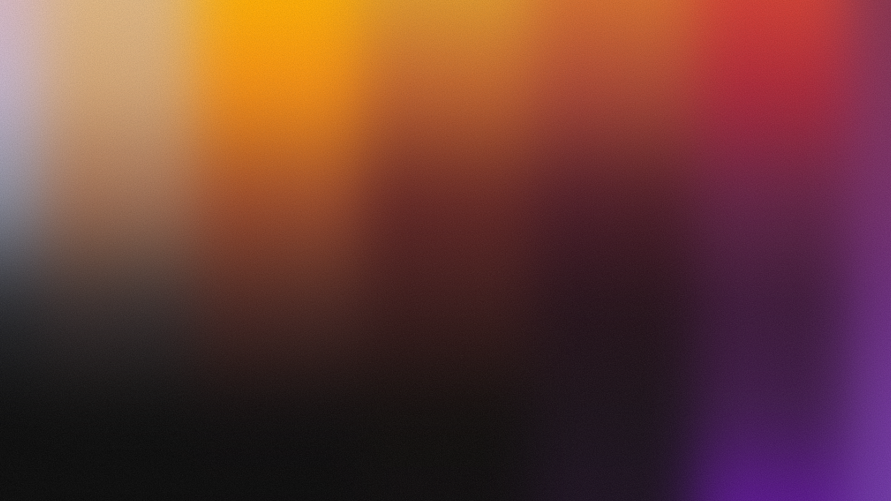
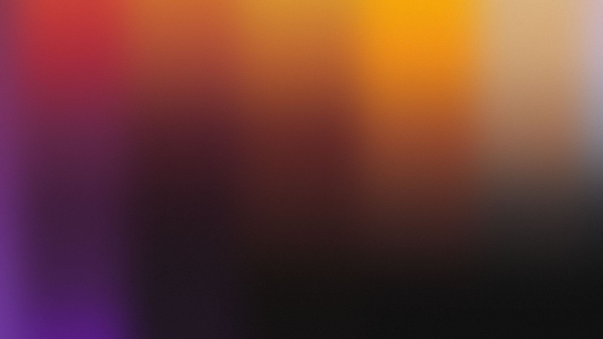
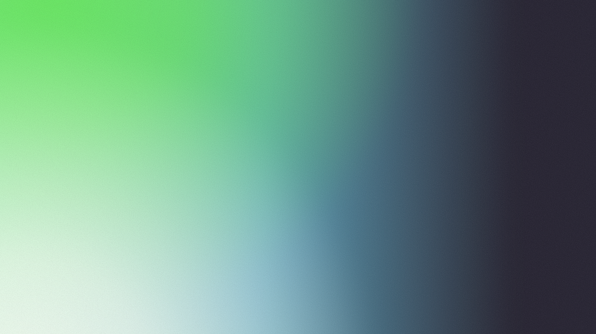

<!-- Generated from index.html#background. Edit index.html, not this file. -->

## 03 — 5配色と4役割の背景

Serifは5配色それぞれにcover／chapter／overview／teamの4役割を持ちます。PNGは1600×900、文字・図表の元座標は800×450。画像を画面全体へ等比配置し、その上に文字・ロゴ・図表を独立して置きます。

| 役割 | 内容と余白 | 配置見本 |
| --- | --- | --- |
| cover | 強い光と濃い面。短い主題を大きく見せる | 表紙・目次・エンド |
| chapter | 章番号と大きい見出しのための流れ | 中扉 |
| overview | 左側に光を寄せ、表や説明の読める面を確保 | 会社概要・メッセージ・実績 |
| team | 右側の光と広い淡色面。横並びの部品を置く | 人物・事業・工程 |

上のページ名は配置例です。見出し・本文・図表がどこへ来るかを先に決め、その領域のコントラストが確保できる背景を選びます。濃い表紙用の背景を、情報量の多い本文へ自動流用しません。

[見本SVG](palette-previews/gradient-blue.svg)

ブルー ／ gradient-blue

[見本SVG](palette-previews/gradient-plum.svg)

プラム ／ gradient-plum

[見本SVG](palette-previews/gradient-orange.svg)

オレンジ ／ gradient-orange

[見本SVG](palette-previews/gradient-indigo.svg)

インディゴ ／ gradient-indigo

[見本SVG](palette-previews/gradient-mint.svg)

ミント ／ gradient-mint

### ブルー `gradient-blue`

深い紺とコバルトの光。白い余白と端正な青の文字を組み合わせて。


cover


chapter


overview


team

### プラム `gradient-plum`

紫とオレンジが溶け合う光に、深いプラムの文字を合わせて。



cover



chapter


overview


team

### オレンジ `gradient-orange`

アプリコットの柔らかな光と繊細な縦の質感。文字は温かいブラウンに。


cover


chapter


overview


team

### インディゴ `gradient-indigo`

青紫からピーチへ広がるグラデーションに、落ち着いたインディゴの文字を。


cover


chapter


overview


team

### ミント `gradient-mint`

ミント・ライム・淡い青の大きな流れ。深いグリーンの文字で引き締めて。


cover



chapter


overview


team

背景PNGと文字色は一組です。オレンジの表紙、ミントの中扉は濃い文字を使います。目次はcoverの背景に暗い面58%を重ね、その合成後の色に白い文字を合わせます。図解を半透明にする設定とは別の規則です。

色相フィルターや色板で別配色を作りません。任意のブランド色を新設する場合は、4役割の背景を再設計・書き出し、見出し・本文・ロゴ・グラフまで確認します。

仕様データ

```
{
  "canvas": [
    800,
    450
  ],
  "raster_canvas": [
    1600,
    900
  ],
  "roles": {
    "cover": [
      "cover",
      "contents",
      "closing"
    ],
    "chapter": [
      "section"
    ],
    "overview": [
      "overview",
      "mission",
      "growth",
      "culture"
    ],
    "team": [
      "members",
      "business",
      "voices",
      "selection"
    ]
  },
  "role_policy": "濃い表紙、章扉、左見出し型の淡い本文、横並び型の淡い本文を区別。役割は配置の出発点で、文字と図の読みやすさから選ぶ。",
  "palettes": [
    {
      "id": "gradient-blue",
      "name": "ブルー",
      "detail": "深い紺とコバルトの光。白い余白と端正な青の文字を組み合わせて。",
      "colors": [
        "#F8F8F5",
        "#E9EFFB",
        "#343B45",
        "#1746D2",
        "#101319"
      ],
      "fontColors": {
        "heading": "#101319",
        "accent": "#1746D2",
        "body": "#343B45",
        "muted": "#66707D"
      },
      "group": "gradient",
      "designIds": [
        "slapon-03"
      ],
      "backgrounds": {
        "cover": "assets/backgrounds/gradient-blue/cover.png",
        "chapter": "assets/backgrounds/gradient-blue/chapter.png",
        "overview": "assets/backgrounds/gradient-blue/overview.png",
        "team": "assets/backgrounds/gradient-blue/team.png"
      }
    },
    {
      "id": "gradient-plum",
      "name": "プラム",
      "detail": "紫とオレンジが溶け合う光に、深いプラムの文字を合わせて。",
      "colors": [
        "#F8F8F5",
        "#E7D6E4",
        "#3C3039",
        "#513045",
        "#2C202F"
      ],
      "fontColors": {
        "heading": "#2C202F",
        "accent": "#513045",
        "body": "#3C3039",
        "muted": "#493642"
      },
      "group": "gradient",
      "designIds": [
        "slapon-03"
      ],
      "backgrounds": {
        "cover": "assets/backgrounds/gradient-plum/cover.png",
        "chapter": "assets/backgrounds/gradient-plum/chapter.png",
        "overview": "assets/backgrounds/gradient-plum/overview.png",
        "team": "assets/backgrounds/gradient-plum/team.png"
      }
    },
    {
      "id": "gradient-orange",
      "name": "オレンジ",
      "detail": "アプリコットの柔らかな光と繊細な縦の質感。文字は温かいブラウンに。",
      "colors": [
        "#F8F8F5",
        "#F8DFC9",
        "#4B3932",
        "#783F27",
        "#35251F"
      ],
      "fontColors": {
        "heading": "#35251F",
        "accent": "#783F27",
        "body": "#4B3932",
        "muted": "#62493E"
      },
      "group": "gradient",
      "designIds": [
        "slapon-03"
      ],
      "backgrounds": {
        "cover": "assets/backgrounds/gradient-orange/cover.png",
        "chapter": "assets/backgrounds/gradient-orange/chapter.png",
        "overview": "assets/backgrounds/gradient-orange/overview.png",
        "team": "assets/backgrounds/gradient-orange/team.png"
      }
    },
    {
      "id": "gradient-indigo",
      "name": "インディゴ",
      "detail": "青紫からピーチへ広がるグラデーションに、落ち着いたインディゴの文字を。",
      "colors": [
        "#F8F8F5",
        "#DDD9EE",
        "#30364A",
        "#30376D",
        "#202740"
      ],
      "fontColors": {
        "heading": "#202740",
        "accent": "#30376D",
        "body": "#30364A",
        "muted": "#383E53"
      },
      "group": "gradient",
      "designIds": [
        "slapon-03"
      ],
      "backgrounds": {
        "cover": "assets/backgrounds/gradient-indigo/cover.png",
        "chapter": "assets/backgrounds/gradient-indigo/chapter.png",
        "overview": "assets/backgrounds/gradient-indigo/overview.png",
        "team": "assets/backgrounds/gradient-indigo/team.png"
      }
    },
    {
      "id": "gradient-mint",
      "name": "ミント",
      "detail": "ミント・ライム・淡い青の大きな流れ。深いグリーンの文字で引き締めて。",
      "colors": [
        "#F8F8F5",
        "#D5EDE3",
        "#29463F",
        "#185A4C",
        "#183C36"
      ],
      "fontColors": {
        "heading": "#183C36",
        "accent": "#185A4C",
        "body": "#29463F",
        "muted": "#35544B"
      },
      "group": "gradient",
      "designIds": [
        "slapon-03"
      ],
      "backgrounds": {
        "cover": "assets/backgrounds/gradient-mint/cover.png",
        "chapter": "assets/backgrounds/gradient-mint/chapter.png",
        "overview": "assets/backgrounds/gradient-mint/overview.png",
        "team": "assets/backgrounds/gradient-mint/team.png"
      }
    }
  ],
  "contents_veil": {
    "source_fill": "#101319",
    "opacity": 0.58,
    "scope": "背景の上・文字の下。目次の可読性のための固有設定。"
  },
  "opacity_policy": "PNG自体は100%で配置し、全ページの文字や図まで薄くしない。新しい色は4役割の背景を再制作・書き出して文字色と組で確認。",
  "logo_policy": "ロゴ枠の背景画素と、目次の暗い面を合成した後の色で判定。カラー・白版から見やすい方を選び、白い下地は追加しない。両方が弱いときは配色・配置を見直す必要があるため要確認として記録。"
}
```
