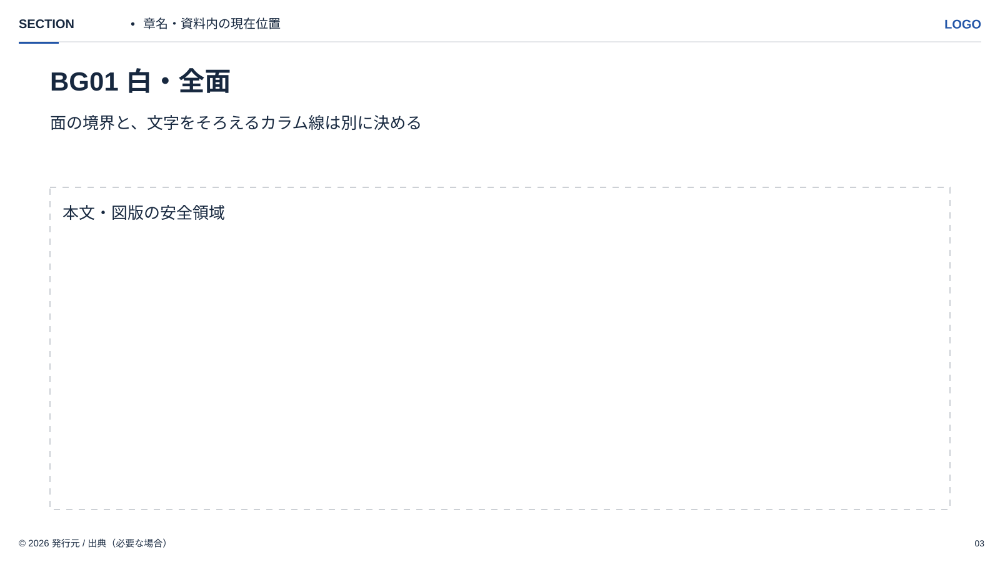
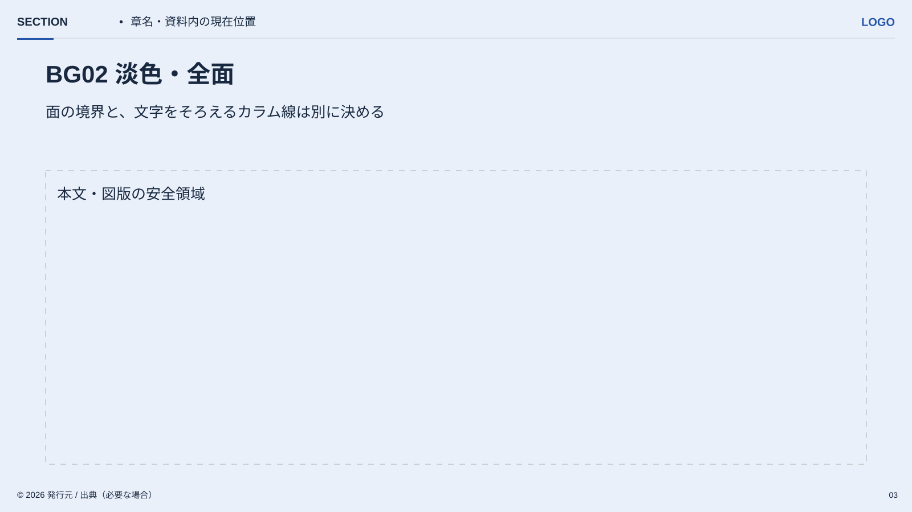
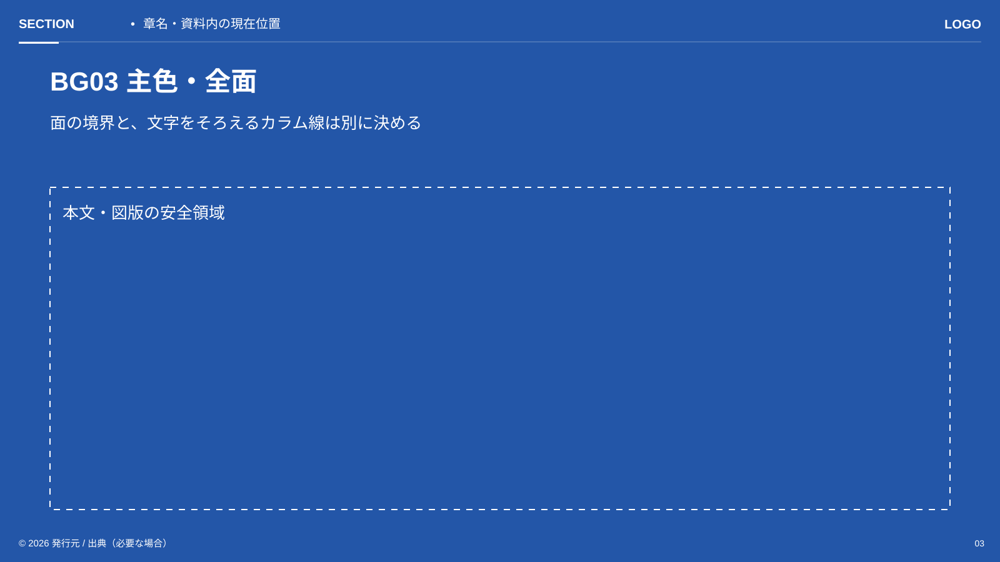
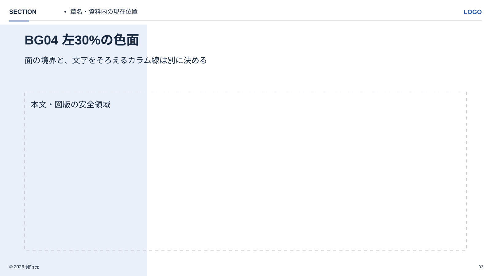
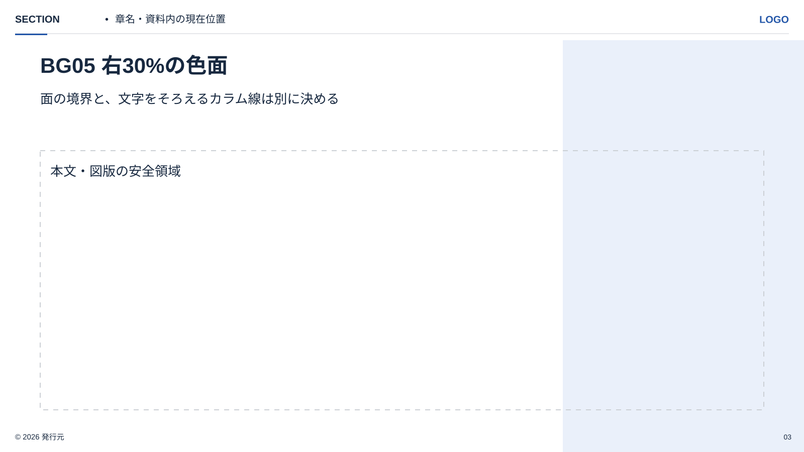

<!-- Generated from index.html#component-background. Edit index.html, not this file. -->

## BG01–BG05｜背景：カラムと切り離して定義する

背景は情報の役割や区分を示す面。背景色を置くために、本文を小さいカードの中へ閉じ込めない。左右の色面は、ヘッダーの下からスライド下端・左右の外周まで連続させる。文字と図版は別に本文余白を守る。

| ID | 面の範囲（参照px） | 使うとき |
| --- | --- | --- |
| BG01 白・全面 | 0,0,1600,900 / background | 詳しい説明、比較、図表の基本 |
| BG02 淡色・全面 | 0,0,1600,900 / sub | 区切りや補助的なまとまり |
| BG03 主色・全面 | 0,0,1600,900 / main（必要なら原本のグラデーション） | 短い主張・メッセージ。白い文字と白ロゴ |
| BG04 左の色面 | 0,80,480,820 / sub。幅比率30%を初期値 | 左に問い・要点・分類、右に説明や根拠 |
| BG05 右の色面 | 1120,80,480,820 / sub。幅比率30%を初期値 | 左に説明、右に図版・結論・補足 |



BG01｜白・全面



BG02｜淡色・全面



BG03｜主色・全面



BG04｜左30%の色面



BG05｜右30%の色面

BG04・BG05の幅はスライド全幅に対する比率。20〜40%を調整目安とし、本文グリッドの1:2と同一の境界になるとは限らない。強い色面を使う提案では、その部分のヘッダー・本文・フッターを個別に反転する。背景の色面が図表の凡例や優劣を誤解させないようにする。

BG01とBG03の方向性はStandard原本で観察。BG02・BG04・BG05を独立した構成部品として使う規則は、BCG版の設計方法を参考にしたStandard向けの提案。BCGの緑やヘッダー画像は同梱・流用しない。

仕様データ

```
{
  "variants": [
    {
      "id": "BG01",
      "name": "白・全面",
      "surface": "light",
      "side": null
    },
    {
      "id": "BG02",
      "name": "淡色・全面",
      "surface": "tint",
      "side": null
    },
    {
      "id": "BG03",
      "name": "主色・全面",
      "surface": "dark",
      "side": null
    },
    {
      "id": "BG04",
      "name": "左30%の色面",
      "surface": "light",
      "side": "left"
    },
    {
      "id": "BG05",
      "name": "右30%の色面",
      "surface": "light",
      "side": "right"
    }
  ],
  "split_default_ratio": 0.3,
  "split_range": [
    0.2,
    0.4
  ],
  "split_paint_region": [
    0,
    80,
    1600,
    820
  ],
  "split_width_basis": "slide_width",
  "text_uses": "separate content grid",
  "status": "observed foundations plus proposed reusable split backgrounds"
}
```
