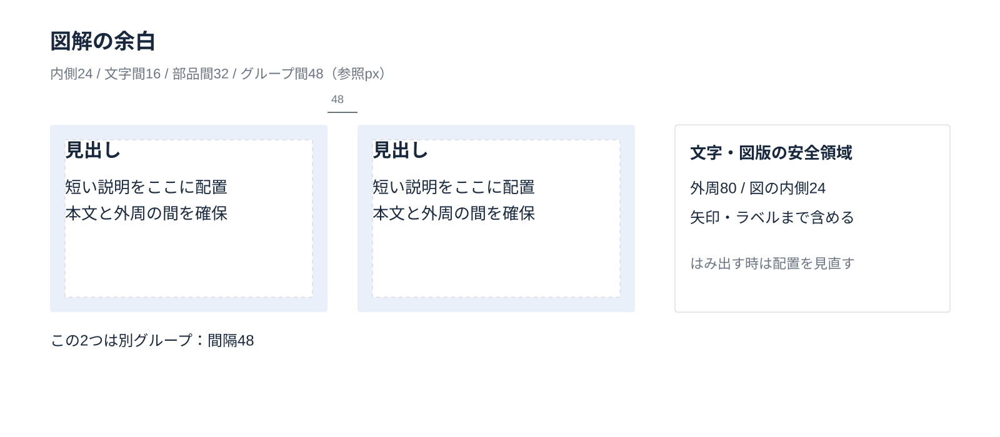
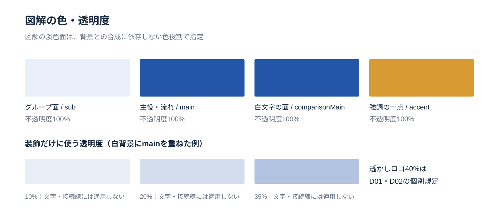
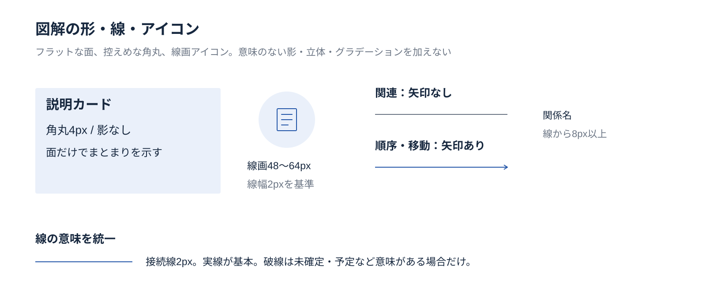

<!-- Generated from index.html#component-diagram. Edit index.html, not this file. -->

## 図解の共通ルール｜余白・色・透明度・スタイル

図解部品を同じ見た目で組み合わせるための規則。以下の寸法は1600×900参照pxの再構成用の初期提案であり、原本の実測値とは区別する。顧客版は保存済みの色役割を適用する。

### 余白：内側と部品間を分ける

| 対象 | 基準 | 使い方 |
| --- | --- | --- |
| 左右の安全領域 | 各80px | 矢印・ラベルを含む図全体で守る |
| カード・ノード内側 | 24px／情報が多い時の下限16px | 同じ階層の部品でそろえる |
| 見出しと説明／アイコンと名称 | 16px | 文字の輪郭・複数行も含めて確保 |
| 同じグループ内の部品間 | 32px | 同列・同階層で統一 |
| 別グループ間 | 48px | 関係が弱いほど広い余白へ |
| 線とラベル | 8px以上 | 文字の背後へ接続線を通さない |



内側24・部品間32・グループ間48の組み分け

### 色：役割を固定し、図の意味に対応させる

| 役割 | 色役割 | 扱い |
| --- | --- | --- |
| 説明・分類の面 | sub | 文字はinkSurface。外枠は必要な時だけline |
| 主役の図形・流れ | main | 小さい主色文字はprimaryInkを使う |
| 白文字を載せる強調面 | comparisonMain＋comparisonText | 文字と面の組で扱う |
| 関係線・補足 | muted／mutedSurface | 薄さではなく役割色で弱める |
| アクセント | accent | 意味のある強調1か所を基本。飾りとして全列に配らない |
| 系列 | main / series2 / series3 / series4 | 系列名と対応。濃淡を勝手な優劣に使わない |

### 透明度：意味のある要素は100%

文字・アイコン・接続線は不透明度100%。淡い面はsubやconcept系の色を100%で塗る。装飾の塗りだけ10%・20%・35%を使用できるが、文字を含むグループ全体に透明度を設定しない。重なりで色が変わる透過面を凡例の代わりにしない。透かしロゴ40%はD01・D02の個別規定。



意味を持つ色面100%と、装飾の透過色を区別

### 形・線・アイコン：フラットにそろえる

| 対象 | 基準 | 使い方 |
| --- | --- | --- |
| カード・枠 | 角丸4pxを基本、0pxも可／影なし | 同じ図では角丸を統一。二重枠・立体・光沢は使わない |
| 接続線 | 2px／矢印先端8px | 関連は線、順序や移動には矢印。破線は予定・未確定など意味がある場合 |
| 区切り・強調 | 区切り1px／強調3px | 線幅だけを理由なく増やさない |
| アイコン | 線幅2px／48または64px枠 | 同列では輪郭の見た目の大きさを合わせる。縦横比を保持 |
| 円 | 中心と周辺／補助アイコンの背景 | 説明文の入れ物として増やさない |
| グラデーション | 図解部品内では使わない | 表紙・メッセージの背景は個別規定 |



カード・線画アイコン・関連線・矢印のスタイル

仕様データ

```
{
  "id": "DIAGRAM",
  "status": "Standard再構成用の初期提案。2026-10-21の利用者指示に基づき定義。原本の精密な測定値とは区別。",
  "canvas": [
    1600,
    900
  ],
  "spacing": {
    "scale": [
      8,
      16,
      24,
      32,
      40,
      48,
      64,
      80
    ],
    "outer_margin_x": 80,
    "card_padding_default": 24,
    "card_padding_min_compact": 16,
    "heading_body_gap": 16,
    "icon_label_gap": 16,
    "sibling_gap_default": 32,
    "group_gap_default": 48,
    "connector_label_clearance": 8,
    "node_text_edge_min": 16,
    "policy": "数値は参照px。図形・矢印・ラベルの見える輪郭すべてを含めて余白を計測。同じ階層では同じ間隔。文字が収まらないときは領域拡大・再配置・分割。"
  },
  "colors": {
    "default_surface": "background",
    "group_surface": "sub",
    "text": "text / inkSurface",
    "main_focus": "main",
    "small_main_text": "primaryInk / primaryInkSurface",
    "white_text_surface": "comparisonMain",
    "white_text": "comparisonText",
    "secondary_text": "muted / mutedSurface",
    "group_boundary": "line",
    "flow_connector": "main",
    "relationship_connector": "muted",
    "accent": "accent：意味のある強調1か所を基本。系列区別はseries2/3/4を使用。",
    "policy": "同じ意味は同じ色。面積をそろえるためだけに主色やアクセントを増やさない。色だけで区別せず名前・線種も対応。状態の赤緑は別途定義なしに追加しない。"
  },
  "opacity": {
    "text": 1,
    "icons": 1,
    "connectors": 1,
    "semantic_surfaces": 1,
    "decorative_fill_allowed": [
      0.1,
      0.2,
      0.35
    ],
    "watermark_exception": {
      "D01": 0.4,
      "D02": 0.4
    },
    "policy": "淡色面はsubやconcept系の解決済み色を不透明100%で使う。装飾の透過はfill-opacityへ限定し、文字を含むグループ全体を薄くしない。重なりや背景変更で色が変わるため、透過色を意味の凡例に使わない。"
  },
  "style": {
    "card_radius_default": 4,
    "card_radius_allowed": [
      0,
      4
    ],
    "shadows": false,
    "diagram_gradients": false,
    "connector_width": 2,
    "separator_width": 1,
    "emphasis_width": 3,
    "arrowhead_length": 8,
    "icon_stroke": 2,
    "icon_box_sizes": [
      48,
      64
    ],
    "circle_use": "中心・周辺・意味の補助アイコン。説明文を入れるためだけの円は作らない。",
    "connections": "関連は線、順序・移動は矢印。交差を避け、接続点と矢印先端に触れる文字を置かない。",
    "exceptions": "表紙・メッセージの背景グラデーションとD01・D02は個別規定。グラフはcharts.md、表はtables.mdを併用。"
  },
  "composition_policy": "05〜12は組み合わせ例。カード数・工程数・列数・サンプル文言は固定しない。",
  "reference_precision": {
    "principle": "構図と要素数は可変。重なり順・不透明な面・細い輪郭・役割色・SVGの寸法を継承する。",
    "references": [
      "components/layered-diagrams.md",
      "components/process-flow.md"
    ],
    "stroke_overrides": {
      "concept_node_outline": 1.5,
      "concept_icon": 2.2,
      "concept_flow": 3,
      "process_icon": 3
    },
    "continuous_process": "連続帯は一部品として扱い、帯内部に部品間32pxを挿入しない。"
  }
}
```
