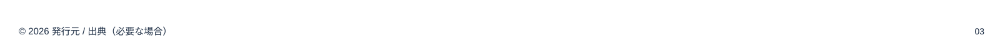
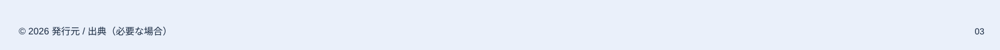
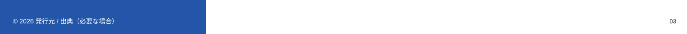

<!-- Generated from index.html#component-footer. Edit index.html, not this file. -->

## F01｜フッター：左右それぞれの背景で判断する

下端64pxを発行元とページ番号に確保する。1桁・2桁でページ番号の右端を動かさない。表紙には既定で付けず、エンドは発行元のみを候補にする。



F01-Light｜白背景：濃い文字



F01-Tint｜淡色背景：濃い文字


F01-Dark｜濃色背景：白文字



F01-Split｜左右の背景が異なる場合：各文字の直下の色で選ぶ

| 要素 | 基準（参照px） | 運用 |
| --- | --- | --- |
| フッター領域 | y836〜900 | 本文の配置はy816まで。必要な出典の分だけ本文を短くする |
| 発行元 | x30 / y860 / w800 / h17、基準線875 | 15px / Regular。提供された会社名・権利表記を使う |
| ページ番号 | 右端1575 / 基準線875 / 最大幅55 | 14px / Regular、右揃え。桁数が増えても右アンカー固定 |
| 出典・注記（任意） | x80 / 基準線825 / 右端1440 | 16px。発行元の行と分離。長文は本文へ配置し直す |
| 背景に境界がある場合 | 文字の実際の領域で判断 | 背景が混在する文字は、片側へ寄せるか単色の安全域を確保する |

フッターのためだけに背景を白い帯へ戻さない。全面濃色なら白、淡色面ならinkSurfaceを使い、背景のつながりを保つ。左右の塗り分けでは左の発行元と右のページ番号を独立して判断する。見本の出典と発行元は位置確認用で、同じ内容を二重表示する指定ではない。

仕様データ

```
{
  "id": "F01",
  "region": [
    0,
    836,
    1600,
    64
  ],
  "company": [
    30,
    860,
    800,
    17
  ],
  "page_anchor": {
    "right": 1575,
    "baseline": 875,
    "width": 55,
    "font_size": 14
  },
  "variants": [
    "light",
    "tint",
    "dark",
    "split-local-surfaces"
  ],
  "source_note": {
    "optional": true,
    "preferred_x": 80,
    "max_right": 1440,
    "baseline": 825,
    "font_size": 16
  },
  "baseline": 875,
  "basis": "社名とページ番号はStandard原本。出典を本文下へ分離する領域は提案。"
}
```
