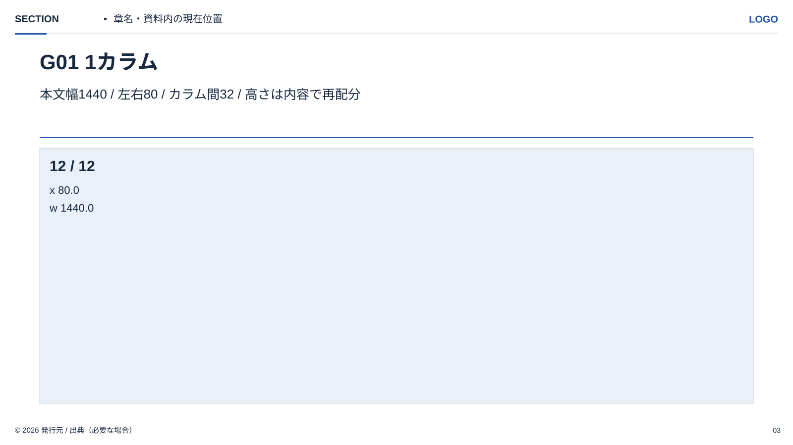
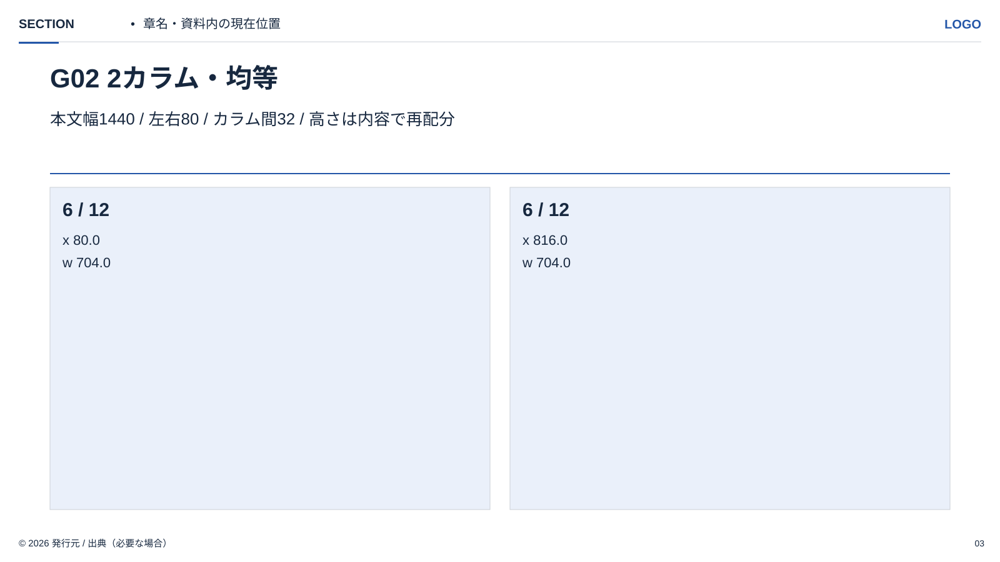
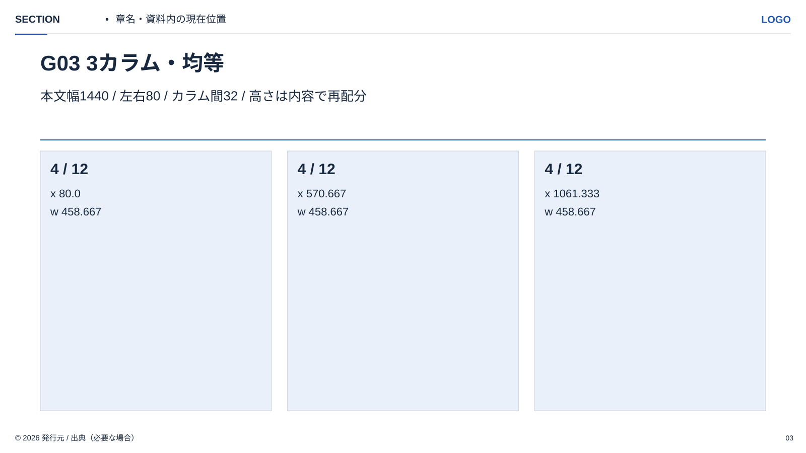
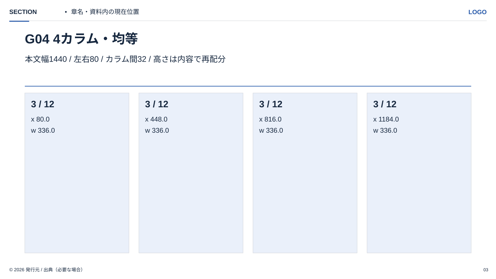
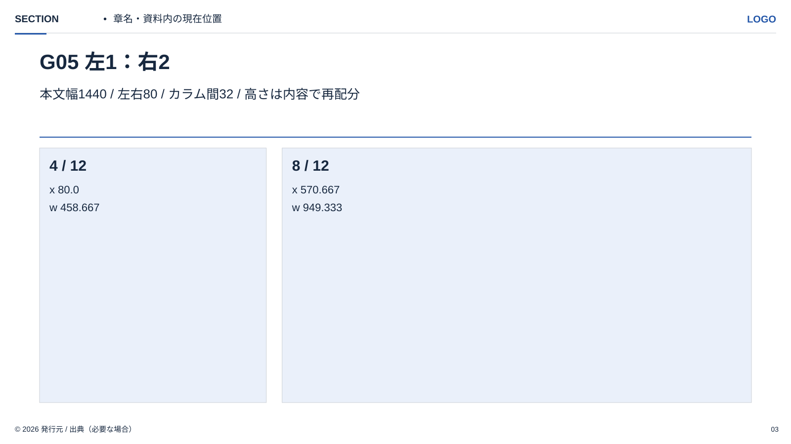
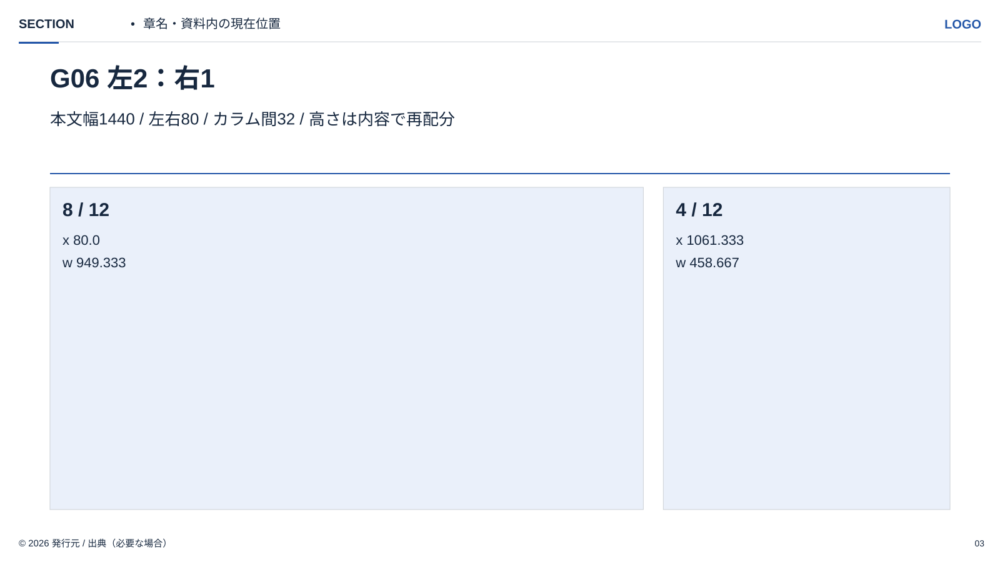

<!-- Generated from index.html#component-grid. Edit index.html, not this file. -->

## G01–G06｜カラム：意味に合わせて割り付ける

本文の左右80pxを保ち、有効幅1440pxを12カラムで考える。カラム間は32px。背景の境界やカードの数と、本文のカラムを同じものとして扱わない。均等な比較は均等幅、説明と図版は非対称を候補にする。

| 項目 | 値・式 |
| --- | --- |
| 本文幅 | 1600−80−80 = 1440px |
| 1ユニット幅 | (1440−11×32)÷12 = 90.667px |
| nユニットの幅 | n×90.667 + (n−1)×32 |
| nユニット目の開始 | x = 80 + 開始ユニット数×(90.667+32) |
| 座標の精度 | 表は小数3桁表示。計算途中は丸めず、右端1520へそろえる |
| 縦方向 | 標準本文はy300〜816を初期目安。説明文・出典の量に応じて再配分 |

| ID・構成 | 12カラムの比率 | 各列の左端x / 幅w |
| --- | --- | --- |
| G01 / 1カラム | 12 | x80.0 / w1440.0 |
| G02 / 2カラム・均等 | 6:6 | x80.0 / w704.0   x816.0 / w704.0 |
| G03 / 3カラム・均等 | 4:4:4 | x80.0 / w458.667   x570.667 / w458.667   x1061.333 / w458.667 |
| G04 / 4カラム・均等 | 3:3:3:3 | x80.0 / w336.0   x448.0 / w336.0   x816.0 / w336.0   x1184.0 / w336.0 |
| G05 / 左1：右2 | 4:8 | x80.0 / w458.667   x570.667 / w949.333 |
| G06 / 左2：右1 | 8:4 | x80.0 / w949.333   x1061.333 / w458.667 |



G01｜1カラム



G02｜2カラム・均等



G03｜3カラム・均等



G04｜4カラム・均等



G05｜左1：右2



G06｜左2：右1

列内は、見出し・本文・数値・図の比較基準線をそろえる。カードを使う場合は左右24px、上下24〜32pxの内側余白を初期値とする。カードなしでも同じグリッドを使える。列ごとに文章量が違っても本文サイズをばらばらにしない。

2×2の面はG02を上下に重ねる。上下の間隔は32pxを初期値とし、上下段の高さは情報量に応じて調整する。全ページにカラム線やカードを描く指定ではない。原本13作例の微調整済み座標は保持し、新原稿の割り付けにこの規則を使う。

仕様データ

```
{
  "canvas": [
    1600,
    900
  ],
  "content_left": 80,
  "content_right": 1520,
  "width": 1440,
  "units": 12,
  "gutter": 32,
  "unit_width": 90.66666666666667,
  "rows_gap": 32,
  "card_padding": [
    24,
    24,
    24,
    24
  ],
  "schemes": [
    {
      "id": "G01",
      "name": "1カラム",
      "spans": [
        12
      ],
      "gutter": 32,
      "columns": [
        {
          "x": 80.0,
          "width": 1440.0,
          "span": 12
        }
      ],
      "body_y": 300,
      "body_bottom": 816,
      "basis": "Standard再構成用の提案。元作例の実配置は各ページの原本座標を優先。"
    },
    {
      "id": "G02",
      "name": "2カラム・均等",
      "spans": [
        6,
        6
      ],
      "gutter": 32,
      "columns": [
        {
          "x": 80.0,
          "width": 704.0,
          "span": 6
        },
        {
          "x": 816.0,
          "width": 704.0,
          "span": 6
        }
      ],
      "body_y": 300,
      "body_bottom": 816,
      "basis": "Standard再構成用の提案。元作例の実配置は各ページの原本座標を優先。"
    },
    {
      "id": "G03",
      "name": "3カラム・均等",
      "spans": [
        4,
        4,
        4
      ],
      "gutter": 32,
      "columns": [
        {
          "x": 80.0,
          "width": 458.667,
          "span": 4
        },
        {
          "x": 570.667,
          "width": 458.667,
          "span": 4
        },
        {
          "x": 1061.333,
          "width": 458.667,
          "span": 4
        }
      ],
      "body_y": 300,
      "body_bottom": 816,
      "basis": "Standard再構成用の提案。元作例の実配置は各ページの原本座標を優先。"
    },
    {
      "id": "G04",
      "name": "4カラム・均等",
      "spans": [
        3,
        3,
        3,
        3
      ],
      "gutter": 32,
      "columns": [
        {
          "x": 80.0,
          "width": 336.0,
          "span": 3
        },
        {
          "x": 448.0,
          "width": 336.0,
          "span": 3
        },
        {
          "x": 816.0,
          "width": 336.0,
          "span": 3
        },
        {
          "x": 1184.0,
          "width": 336.0,
          "span": 3
        }
      ],
      "body_y": 300,
      "body_bottom": 816,
      "basis": "Standard再構成用の提案。元作例の実配置は各ページの原本座標を優先。"
    },
    {
      "id": "G05",
      "name": "左1：右2",
      "spans": [
        4,
        8
      ],
      "gutter": 32,
      "columns": [
        {
          "x": 80.0,
          "width": 458.667,
          "span": 4
        },
        {
          "x": 570.667,
          "width": 949.333,
          "span": 8
        }
      ],
      "body_y": 300,
      "body_bottom": 816,
      "basis": "Standard再構成用の提案。元作例の実配置は各ページの原本座標を優先。"
    },
    {
      "id": "G06",
      "name": "左2：右1",
      "spans": [
        8,
        4
      ],
      "gutter": 32,
      "columns": [
        {
          "x": 80.0,
          "width": 949.333,
          "span": 8
        },
        {
          "x": 1061.333,
          "width": 458.667,
          "span": 4
        }
      ],
      "body_y": 300,
      "body_bottom": 816,
      "basis": "Standard再構成用の提案。元作例の実配置は各ページの原本座標を優先。"
    }
  ],
  "status": "proposed_reusable_grid",
  "original_geometry_policy": "既存13作例の原本座標は自動で正規化しない。"
}
```
