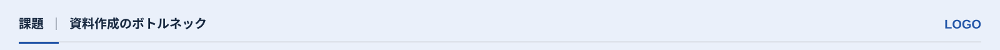

<!-- Generated from index.html#component-header. Edit index.html, not this file. -->

## H01｜ヘッダー：背景に合わせて切り替える

上段80pxを共通の現在位置表示に使う。大見出しは別部品T01であり、ヘッダーのロゴと一緒に縮小しない。表紙・章扉・エンドには自動追加しない。


H01-Light｜白背景：濃い文字＋カラー版ロゴ



H01-Tint｜淡色背景：濃い文字＋カラー版ロゴ


H01-Dark｜主色背景：白文字＋白版ロゴ

| 要素 | x, y, w, h（参照px） | 規則 |
| --- | --- | --- |
| 領域 | 0, 0, 1600, 80 | 位置は固定。本文・図を侵入させない |
| カテゴリ | 30, 25, 実測文字幅, 26 | 通常20px / Bold。長い英語カテゴリは17pxまで調整可。固定幅の空欄を取らない |
| 区切り | x=カテゴリ実測右端+20 / w1 / h20 | 文字の「\|」ではなく縦線。文字の可視輪郭の上下中央へ合わせる。左右に各20px |
| パンくず | x=区切り右端+20 / y25 / 右端1436まで / h26 | 20px / Bold。カテゴリに続けて左寄せ。長い章名はここへ。ロゴ領域を避ける |
| ロゴ枠 | 1466, 23, 104, 29 | 右端1570。縦横比を保って内接。切り取りなし |
| 左右に余白を取る薄い罫線 | 30, 67, 1540, 1 | 左右各30px。カテゴリの左端とロゴ枠の右端にそろえる。背景に応じたline / 白の低不透明度 |
| 主色の短線 | 30, 67, 64, 3 | 白・淡色上はmain、濃色上はonmain |

ロゴの見た目の大きさは枠内の実際の輪郭で確認する。ロゴデータ内の余白と、配置側の余白を分ける。顧客版では余白を調整した正式ロゴのカラー版／白版を選び、濃色背景に白い下地を付けず白版を直接置く。

仕様データ

```
{
  "id": "H01",
  "region": [
    0,
    0,
    1600,
    80
  ],
  "category": [
    30,
    25,
    40,
    26
  ],
  "separator": [
    90,
    28,
    1,
    20
  ],
  "breadcrumb": [
    111,
    25,
    1325,
    26
  ],
  "logo": [
    1466,
    23,
    104,
    29
  ],
  "short_rule": [
    30,
    67,
    64,
    3
  ],
  "variants": {
    "light": {
      "surface": "background",
      "ink": "text",
      "logo": "color"
    },
    "tint": {
      "surface": "sub",
      "ink": "inkSurface",
      "logo": "color"
    },
    "dark": {
      "surface": "main",
      "ink": "onmain",
      "logo": "white"
    }
  },
  "modes": {
    "fixed": [
      "text baseline y",
      "logo bbox",
      "short rule",
      "separator size",
      "20px gaps"
    ],
    "bounded": [
      "category and breadcrumb combined width"
    ],
    "flexible": [
      "category text width",
      "separator x",
      "breadcrumb x",
      "category and breadcrumb text"
    ]
  },
  "basis": "原本・公開用SVGの共通ヘッダー。淡色・濃色の使い分けを部品として整理。 2026-10-21利用者指示：下罫線の左右に各30pxの余白。 2026-10-22利用者指定：区切りの左右に各全角1文字分、左詰め、上下中央揃え。区切りを縦線へ統一。座標は「課題」の見本値。",
  "omit_when": [
    "cover",
    "section",
    "closing"
  ],
  "long_rule": [
    30,
    67,
    1540,
    1
  ],
  "border_inset": {
    "left": 30,
    "right": 30
  },
  "layout": {
    "mode": "content_width",
    "sample_category": "課題",
    "sample_breadcrumb": "資料作成のボトルネック",
    "category_x": 30,
    "text_baseline_y": 45,
    "gap_before_separator": 20,
    "gap_after_separator": 20,
    "separator_width": 1,
    "separator_height": 20,
    "separator_alignment": "center of visible glyph bounds of category and breadcrumb",
    "separator_x": "category visible right + 20",
    "breadcrumb_x": "separator right + 20",
    "breadcrumb_right_limit": 1436,
    "overflow": "カテゴリ・パンくずをロゴへ重ねない。意味を保った短縮・章名の移動で調整。固定幅欄へ戻さない。"
  }
}
```
