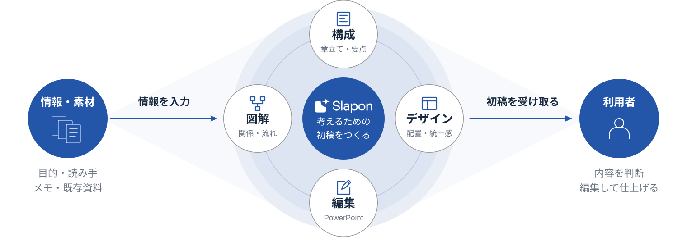

<!-- Generated from index.html#component-layered-diagram. Edit index.html, not this file. -->

## 図解の重なり・面・色｜SVGで精度を保つ

Figma 107:8722から、形そのものと作り方を分けて参照する。中心円＋周辺4つという構図は、この原稿の組み合わせ例。別の内容には並列・包含・分岐などを選び、面の階層、重なり順、役割色、細い輪郭を共通スタイルとして使う。



淡い面 → 細い関係線 → 主役 → 白い機能ノード → アイコン・文字の順。面は100%不透明。

### 重ねたときの隠れ方を保つ

白い機能ノードは背面の面や輪郭を隠す。紙を重ねるアイコンでは、手前の紙を主役の面と同じ色で塗り、奥の紙の線を隠す。透明な塗りや白い抜きへ置き換えない。面だけを役割色へ変更し、白文字・細い枠・アイコンの線を一括で着色しない。

参照の塗りとグループは不透明度100%。淡さは透明度ではなく色で作る。SVGのpath、viewBox、固有寸法、線幅、描画順を保持する。一般的な2px線より、参照で定義された1.5pxの輪郭・2.2pxの小アイコン・3pxの流れ線を、この部品では優先する。

[図解のSVG](../assets/components/layered-concept.svg) ／ [ページへの組み込み例](../examples/concept.md)

仕様データ

```
{
  "id": "DIAGRAM-LAYERS",
  "reference": {
    "fileKey": "yZRuVrGDlV496zazD5AqGf",
    "nodeId": "107:8722",
    "url": "https://www.figma.com/design/yZRuVrGDlV496zazD5AqGf/?node-id=107-8722"
  },
  "composition_is_fixed": false,
  "layer_order": [
    "補助的な接続面",
    "外側の淡色面",
    "内側の淡色面",
    "細い関係の輪郭",
    "主役・入力・出力",
    "白い説明ノードと細い枠",
    "アイコン・文字"
  ],
  "source_alpha": 1,
  "surface_map": {
    "#F7F7F7": "conceptBackdrop",
    "#E8E8E8": "conceptRingOuter",
    "#DDDDDD": "conceptRingInner",
    "#B3B3B3": "conceptRingStroke",
    "#262626": "comparisonMain"
  },
  "node_outline": {
    "color": "#969696",
    "width": 1.5
  },
  "icon_stroke": 2.2,
  "flow_stroke": 3,
  "occlusion": "白ノードは白100%で背面を隠す。紙などが重なる場合、手前の面は親と同じ塗りを100%で持ち、奥の輪郭を透かさない。",
  "variation": "中心と周辺、並列、包含、集約・分岐など、情報の関係に応じて構図と要素数を変える。面の階層・輪郭・重なり順・役割色を継承する。",
  "precision": "SVG path、viewBox、ネイティブ寸法、stroke-width、重なり順を保持。色変更は役割マップを使い、全体opacityや一括着色で文字・白・輪郭を変えない。"
}
```
