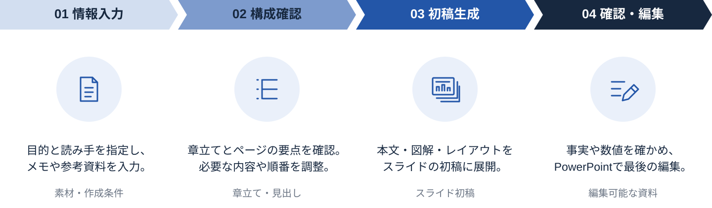

<!-- Generated from index.html#component-process-flow. Edit index.html, not this file. -->

## P03｜連続シェブロンの工程図

利用の流れはSVGのシェブロン帯、円形背景、線画アイコン、説明、出力ラベルを組み合わせる。参照はFigma 107:8778。工程帯の内部は連続させ、別部品間の32pxを4工程の間へ挿入しない。段階数は原稿に合わせて変更できる。



4工程の作例：360×60の帯／直径132の円／線画64枠。参照SVGを使用。

[工程図のSVG](../assets/components/process-flow.svg) ／ [ページへの組み込み例](../examples/process.md)

仕様データ

```
{
  "id": "P03",
  "reference": {
    "fileKey": "yZRuVrGDlV496zazD5AqGf",
    "nodeId": "107:8778",
    "url": "https://www.figma.com/design/yZRuVrGDlV496zazD5AqGf/?node-id=107-8778"
  },
  "component_bounds": [
    80,
    357,
    1440,
    422
  ],
  "stage_width": 360,
  "band_height": 60,
  "stage_count_in_example": 4,
  "gap_inside_band": 0,
  "chevron_tip_depth": 18,
  "icon_circle_diameter": 132,
  "icon_frame": 64,
  "band_to_icon_gap": 55,
  "icon_stroke": 3,
  "description_type": {
    "size": 23,
    "line_height": 33.35
  },
  "output_type": {
    "size": 20,
    "line_height": 28
  },
  "colors": [
    "series4",
    "series2",
    "main",
    "text"
  ],
  "shape_policy": "工程数は固定しない。原稿の順序に合わせて組み替える。360×60は参照の4工程作例の寸法。"
}
```
