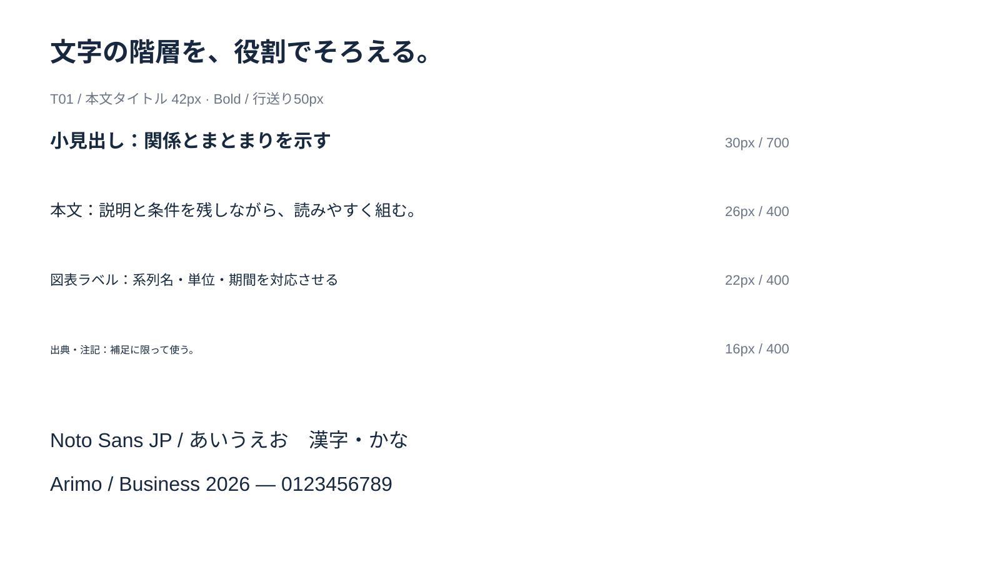

<!-- Generated from index.html#component-type. Edit index.html, not this file. -->

## T01–T07｜文字：書体・太さ・サイズ・行送り

和文はNoto Sans JP、欧文・独立した数字はArimo。和文の文章中の英数字はNoto Sans JPのままでよい。Regular 400 / Medium 500 / Bold 700を役割で使い分ける。本文全体をBoldにせず、小見出しと重要語に強弱を付ける。

和文｜Noto Sans JP

資料の意味が、  
**ひと目で伝わる。**

欧文・数値｜Arimo

Business Impact  
**72.8% / 2026**



文字の階層見本。参照キャンバス1600×900を縮小表示。

| ID・役割 | 基準サイズ（px） | 太さ | 行送り（px） | 許容・収まり方 |
| --- | --- | --- | --- | --- |
| T-COVER / 表紙タイトル | 76 | 700 | 90 | 76 → 72 → 68 → 64 / 最大3行 |
| T01 / 本文タイトル | 42 | 700 | 50 | 42 → 40 → 38 → 36 / 最大2行 |
| T-LEAD / 大きいリード | 48 | 700 | 62 | 48 → 46 → 44 / 最大3行 |
| T02 / 小見出し | 30 | 700 | 39 | [28, 32] |
| T03 / 本文 | 26 | 400 | 39 | [24, 28] |
| T04 / 図表ラベル | 22 | 400 | 29 | [20, 24] |
| T05 / 出典・注記 | 16 | 400 | 22 | [16, 18] |
| T06 / ヘッダー | 20 | 700 | 26 | 17〜20 / 長い英語カテゴリのみ17 |
| T07 / 発行元・ページ番号 | 15 | 400 | 17 | 発行元15 / ページ14 |
| T-KPI / 主役の数値 | 88 | 700 | 92 | [64, 96] |

通常本文は24〜28px。参照SVGの工程説明は23px・行送り33.35px、比較表12は22px・行送り30px。情報量の多いカード09は24px・行送り30px。これらは専用作例の値であり、一般本文を一律に縮小する指定ではない。タイトル・説明文の間隔は2026-10-22の利用者指定を反映。採用作例のdrawingにも同じ配置を適用する。

これらのサイズ・太さ・行送りは編集可能な文字へ再構成するための初期提案。アウトライン済みの原本から確定したフォント値ではない。原本の構図と見比べて調整する。

| 条件 | 配置の処理 |
| --- | --- |
| 本文タイトルが1行 | x80 / y114 / w1440 / h50。説明文y176（タイトル枠下端+12）。本文の開始は通常y300 |
| 本文タイトルが2行 | タイトルの高さを100へ。説明文y226（タイトル枠下端+12）へ移動。本文の開始も必要量だけ下げる |
| 説明文が複数行 | 35pxの行送りを目安に高さを確保。本文開始=max(300, 説明文の下端+40) |
| タイトルが36pxでも収まらない | 意味の切れ目・表現・ページ分割を見直す。枠外へのはみ出しや無断省略で対応しない |
| 本文が24pxでも収まらない | カラム数・段落・図の大きさ・ページ分割を見直す。注記サイズを本文に転用しない |

出力幅W pxなら参照値×W÷1600。PowerPoint幅P ptなら参照値×P÷1600。幅960ptでは42px→25.2pt、26px→15.6pt。縦横比が変わる場合は配置を再設計する。代替はYu Gothic / Arial。代替時は幅・改行・数字のそろい・文字切れを再確認する。

仕様データ

```
{
  "unit": "reference_px",
  "canvas": [
    1600,
    900
  ],
  "jp": "Noto Sans JP",
  "latin": "Arimo",
  "weights": [
    400,
    500,
    700
  ],
  "roles": [
    {
      "id": "T-COVER",
      "role": "表紙タイトル",
      "font": "Noto Sans JP",
      "size": 76,
      "steps": [
        76,
        72,
        68,
        64
      ],
      "weight": 700,
      "leading": 90,
      "max_lines": 3
    },
    {
      "id": "T01",
      "role": "本文タイトル",
      "font": "Noto Sans JP",
      "size": 42,
      "steps": [
        42,
        40,
        38,
        36
      ],
      "weight": 700,
      "leading": 50,
      "max_lines": 2
    },
    {
      "id": "T-LEAD",
      "role": "大きいリード",
      "font": "Noto Sans JP",
      "size": 48,
      "steps": [
        48,
        46,
        44
      ],
      "weight": 700,
      "leading": 62,
      "max_lines": 3
    },
    {
      "id": "T02",
      "role": "小見出し",
      "font": "Noto Sans JP",
      "size": 30,
      "range": [
        28,
        32
      ],
      "weight": 700,
      "leading": 39
    },
    {
      "id": "T03",
      "role": "本文",
      "font": "Noto Sans JP",
      "size": 26,
      "range": [
        24,
        28
      ],
      "weight": 400,
      "leading": 39
    },
    {
      "id": "T04",
      "role": "図表ラベル",
      "font": "Noto Sans JP / Arimo",
      "size": 22,
      "range": [
        20,
        24
      ],
      "weight": 400,
      "leading": 29
    },
    {
      "id": "T05",
      "role": "出典・注記",
      "font": "Noto Sans JP",
      "size": 16,
      "range": [
        16,
        18
      ],
      "weight": 400,
      "leading": 22
    },
    {
      "id": "T06",
      "role": "ヘッダー",
      "font": "Noto Sans JP / Arimo",
      "size": 20,
      "range": [
        17,
        20
      ],
      "weight": 700,
      "leading": 26,
      "exception": "長い英語カテゴリのみ17pxまで。通常20px。"
    },
    {
      "id": "T07",
      "role": "発行元・ページ番号",
      "font": "Noto Sans JP / Arimo",
      "size": 15,
      "page_size": 14,
      "weight": 400,
      "leading": 17
    },
    {
      "id": "T-KPI",
      "role": "主役の数値",
      "font": "Arimo",
      "size": 88,
      "range": [
        64,
        96
      ],
      "weight": 700,
      "leading": 92
    }
  ],
  "status": "reconstruction_proposal",
  "title_formula": {
    "title_y": 114,
    "one_line_h": 50,
    "two_line_h": 100,
    "subtitle_gap": 12,
    "subtitle_leading": 35,
    "body_min_y": 300,
    "body_gap_after_subtitle": 40,
    "basis": "2026-10-22利用者指定。本文型T01に適用。表紙・目次・メッセージ・中扉には適用しない。"
  },
  "example_overrides": {
    "process": {
      "body_size": 23,
      "body_leading": 33.35,
      "output_size": 20,
      "basis": "指定Figma 107:8778"
    },
    "comparison": {
      "cell_size": 22,
      "cell_leading": 30,
      "padding": [
        24,
        16
      ]
    },
    "features": {
      "body_size": 24,
      "body_leading": 30
    },
    "policy": "一般ルールより専用作例のdrawingと参照SVGの実測値を優先。"
  }
}
```
