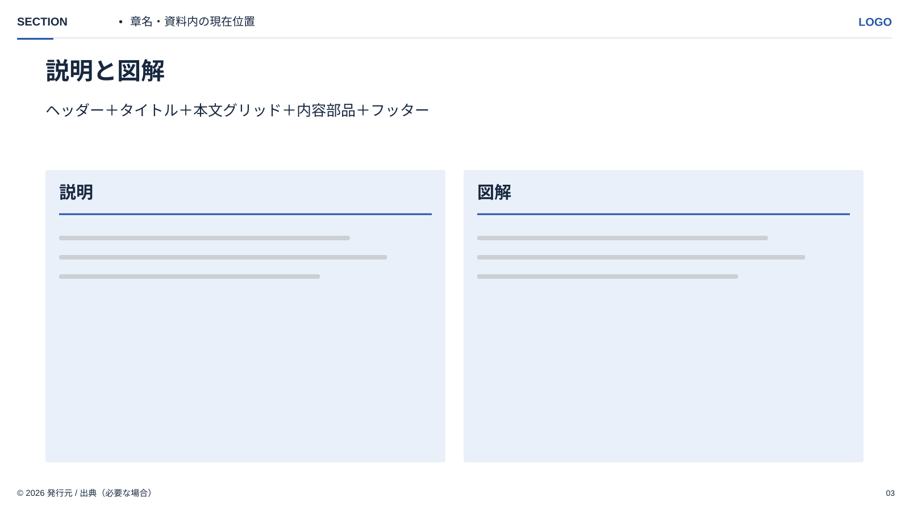
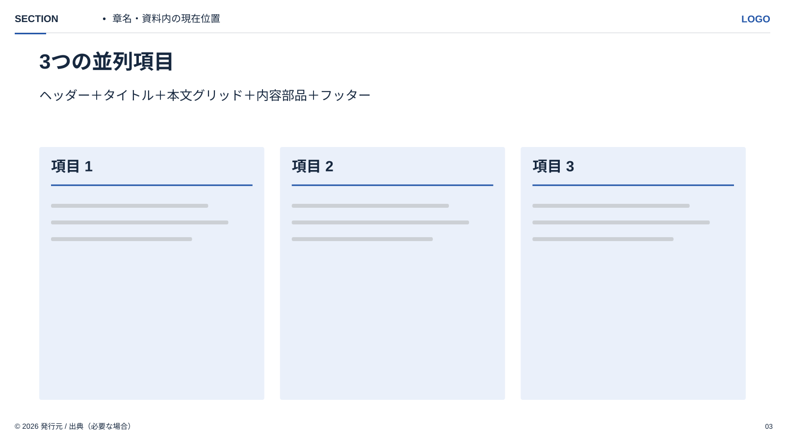
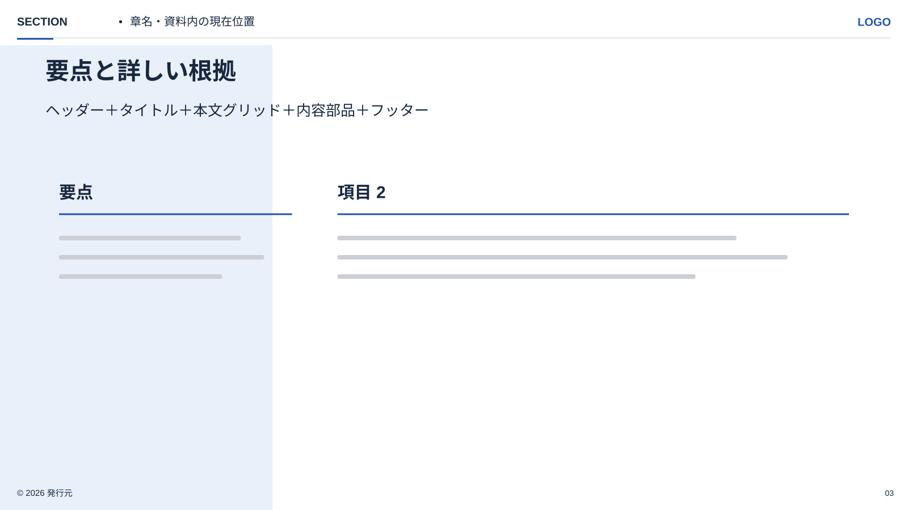

<!-- Generated from index.html#composition. Edit index.html, not this file. -->

## 部品を組み合わせてページを構成する

まず伝える関係を決め、背景 → ヘッダー → タイトル → 本文グリッド → 内容部品 → フッターの順で割り当てる。本文はこの選択をまとめた組み合わせとして扱い、05〜12はその作例に位置づける。見本と同じカード数や工程数を埋めることを目的にしない。

| ページ例 | 背景 | ヘッダー | タイトル | カラム | 本文の部品 | フッター |
| --- | --- | --- | --- | --- | --- | --- |
| R01 説明＋図解 | BG01 | H01-Light | T01＋説明文 | G02 / 6:6 | 左T02＋T03、右P04やグラフ | F01-Light |
| R02 3つの並列項目 | BG01 | H01-Light | T01＋説明文 | G03 / 4:4:4 | 各列P01＋T02＋T03。必要時P02 | F01-Light |
| R03 要点＋詳しい根拠 | BG04 | H01-Light | T01＋説明文 | G05 / 4:8 | 左に要点T02、右にT03・図・表 | F01を左右の面に合わせる |



R01｜部品の組み合わせ見本。枠内の線は文章の配置ガイド。



R02｜部品の組み合わせ見本。枠内の線は文章の配置ガイド。



R03｜部品の組み合わせ見本。枠内の線は文章の配置ガイド。

情報が多ければ、列数・図の領域・説明文・ページ分割を変更する。変更しても固定アンカー、文字の役割、ロゴの縦横比を保つ。基本枠と本文作例を分け、05〜12は図解部品の選択・配置を考える参考に使う。

仕様データ

```
{
  "recipes": [
    [
      "R01 説明＋図解",
      "BG01",
      "H01-Light",
      "T01＋説明文",
      "G02 / 6:6",
      "左T02＋T03、右P04やグラフ",
      "F01-Light"
    ],
    [
      "R02 3つの並列項目",
      "BG01",
      "H01-Light",
      "T01＋説明文",
      "G03 / 4:4:4",
      "各列P01＋T02＋T03。必要時P02",
      "F01-Light"
    ],
    [
      "R03 要点＋詳しい根拠",
      "BG04",
      "H01-Light",
      "T01＋説明文",
      "G05 / 4:8",
      "左に要点T02、右にT03・図・表",
      "F01を左右の面に合わせる"
    ]
  ],
  "selection": "情報の関係と量から部品を選ぶ。05〜12の新見本はspecs/examples/{id}.json内drawingを配置基準とする。reference_nodesは変更前の原本読取値。",
  "scope": "HTML design specification only; no image generation or PowerPoint verification"
}
```
