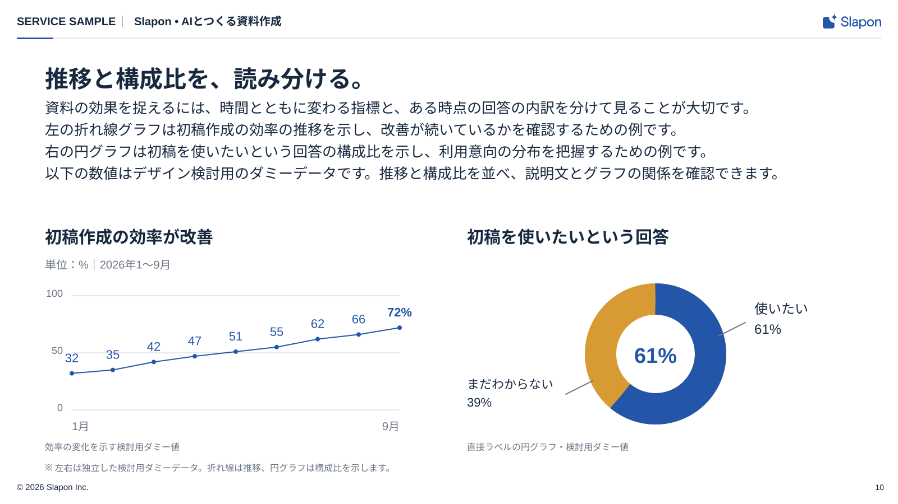

<!-- Generated from index.html#page-charts. Edit index.html, not this file. -->

## 組合せ例 10｜推移＋構成比

固定のページ型ではなく、図解部品の組み合わせ例。[共通ルール](../components/diagram-rules.md)に沿って部品数・配置・原稿量を調整する。

### 使用するコンポーネント

| 背景 | ヘッダー | 文字 | グリッド | 本文・主役 | フッター |
| --- | --- | --- | --- | --- | --- |
| BG01 | H01-Light | T01＋説明文 | G02 / 独立する図表2つ | C01 折れ線＋C02 構成比 | F01-Light |

独立する推移と構成比を読み分ける



図解共通ルールを適用した再構成見本。文章・数値は原本のサンプルを保持。新しい資料の原稿ではありません。

上段に説明、下段に折れ線と円グラフ。直接ラベルと細い軸、数値・単位・期間を明記。

### 可変領域・収まらないとき

軸と分母が異なる図を混同しない

2グラフは独立した例。サンプルの32〜72、61/39を実績として使わない。

過去原本の読取座標（新見本の配置は仕様drawingに記載）

過去原本のレイヤー読取値は比較用に保持する。05〜12の再構成後の配置はdrawingの座標を使い、古い枠へ機械的に文字を押し込まない。

| 要素 | x | y | w | h | 扱い |
| --- | --- | --- | --- | --- | --- |
| カテゴリ | 30 | 25 | 167 | 26 | 原本サンプル。文字は差替え |
| 区切り | 209 | 25 | 8 | 26 | 原本サンプル。文字は差替え |
| パンくず | 229 | 25 | 1020 | 26 | 原本サンプル。文字は差替え |
| 見出し | 80 | 98 | 1440 | 50 | 原本サンプル。文字は差替え |
| 課題提起のサブタイトル | 80 | 168 | 1440 | 140 | 原本サンプル。文字は差替え |
| 初稿作成の効率が改善 | 80 | 350 | 680 | 44 | 原本サンプル。文字は差替え |
| 単位：%｜2026年1〜9月 | 80 | 399 | 680 | 27 | 原本サンプル。文字は差替え |
| 100 | 80 | 445 | 45 | 27 | 原本サンプル。文字は差替え |
| 50 | 87 | 559 | 38 | 27 | 原本サンプル。文字は差替え |
| 0 | 97 | 674 | 28 | 27 | 原本サンプル。文字は差替え |
| 32 | 120 | 629 | 48 | 27 | 原本サンプル。文字は差替え |
| 35 | 181 | 623 | 48 | 27 | 原本サンプル。文字は差替え |
| 42 | 242 | 606 | 48 | 27 | 原本サンプル。文字は差替え |
| 47 | 303 | 595 | 48 | 27 | 原本サンプル。文字は差替え |
| 51 | 364 | 586 | 48 | 27 | 原本サンプル。文字は差替え |
| 55 | 425 | 577 | 48 | 27 | 原本サンプル。文字は差替え |
| 62 | 486 | 560 | 48 | 27 | 原本サンプル。文字は差替え |
| 66 | 547 | 551 | 48 | 27 | 原本サンプル。文字は差替え |
| 72 | 608 | 537 | 48 | 27 | 原本サンプル。文字は差替え |
| 1月 | 124 | 709 | 100 | 30 | 原本サンプル。文字は差替え |
| 9月 | 608 | 709 | 100 | 30 | 原本サンプル。文字は差替え |
| 72% | 520 | 443 | 210 | 72 | 原本サンプル。文字は差替え |
| 効率の変化を示す検討用ダミー値 | 80 | 741 | 680 | 27 | 原本サンプル。文字は差替え |
| 初稿を使いたいという回答 | 840 | 350 | 680 | 44 | 原本サンプル。文字は差替え |
| 使いたい | 1318 | 448 | 200 | 36 | 原本サンプル。文字は差替え |
| 61% | 1318 | 485 | 200 | 57 | 原本サンプル。文字は差替え |
| まだわからない | 840 | 625 | 190 | 35 | 原本サンプル。文字は差替え |
| 39% | 840 | 663 | 190 | 57 | 原本サンプル。文字は差替え |
| 直接ラベルの円グラフ・検討用ダミー値 | 840 | 764 | 680 | 27 | 原本サンプル。文字は差替え |
| 独立したデータの注記 | 80 | 804 | 1440 | 26 | 原本サンプル。文字は差替え |
| 著作権 | 30 | 860 | 800 | 17 | 原本サンプル。文字は差替え |
| ページ | 1520 | 860 | 55 | 17 | 原本サンプル。文字は差替え |

仕様データ

```
{
  "id": "charts",
  "template_node": "45:27894",
  "purpose": "独立する推移と構成比を読み分ける",
  "recipe": "上段に説明、下段に折れ線と円グラフ。直接ラベルと細い軸、数値・単位・期間を明記。",
  "overflow": "2グラフは独立した例。サンプルの32〜72、61/39を実績として使わない。",
  "reference_nodes": [
    {
      "name": "カテゴリ",
      "type": "TEXT",
      "text": "SERVICE SAMPLE",
      "x": 30,
      "y": 25,
      "w": 167,
      "h": 26
    },
    {
      "name": "区切り",
      "type": "TEXT",
      "text": "•",
      "x": 209,
      "y": 25,
      "w": 8,
      "h": 26
    },
    {
      "name": "パンくず",
      "type": "TEXT",
      "text": "Slapon  •  AIとつくる資料作成",
      "x": 229,
      "y": 25,
      "w": 1020,
      "h": 26
    },
    {
      "name": "見出し",
      "type": "TEXT",
      "text": "推移と構成比を、読み分ける。",
      "x": 80,
      "y": 98,
      "w": 1440,
      "h": 50
    },
    {
      "name": "課題提起のサブタイトル",
      "type": "TEXT",
      "text": "資料の効果を捉えるには、時間とともに変わる指標と、ある時点の回答の内訳を分けて見ることが大切です。\n左の折れ線グラフは初稿作成の効率の推移を示し、改善が続いているかを確認するための例です。\n右の円グラフは初稿を使いたいという回答の構成比を示し、利用意向の分布を把握するための例です。\n以下の数値はデザイン検討用のダミーデータです。推移と構成比を並べ、説明文とグラフの関係を確認できます。",
      "x": 80,
      "y": 168,
      "w": 1440,
      "h": 140
    },
    {
      "name": "初稿作成の効率が改善",
      "type": "TEXT",
      "text": "初稿作成の効率が改善",
      "x": 80,
      "y": 350,
      "w": 680,
      "h": 44
    },
    {
      "name": "単位：%｜2026年1〜9月",
      "type": "TEXT",
      "text": "単位：%｜2026年1〜9月",
      "x": 80,
      "y": 399,
      "w": 680,
      "h": 27
    },
    {
      "name": "100",
      "type": "TEXT",
      "text": "100",
      "x": 80,
      "y": 445,
      "w": 45,
      "h": 27
    },
    {
      "name": "50",
      "type": "TEXT",
      "text": "50",
      "x": 87,
      "y": 559,
      "w": 38,
      "h": 27
    },
    {
      "name": "0",
      "type": "TEXT",
      "text": "0",
      "x": 97,
      "y": 674,
      "w": 28,
      "h": 27
    },
    {
      "name": "32",
      "type": "TEXT",
      "text": "32",
      "x": 120,
      "y": 629,
      "w": 48,
      "h": 27
    },
    {
      "name": "35",
      "type": "TEXT",
      "text": "35",
      "x": 181,
      "y": 623,
      "w": 48,
      "h": 27
    },
    {
      "name": "42",
      "type": "TEXT",
      "text": "42",
      "x": 242,
      "y": 606,
      "w": 48,
      "h": 27
    },
    {
      "name": "47",
      "type": "TEXT",
      "text": "47",
      "x": 303,
      "y": 595,
      "w": 48,
      "h": 27
    },
    {
      "name": "51",
      "type": "TEXT",
      "text": "51",
      "x": 364,
      "y": 586,
      "w": 48,
      "h": 27
    },
    {
      "name": "55",
      "type": "TEXT",
      "text": "55",
      "x": 425,
      "y": 577,
      "w": 48,
      "h": 27
    },
    {
      "name": "62",
      "type": "TEXT",
      "text": "62",
      "x": 486,
      "y": 560,
      "w": 48,
      "h": 27
    },
    {
      "name": "66",
      "type": "TEXT",
      "text": "66",
      "x": 547,
      "y": 551,
      "w": 48,
      "h": 27
    },
    {
      "name": "72",
      "type": "TEXT",
      "text": "72",
      "x": 608,
      "y": 537,
      "w": 48,
      "h": 27
    },
    {
      "name": "1月",
      "type": "TEXT",
      "text": "1月",
      "x": 124,
      "y": 709,
      "w": 100,
      "h": 30
    },
    {
      "name": "9月",
      "type": "TEXT",
      "text": "9月",
      "x": 608,
      "y": 709,
      "w": 100,
      "h": 30
    },
    {
      "name": "72%",
      "type": "TEXT",
      "text": "72%",
      "x": 520,
      "y": 443,
      "w": 210,
      "h": 72
    },
    {
      "name": "効率の変化を示す検討用ダミー値",
      "type": "TEXT",
      "text": "効率の変化を示す検討用ダミー値",
      "x": 80,
      "y": 741,
      "w": 680,
      "h": 27
    },
    {
      "name": "初稿を使いたいという回答",
      "type": "TEXT",
      "text": "初稿を使いたいという回答",
      "x": 840,
      "y": 350,
      "w": 680,
      "h": 44
    },
    {
      "name": "使いたい",
      "type": "TEXT",
      "text": "使いたい",
      "x": 1318,
      "y": 448,
      "w": 200,
      "h": 36
    },
    {
      "name": "61%",
      "type": "TEXT",
      "text": "61%",
      "x": 1318,
      "y": 485,
      "w": 200,
      "h": 57
    },
    {
      "name": "まだわからない",
      "type": "TEXT",
      "text": "まだわからない",
      "x": 840,
      "y": 625,
      "w": 190,
      "h": 35
    },
    {
      "name": "39%",
      "type": "TEXT",
      "text": "39%",
      "x": 840,
      "y": 663,
      "w": 190,
      "h": 57
    },
    {
      "name": "直接ラベルの円グラフ・検討用ダミー値",
      "type": "TEXT",
      "text": "直接ラベルの円グラフ・検討用ダミー値",
      "x": 840,
      "y": 764,
      "w": 680,
      "h": 27
    },
    {
      "name": "独立したデータの注記",
      "type": "TEXT",
      "text": "※ 左右は独立した検討用ダミーデータ。折れ線は推移、円グラフは構成比を示します。",
      "x": 80,
      "y": 804,
      "w": 1440,
      "h": 26
    },
    {
      "name": "著作権",
      "type": "TEXT",
      "text": "© 2026 Slapon Inc.",
      "x": 30,
      "y": 860,
      "w": 800,
      "h": 17
    },
    {
      "name": "ページ",
      "type": "TEXT",
      "text": "03",
      "x": 1520,
      "y": 860,
      "w": 55,
      "h": 17
    }
  ],
  "geometry_status": "既存レイヤー読取情報。アウトラインのインク外接矩形と異なる場合がある。改行後はプレビュー照合。",
  "canvas": [
    1600,
    900
  ],
  "composition": {
    "background": "BG01",
    "header": "H01-Light",
    "typography": "T01＋説明文",
    "grid": "G02 / 原本の左右配置",
    "content": "C01 折れ線＋C02 構成比",
    "footer": "F01-Light"
  },
  "composition_geometry_policy": "新しい作例はdrawingの座標で再構成。reference_nodesは過去原本の読取値で、新見本の配置値ではない。",
  "classification": "composition_example",
  "fixed_page_template": false,
  "reusable_components": "C01 折れ線＋C02 構成比",
  "adaptation": "軸と分母が異なる図を混同しない",
  "common_rules": "components/diagram-rules.md",
  "drawing": {
    "canvas": [
      1600,
      900
    ],
    "nodes": [
      {
        "type": "text",
        "x": 30,
        "y": 25,
        "w": 168.0,
        "h": 30,
        "text": "SERVICE SAMPLE",
        "size": 20,
        "role": "text",
        "line_height": 26,
        "align": "left",
        "font-weight": 700
      },
      {
        "type": "line",
        "x1": 218.0,
        "x2": 218.0,
        "y1": 28.0,
        "y2": 48.0,
        "role": "muted",
        "stroke-width": 1
      },
      {
        "type": "text",
        "x": 239.0,
        "y": 25,
        "w": 1197.0,
        "h": 30,
        "text": "Slapon  •  AIとつくる資料作成",
        "size": 20,
        "role": "text",
        "line_height": 26,
        "align": "left",
        "font-weight": 700
      },
      {
        "type": "line",
        "x1": 30,
        "y1": 68,
        "x2": 1570,
        "y2": 68,
        "role": "line",
        "stroke-width": 1
      },
      {
        "type": "rect",
        "x": 30,
        "y": 67,
        "width": 64,
        "height": 3,
        "rx": 0,
        "role": "main"
      },
      {
        "type": "text",
        "x": 80,
        "y": 114,
        "w": 1440,
        "h": 50,
        "text": "推移と構成比を、読み分ける。",
        "size": 42,
        "role": "text",
        "line_height": 50,
        "align": "left",
        "font-weight": 700
      },
      {
        "type": "text",
        "x": 80,
        "y": 176,
        "w": 1440,
        "h": 200,
        "text": "資料の効果を捉えるには、時間とともに変わる指標と、ある時点の回答の内訳を分けて見ることが大切です。\n左の折れ線グラフは初稿作成の効率の推移を示し、改善が続いているかを確認するための例です。\n右の円グラフは初稿を使いたいという回答の構成比を示し、利用意向の分布を把握するための例です。\n以下の数値はデザイン検討用のダミーデータです。推移と構成比を並べ、説明文とグラフの関係を確認できます。",
        "size": 26,
        "role": "text",
        "line_height": 39,
        "align": "left"
      },
      {
        "type": "text",
        "x": 1520,
        "y": 861,
        "w": 55,
        "h": 22,
        "text": "10",
        "size": 14,
        "role": "text",
        "line_height": 20,
        "align": "right"
      },
      {
        "type": "text",
        "x": 80,
        "y": 404,
        "w": 704,
        "h": 42,
        "text": "初稿作成の効率が改善",
        "size": 30,
        "role": "text",
        "line_height": 40,
        "align": "left",
        "font-weight": 700
      },
      {
        "type": "text",
        "x": 80,
        "y": 460,
        "w": 704,
        "h": 30,
        "text": "単位：%｜2026年1〜9月",
        "size": 20,
        "role": "muted",
        "line_height": 28,
        "align": "left"
      },
      {
        "type": "line",
        "x1": 128,
        "y1": 732.0,
        "x2": 712,
        "y2": 732.0,
        "role": "line",
        "stroke-width": 1
      },
      {
        "type": "text",
        "x": 80,
        "y": 716.0,
        "w": 32,
        "h": 30,
        "text": "0",
        "size": 18,
        "role": "muted",
        "line_height": 26,
        "align": "right",
        "font-family": "Arimo,Arial,sans-serif"
      },
      {
        "type": "line",
        "x1": 128,
        "y1": 630.0,
        "x2": 712,
        "y2": 630.0,
        "role": "line",
        "stroke-width": 1
      },
      {
        "type": "text",
        "x": 80,
        "y": 614.0,
        "w": 32,
        "h": 30,
        "text": "50",
        "size": 18,
        "role": "muted",
        "line_height": 26,
        "align": "right",
        "font-family": "Arimo,Arial,sans-serif"
      },
      {
        "type": "line",
        "x1": 128,
        "y1": 528.0,
        "x2": 712,
        "y2": 528.0,
        "role": "line",
        "stroke-width": 1
      },
      {
        "type": "text",
        "x": 80,
        "y": 512.0,
        "w": 32,
        "h": 30,
        "text": "100",
        "size": 18,
        "role": "muted",
        "line_height": 26,
        "align": "right",
        "font-family": "Arimo,Arial,sans-serif"
      },
      {
        "type": "polyline",
        "points": "128.0,666.72 201.0,660.6 274.0,646.3199999999999 347.0,636.12 420.0,627.96 493.0,619.8 566.0,605.52 639.0,597.36 712.0,585.12",
        "role": "main"
      },
      {
        "type": "circle",
        "cx": 128.0,
        "cy": 666.72,
        "r": 4,
        "role": "main"
      },
      {
        "type": "text",
        "x": 104.0,
        "y": 624.72,
        "w": 48,
        "h": 32,
        "text": "32",
        "size": 22,
        "role": "primaryInk",
        "line_height": 30,
        "align": "center",
        "font-family": "Arimo,Arial,sans-serif"
      },
      {
        "type": "circle",
        "cx": 201.0,
        "cy": 660.6,
        "r": 4,
        "role": "main"
      },
      {
        "type": "text",
        "x": 177.0,
        "y": 618.6,
        "w": 48,
        "h": 32,
        "text": "35",
        "size": 22,
        "role": "primaryInk",
        "line_height": 30,
        "align": "center",
        "font-family": "Arimo,Arial,sans-serif"
      },
      {
        "type": "circle",
        "cx": 274.0,
        "cy": 646.3199999999999,
        "r": 4,
        "role": "main"
      },
      {
        "type": "text",
        "x": 250.0,
        "y": 604.3199999999999,
        "w": 48,
        "h": 32,
        "text": "42",
        "size": 22,
        "role": "primaryInk",
        "line_height": 30,
        "align": "center",
        "font-family": "Arimo,Arial,sans-serif"
      },
      {
        "type": "circle",
        "cx": 347.0,
        "cy": 636.12,
        "r": 4,
        "role": "main"
      },
      {
        "type": "text",
        "x": 323.0,
        "y": 594.12,
        "w": 48,
        "h": 32,
        "text": "47",
        "size": 22,
        "role": "primaryInk",
        "line_height": 30,
        "align": "center",
        "font-family": "Arimo,Arial,sans-serif"
      },
      {
        "type": "circle",
        "cx": 420.0,
        "cy": 627.96,
        "r": 4,
        "role": "main"
      },
      {
        "type": "text",
        "x": 396.0,
        "y": 585.96,
        "w": 48,
        "h": 32,
        "text": "51",
        "size": 22,
        "role": "primaryInk",
        "line_height": 30,
        "align": "center",
        "font-family": "Arimo,Arial,sans-serif"
      },
      {
        "type": "circle",
        "cx": 493.0,
        "cy": 619.8,
        "r": 4,
        "role": "main"
      },
      {
        "type": "text",
        "x": 469.0,
        "y": 577.8,
        "w": 48,
        "h": 32,
        "text": "55",
        "size": 22,
        "role": "primaryInk",
        "line_height": 30,
        "align": "center",
        "font-family": "Arimo,Arial,sans-serif"
      },
      {
        "type": "circle",
        "cx": 566.0,
        "cy": 605.52,
        "r": 4,
        "role": "main"
      },
      {
        "type": "text",
        "x": 542.0,
        "y": 563.52,
        "w": 48,
        "h": 32,
        "text": "62",
        "size": 22,
        "role": "primaryInk",
        "line_height": 30,
        "align": "center",
        "font-family": "Arimo,Arial,sans-serif"
      },
      {
        "type": "circle",
        "cx": 639.0,
        "cy": 597.36,
        "r": 4,
        "role": "main"
      },
      {
        "type": "text",
        "x": 615.0,
        "y": 555.36,
        "w": 48,
        "h": 32,
        "text": "66",
        "size": 22,
        "role": "primaryInk",
        "line_height": 30,
        "align": "center",
        "font-family": "Arimo,Arial,sans-serif"
      },
      {
        "type": "circle",
        "cx": 712.0,
        "cy": 585.12,
        "r": 4,
        "role": "main"
      },
      {
        "type": "text",
        "x": 664,
        "y": 543.12,
        "w": 96,
        "h": 32,
        "text": "72%",
        "size": 22,
        "role": "primaryInk",
        "line_height": 30,
        "align": "center",
        "font-weight": 700,
        "font-family": "Arimo,Arial,sans-serif"
      },
      {
        "type": "text",
        "x": 128,
        "y": 748,
        "w": 120,
        "h": 30,
        "text": "1月",
        "size": 20,
        "role": "muted",
        "line_height": 28,
        "align": "left"
      },
      {
        "type": "text",
        "x": 592,
        "y": 748,
        "w": 120,
        "h": 30,
        "text": "9月",
        "size": 20,
        "role": "muted",
        "line_height": 28,
        "align": "right"
      },
      {
        "type": "text",
        "x": 80,
        "y": 788,
        "w": 704,
        "h": 26,
        "text": "効率の変化を示す検討用ダミー値",
        "size": 16,
        "role": "muted",
        "line_height": 24,
        "align": "left"
      },
      {
        "type": "text",
        "x": 832,
        "y": 404,
        "w": 688,
        "h": 42,
        "text": "初稿を使いたいという回答",
        "size": 30,
        "role": "text",
        "line_height": 40,
        "align": "left",
        "font-weight": 700
      },
      {
        "type": "circle",
        "cx": 1168,
        "cy": 632,
        "r": 98,
        "role": "white",
        "stroke_role": "accent",
        "stroke-width": 56,
        "fill": "none"
      },
      {
        "type": "circle",
        "cx": 1168,
        "cy": 632,
        "r": 98,
        "role": "white",
        "stroke_role": "main",
        "stroke-width": 56,
        "stroke-dasharray": "375.6088176631956 240.14334244040379",
        "transform": "rotate(-90 1168 632)",
        "fill": "none"
      },
      {
        "type": "text",
        "x": 1080,
        "y": 610,
        "w": 176,
        "h": 50,
        "text": "61%",
        "size": 38,
        "role": "primaryInk",
        "line_height": 50,
        "align": "center",
        "font-weight": 700,
        "font-family": "Arimo,Arial,sans-serif"
      },
      {
        "type": "line",
        "x1": 1280,
        "y1": 600,
        "x2": 1328,
        "y2": 576,
        "role": "muted",
        "stroke-width": 2
      },
      {
        "type": "text",
        "x": 1344,
        "y": 536,
        "w": 176,
        "h": 76,
        "text": "使いたい\n61%",
        "size": 24,
        "role": "text",
        "line_height": 36,
        "align": "left"
      },
      {
        "type": "line",
        "x1": 1056,
        "y1": 680,
        "x2": 1008,
        "y2": 704,
        "role": "muted",
        "stroke-width": 2
      },
      {
        "type": "text",
        "x": 832,
        "y": 672,
        "w": 176,
        "h": 80,
        "text": "まだわからない\n39%",
        "size": 22,
        "role": "text",
        "line_height": 32,
        "align": "left"
      },
      {
        "type": "text",
        "x": 832,
        "y": 788,
        "w": 688,
        "h": 26,
        "text": "直接ラベルの円グラフ・検討用ダミー値",
        "size": 16,
        "role": "muted",
        "line_height": 24,
        "align": "left"
      },
      {
        "type": "text",
        "x": 80,
        "y": 824,
        "w": 1440,
        "h": 24,
        "text": "※ 左右は独立した検討用ダミーデータ。折れ線は推移、円グラフは構成比を示します。",
        "size": 16,
        "role": "muted",
        "line_height": 24,
        "align": "left"
      }
    ],
    "header_layout": "H01 content_width; separator gaps 20px, glyph-center alignment",
    "title_spacing": "T01 y114 h50; subtitle y176 (12px gap)"
  },
  "rendering_basis": "2026-10-21利用者指示による図解共通ルール適用後の再構成見本。原本はassets/sourceに保存。",
  "applied_rules": {
    "chart_gap": 48,
    "connector_width": 2,
    "gridline_width": 1,
    "line_values": [
      32,
      35,
      42,
      47,
      51,
      55,
      62,
      66,
      72
    ],
    "share_values": [
      61,
      39
    ],
    "chart_values_status": "原本と同じ検討用ダミー値",
    "header_long_category_size": 17,
    "footer_baseline": 875
  }
}
```
