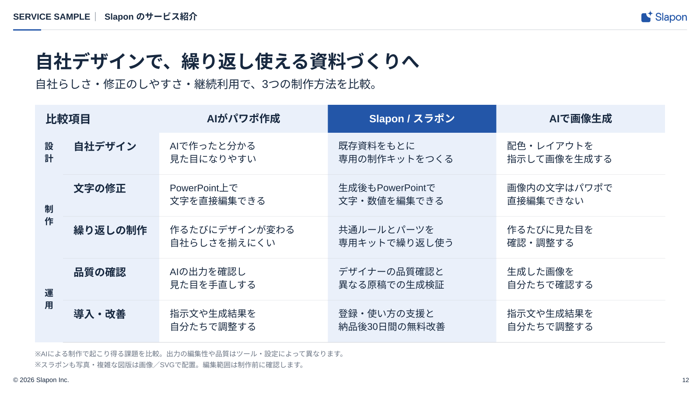

<!-- Generated from index.html#page-comparison. Edit index.html, not this file. -->

## 組合せ例 12｜同じ軸で比較

固定のページ型ではなく、図解部品の組み合わせ例。[共通ルール](../components/diagram-rules.md)に沿って部品数・配置・原稿量を調整する。

### 使用するコンポーネント

| 背景 | ヘッダー | 文字 | グリッド | 本文・主役 | フッター |
| --- | --- | --- | --- | --- | --- |
| BG01 | H01-Light | T01＋説明文 | 項目列＋比較列 | P08＋T02＋T03 | F01-Light |

同じ軸で選択肢を比較する



図解共通ルールを適用した再構成見本。文章・数値は原本のサンプルを保持。新しい資料の原稿ではありません。

左に分類と比較項目、右の3列を同じ行の高さでそろえる。注目列の見出しは主色、本文面は淡色。

### 可変領域・収まらないとき

共通軸・行高・単位をそろえる。列数は可変

強調先は原稿で選ぶ。サンプルの自社優位という主張を自動挿入しない。項目・列数は可変。

過去原本の読取座標（新見本の配置は仕様drawingに記載）

過去原本のレイヤー読取値は比較用に保持する。05〜12の再構成後の配置はdrawingの座標を使い、古い枠へ機械的に文字を押し込まない。

| 要素 | x | y | w | h | 扱い |
| --- | --- | --- | --- | --- | --- |
| カテゴリ | 30 | 25 | 167 | 26 | 原本サンプル。文字は差替え |
| 区切り | 209 | 25 | 8 | 26 | 原本サンプル。文字は差替え |
| パンくず | 229 | 25 | 1020 | 26 | 原本サンプル。文字は差替え |
| 見出し | 80 | 98 | 1440 | 50 | 原本サンプル。文字は差替え |
| 課題提起のサブタイトル | 80 | 168 | 1440 | 35 | 原本サンプル。文字は差替え |
| ※AIによる制作で起こり得る課題を比較。出力の編集性や品質はツール・設定によって異なります。 | 80 | 778 | 671 | 20 | 原本サンプル。文字は差替え |
| ※スラポンも写真・複雑な図版は画像／SVGで配置。編集範囲は制作前に確認します。 | 80 | 800 | 582 | 20 | 原本サンプル。文字は差替え |
| 設 計 | 80 | 358 | 36 | 52 | 原本サンプル。文字は差替え |
| 制 作 | 80 | 484 | 36 | 52 | 原本サンプル。文字は差替え |
| 運 用 | 80 | 648 | 36 | 52 | 原本サンプル。文字は差替え |
| 比較項目 | 148 | 299 | 180 | 34 | 原本サンプル。文字は差替え |
| 自社デザイン | 148 | 368 | 164 | 34 | 原本サンプル。文字は差替え |
| 文字の修正 | 148 | 450 | 164 | 34 | 原本サンプル。文字は差替え |
| 繰り返しの制作 | 148 | 532 | 180 | 34 | 原本サンプル。文字は差替え |
| 品質の確認 | 148 | 614 | 164 | 34 | 原本サンプル。文字は差替え |
| 導入・改善 | 148 | 695 | 164 | 34 | 原本サンプル。文字は差替え |
| AIがパワポ作成 | 344 | 299 | 372 | 34 | 原本サンプル。文字は差替え |
| AIで作ったと分かる 見た目になりやすい | 366 | 356 | 334 | 58 | 原本サンプル。文字は差替え |
| PowerPoint上で 文字を直接編集できる | 366 | 438 | 334 | 58 | 原本サンプル。文字は差替え |
| 作るたびにデザインが変わる 自社らしさを揃えにくい | 366 | 520 | 334 | 58 | 原本サンプル。文字は差替え |
| AIの出力を確認し 見た目を手直しする | 366 | 602 | 334 | 58 | 原本サンプル。文字は差替え |
| 指示文や生成結果を 自分たちで調整する | 366 | 683 | 334 | 58 | 原本サンプル。文字は差替え |
| Slapon | 734 | 283 | 380 | 22 | 原本サンプル。文字は差替え |
| スラポン | 734 | 305 | 380 | 34 | 原本サンプル。文字は差替え |
| 既存資料をもとに 専用の制作キットをつくる | 758 | 358 | 340 | 58 | 原本サンプル。文字は差替え |
| 生成後もPowerPointで 文字・数値を編集できる | 758 | 440 | 340 | 58 | 原本サンプル。文字は差替え |
| 共通ルールとパーツを 専用キットで繰り返し使う | 758 | 522 | 340 | 58 | 原本サンプル。文字は差替え |
| デザイナーの品質確認と 異なる原稿での生成検証 | 758 | 604 | 340 | 58 | 原本サンプル。文字は差替え |
| 登録・使い方の支援と 納品後30日間の無料改善 | 758 | 685 | 340 | 58 | 原本サンプル。文字は差替え |
| AIで画像生成 | 1128 | 299 | 392 | 34 | 原本サンプル。文字は差替え |
| 配色・レイアウトを 指示して画像を生成する | 1152 | 356 | 352 | 58 | 原本サンプル。文字は差替え |
| 画像内の文字はパワポで 直接編集できない | 1152 | 438 | 352 | 58 | 原本サンプル。文字は差替え |
| 作るたびに見た目を 確認・調整する | 1152 | 520 | 352 | 58 | 原本サンプル。文字は差替え |
| 生成した画像を 自分たちで確認する | 1152 | 602 | 352 | 58 | 原本サンプル。文字は差替え |
| 指示文や生成結果を 自分たちで調整する | 1152 | 683 | 352 | 58 | 原本サンプル。文字は差替え |
| 著作権 | 30 | 860 | 800 | 17 | 原本サンプル。文字は差替え |
| ページ | 1520 | 860 | 55 | 17 | 原本サンプル。文字は差替え |

仕様データ

```
{
  "id": "comparison",
  "template_node": "45:28152",
  "purpose": "同じ軸で選択肢を比較する",
  "recipe": "左に分類と比較項目、右の3列を同じ行の高さでそろえる。注目列の見出しは主色、本文面は淡色。",
  "overflow": "強調先は原稿で選ぶ。サンプルの自社優位という主張を自動挿入しない。項目・列数は可変。",
  "reference_nodes": [
    {
      "name": "カテゴリ",
      "type": "TEXT",
      "text": "SERVICE SAMPLE",
      "x": 30,
      "y": 25,
      "w": 167,
      "h": 26
    },
    {
      "name": "区切り",
      "type": "TEXT",
      "text": "•",
      "x": 209,
      "y": 25,
      "w": 8,
      "h": 26
    },
    {
      "name": "パンくず",
      "type": "TEXT",
      "text": "Slapon のサービス紹介",
      "x": 229,
      "y": 25,
      "w": 1020,
      "h": 26
    },
    {
      "name": "見出し",
      "type": "TEXT",
      "text": "自社デザインで、繰り返し使える資料づくりへ",
      "x": 80,
      "y": 98,
      "w": 1440,
      "h": 50
    },
    {
      "name": "課題提起のサブタイトル",
      "type": "TEXT",
      "text": "自社らしさ・修正のしやすさ・継続利用で、3つの制作方法を比較。",
      "x": 80,
      "y": 168,
      "w": 1440,
      "h": 35
    },
    {
      "name": "※AIによる制作で起こり得る課題を比較。出力の編集性や品質はツール・設定によって異なります。",
      "type": "TEXT",
      "text": "※AIによる制作で起こり得る課題を比較。出力の編集性や品質はツール・設定によって異なります。",
      "x": 80,
      "y": 778,
      "w": 671,
      "h": 20
    },
    {
      "name": "※スラポンも写真・複雑な図版は画像／SVGで配置。編集範囲は制作前に確認します。",
      "type": "TEXT",
      "text": "※スラポンも写真・複雑な図版は画像／SVGで配置。編集範囲は制作前に確認します。",
      "x": 80,
      "y": 800,
      "w": 582,
      "h": 20
    },
    {
      "name": "設\n計",
      "type": "TEXT",
      "text": "設\n計",
      "x": 80,
      "y": 358,
      "w": 36,
      "h": 52
    },
    {
      "name": "制\n作",
      "type": "TEXT",
      "text": "制\n作",
      "x": 80,
      "y": 484,
      "w": 36,
      "h": 52
    },
    {
      "name": "運\n用",
      "type": "TEXT",
      "text": "運\n用",
      "x": 80,
      "y": 648,
      "w": 36,
      "h": 52
    },
    {
      "name": "比較項目",
      "type": "TEXT",
      "text": "比較項目",
      "x": 148,
      "y": 299,
      "w": 180,
      "h": 34
    },
    {
      "name": "自社デザイン",
      "type": "TEXT",
      "text": "自社デザイン",
      "x": 148,
      "y": 368,
      "w": 164,
      "h": 34
    },
    {
      "name": "文字の修正",
      "type": "TEXT",
      "text": "文字の修正",
      "x": 148,
      "y": 450,
      "w": 164,
      "h": 34
    },
    {
      "name": "繰り返しの制作",
      "type": "TEXT",
      "text": "繰り返しの制作",
      "x": 148,
      "y": 532,
      "w": 180,
      "h": 34
    },
    {
      "name": "品質の確認",
      "type": "TEXT",
      "text": "品質の確認",
      "x": 148,
      "y": 614,
      "w": 164,
      "h": 34
    },
    {
      "name": "導入・改善",
      "type": "TEXT",
      "text": "導入・改善",
      "x": 148,
      "y": 695,
      "w": 164,
      "h": 34
    },
    {
      "name": "AIがパワポ作成",
      "type": "TEXT",
      "text": "AIがパワポ作成",
      "x": 344,
      "y": 299,
      "w": 372,
      "h": 34
    },
    {
      "name": "AIで作ったと分かる\n見た目になりやすい",
      "type": "TEXT",
      "text": "AIで作ったと分かる\n見た目になりやすい",
      "x": 366,
      "y": 356,
      "w": 334,
      "h": 58
    },
    {
      "name": "PowerPoint上で\n文字を直接編集できる",
      "type": "TEXT",
      "text": "PowerPoint上で\n文字を直接編集できる",
      "x": 366,
      "y": 438,
      "w": 334,
      "h": 58
    },
    {
      "name": "作るたびにデザインが変わる\n自社らしさを揃えにくい",
      "type": "TEXT",
      "text": "作るたびにデザインが変わる\n自社らしさを揃えにくい",
      "x": 366,
      "y": 520,
      "w": 334,
      "h": 58
    },
    {
      "name": "AIの出力を確認し\n見た目を手直しする",
      "type": "TEXT",
      "text": "AIの出力を確認し\n見た目を手直しする",
      "x": 366,
      "y": 602,
      "w": 334,
      "h": 58
    },
    {
      "name": "指示文や生成結果を\n自分たちで調整する",
      "type": "TEXT",
      "text": "指示文や生成結果を\n自分たちで調整する",
      "x": 366,
      "y": 683,
      "w": 334,
      "h": 58
    },
    {
      "name": "Slapon",
      "type": "TEXT",
      "text": "Slapon",
      "x": 734,
      "y": 283,
      "w": 380,
      "h": 22
    },
    {
      "name": "スラポン",
      "type": "TEXT",
      "text": "スラポン",
      "x": 734,
      "y": 305,
      "w": 380,
      "h": 34
    },
    {
      "name": "既存資料をもとに\n専用の制作キットをつくる",
      "type": "TEXT",
      "text": "既存資料をもとに\n専用の制作キットをつくる",
      "x": 758,
      "y": 358,
      "w": 340,
      "h": 58
    },
    {
      "name": "生成後もPowerPointで\n文字・数値を編集できる",
      "type": "TEXT",
      "text": "生成後もPowerPointで\n文字・数値を編集できる",
      "x": 758,
      "y": 440,
      "w": 340,
      "h": 58
    },
    {
      "name": "共通ルールとパーツを\n専用キットで繰り返し使う",
      "type": "TEXT",
      "text": "共通ルールとパーツを\n専用キットで繰り返し使う",
      "x": 758,
      "y": 522,
      "w": 340,
      "h": 58
    },
    {
      "name": "デザイナーの品質確認と\n異なる原稿での生成検証",
      "type": "TEXT",
      "text": "デザイナーの品質確認と\n異なる原稿での生成検証",
      "x": 758,
      "y": 604,
      "w": 340,
      "h": 58
    },
    {
      "name": "登録・使い方の支援と\n納品後30日間の無料改善",
      "type": "TEXT",
      "text": "登録・使い方の支援と\n納品後30日間の無料改善",
      "x": 758,
      "y": 685,
      "w": 340,
      "h": 58
    },
    {
      "name": "AIで画像生成",
      "type": "TEXT",
      "text": "AIで画像生成",
      "x": 1128,
      "y": 299,
      "w": 392,
      "h": 34
    },
    {
      "name": "配色・レイアウトを\n指示して画像を生成する",
      "type": "TEXT",
      "text": "配色・レイアウトを\n指示して画像を生成する",
      "x": 1152,
      "y": 356,
      "w": 352,
      "h": 58
    },
    {
      "name": "画像内の文字はパワポで\n直接編集できない",
      "type": "TEXT",
      "text": "画像内の文字はパワポで\n直接編集できない",
      "x": 1152,
      "y": 438,
      "w": 352,
      "h": 58
    },
    {
      "name": "作るたびに見た目を\n確認・調整する",
      "type": "TEXT",
      "text": "作るたびに見た目を\n確認・調整する",
      "x": 1152,
      "y": 520,
      "w": 352,
      "h": 58
    },
    {
      "name": "生成した画像を\n自分たちで確認する",
      "type": "TEXT",
      "text": "生成した画像を\n自分たちで確認する",
      "x": 1152,
      "y": 602,
      "w": 352,
      "h": 58
    },
    {
      "name": "指示文や生成結果を\n自分たちで調整する",
      "type": "TEXT",
      "text": "指示文や生成結果を\n自分たちで調整する",
      "x": 1152,
      "y": 683,
      "w": 352,
      "h": 58
    },
    {
      "name": "著作権",
      "type": "TEXT",
      "text": "© 2026 Slapon Inc.",
      "x": 30,
      "y": 860,
      "w": 800,
      "h": 17
    },
    {
      "name": "ページ",
      "type": "TEXT",
      "text": "03",
      "x": 1520,
      "y": 860,
      "w": 55,
      "h": 17
    }
  ],
  "geometry_status": "既存レイヤー読取情報。アウトラインのインク外接矩形と異なる場合がある。改行後はプレビュー照合。",
  "canvas": [
    1600,
    900
  ],
  "composition": {
    "background": "BG01",
    "header": "H01-Light",
    "typography": "T01＋説明文",
    "grid": "原本の項目列＋3つの比較列",
    "content": "P08＋T02＋T03",
    "footer": "F01-Light"
  },
  "composition_geometry_policy": "新しい作例はdrawingの座標で再構成。reference_nodesは過去原本の読取値で、新見本の配置値ではない。",
  "classification": "composition_example",
  "fixed_page_template": false,
  "reusable_components": "P08＋T02＋T03",
  "adaptation": "共通軸・行高・単位をそろえる。列数は可変",
  "common_rules": "components/diagram-rules.md",
  "drawing": {
    "canvas": [
      1600,
      900
    ],
    "nodes": [
      {
        "type": "text",
        "x": 30,
        "y": 25,
        "w": 168.0,
        "h": 30,
        "text": "SERVICE SAMPLE",
        "size": 20,
        "role": "text",
        "line_height": 26,
        "align": "left",
        "font-weight": 700
      },
      {
        "type": "line",
        "x1": 218.0,
        "x2": 218.0,
        "y1": 28.0,
        "y2": 48.0,
        "role": "muted",
        "stroke-width": 1
      },
      {
        "type": "text",
        "x": 239.0,
        "y": 25,
        "w": 1197.0,
        "h": 30,
        "text": "Slapon のサービス紹介",
        "size": 20,
        "role": "text",
        "line_height": 26,
        "align": "left",
        "font-weight": 700
      },
      {
        "type": "line",
        "x1": 30,
        "y1": 68,
        "x2": 1570,
        "y2": 68,
        "role": "line",
        "stroke-width": 1
      },
      {
        "type": "rect",
        "x": 30,
        "y": 67,
        "width": 64,
        "height": 3,
        "rx": 0,
        "role": "main"
      },
      {
        "type": "text",
        "x": 80,
        "y": 114,
        "w": 1440,
        "h": 50,
        "text": "自社デザインで、繰り返し使える資料づくりへ",
        "size": 42,
        "role": "text",
        "line_height": 50,
        "align": "left",
        "font-weight": 700
      },
      {
        "type": "text",
        "x": 80,
        "y": 176,
        "w": 1440,
        "h": 80,
        "text": "自社らしさ・修正のしやすさ・継続利用で、3つの制作方法を比較。",
        "size": 26,
        "role": "text",
        "line_height": 39,
        "align": "left"
      },
      {
        "type": "text",
        "x": 1520,
        "y": 861,
        "w": 55,
        "h": 22,
        "text": "12",
        "size": 14,
        "role": "text",
        "line_height": 20,
        "align": "right"
      },
      {
        "type": "rect",
        "x": 80,
        "y": 240,
        "width": 284,
        "height": 64,
        "rx": 0,
        "role": "sub"
      },
      {
        "type": "text",
        "x": 104,
        "y": 256,
        "w": 236,
        "h": 40,
        "text": "比較項目",
        "size": 26,
        "role": "text",
        "line_height": 36,
        "align": "left",
        "font-weight": 700
      },
      {
        "type": "rect",
        "x": 364,
        "y": 240,
        "width": 385.3333333333333,
        "height": 64,
        "rx": 0,
        "role": "sub"
      },
      {
        "type": "text",
        "x": 388,
        "y": 256,
        "w": 337.3333333333333,
        "h": 36,
        "text": "AIがパワポ作成",
        "size": 24,
        "role": "text",
        "line_height": 32,
        "align": "center",
        "font-weight": 700
      },
      {
        "type": "rect",
        "x": 749.3333333333333,
        "y": 240,
        "width": 385.3333333333333,
        "height": 64,
        "rx": 0,
        "role": "comparisonMain"
      },
      {
        "type": "text",
        "x": 773.3333333333333,
        "y": 256,
        "w": 337.3333333333333,
        "h": 36,
        "text": "Slapon / スラポン",
        "size": 24,
        "role": "comparisonText",
        "line_height": 32,
        "align": "center",
        "font-weight": 700
      },
      {
        "type": "rect",
        "x": 1134.6666666666665,
        "y": 240,
        "width": 385.3333333333333,
        "height": 64,
        "rx": 0,
        "role": "sub"
      },
      {
        "type": "text",
        "x": 1158.6666666666665,
        "y": 256,
        "w": 337.3333333333333,
        "h": 36,
        "text": "AIで画像生成",
        "size": 24,
        "role": "text",
        "line_height": 32,
        "align": "center",
        "font-weight": 700
      },
      {
        "type": "rect",
        "x": 144,
        "y": 304,
        "width": 220,
        "height": 96,
        "rx": 0,
        "role": "sub"
      },
      {
        "type": "text",
        "x": 168,
        "y": 320,
        "w": 172,
        "h": 64,
        "text": "自社デザイン",
        "size": 24,
        "role": "text",
        "line_height": 32,
        "align": "left",
        "font-weight": 700
      },
      {
        "type": "rect",
        "x": 364,
        "y": 304,
        "width": 385.3333333333333,
        "height": 96,
        "rx": 0,
        "role": "background"
      },
      {
        "type": "text",
        "x": 388,
        "y": 320,
        "w": 337.3333333333333,
        "h": 64,
        "text": "AIで作ったと分かる\n見た目になりやすい",
        "size": 22,
        "role": "text",
        "line_height": 30,
        "align": "left"
      },
      {
        "type": "rect",
        "x": 749.3333333333333,
        "y": 304,
        "width": 385.3333333333333,
        "height": 96,
        "rx": 0,
        "role": "sub"
      },
      {
        "type": "text",
        "x": 773.3333333333333,
        "y": 320,
        "w": 337.3333333333333,
        "h": 64,
        "text": "既存資料をもとに\n専用の制作キットをつくる",
        "size": 22,
        "role": "text",
        "line_height": 30,
        "align": "left"
      },
      {
        "type": "rect",
        "x": 1134.6666666666665,
        "y": 304,
        "width": 385.3333333333333,
        "height": 96,
        "rx": 0,
        "role": "background"
      },
      {
        "type": "text",
        "x": 1158.6666666666665,
        "y": 320,
        "w": 337.3333333333333,
        "h": 64,
        "text": "配色・レイアウトを\n指示して画像を生成する",
        "size": 22,
        "role": "text",
        "line_height": 30,
        "align": "left"
      },
      {
        "type": "line",
        "x1": 144,
        "y1": 400,
        "x2": 1520,
        "y2": 400,
        "role": "line",
        "stroke-width": 1
      },
      {
        "type": "rect",
        "x": 144,
        "y": 400,
        "width": 220,
        "height": 96,
        "rx": 0,
        "role": "sub"
      },
      {
        "type": "text",
        "x": 168,
        "y": 416,
        "w": 172,
        "h": 64,
        "text": "文字の修正",
        "size": 24,
        "role": "text",
        "line_height": 32,
        "align": "left",
        "font-weight": 700
      },
      {
        "type": "rect",
        "x": 364,
        "y": 400,
        "width": 385.3333333333333,
        "height": 96,
        "rx": 0,
        "role": "background"
      },
      {
        "type": "text",
        "x": 388,
        "y": 416,
        "w": 337.3333333333333,
        "h": 64,
        "text": "PowerPoint上で\n文字を直接編集できる",
        "size": 22,
        "role": "text",
        "line_height": 30,
        "align": "left"
      },
      {
        "type": "rect",
        "x": 749.3333333333333,
        "y": 400,
        "width": 385.3333333333333,
        "height": 96,
        "rx": 0,
        "role": "sub"
      },
      {
        "type": "text",
        "x": 773.3333333333333,
        "y": 416,
        "w": 337.3333333333333,
        "h": 64,
        "text": "生成後もPowerPointで\n文字・数値を編集できる",
        "size": 22,
        "role": "text",
        "line_height": 30,
        "align": "left"
      },
      {
        "type": "rect",
        "x": 1134.6666666666665,
        "y": 400,
        "width": 385.3333333333333,
        "height": 96,
        "rx": 0,
        "role": "background"
      },
      {
        "type": "text",
        "x": 1158.6666666666665,
        "y": 416,
        "w": 337.3333333333333,
        "h": 64,
        "text": "画像内の文字はパワポで\n直接編集できない",
        "size": 22,
        "role": "text",
        "line_height": 30,
        "align": "left"
      },
      {
        "type": "line",
        "x1": 144,
        "y1": 496,
        "x2": 1520,
        "y2": 496,
        "role": "line",
        "stroke-width": 1
      },
      {
        "type": "rect",
        "x": 144,
        "y": 496,
        "width": 220,
        "height": 96,
        "rx": 0,
        "role": "sub"
      },
      {
        "type": "text",
        "x": 168,
        "y": 512,
        "w": 172,
        "h": 64,
        "text": "繰り返しの制作",
        "size": 24,
        "role": "text",
        "line_height": 32,
        "align": "left",
        "font-weight": 700
      },
      {
        "type": "rect",
        "x": 364,
        "y": 496,
        "width": 385.3333333333333,
        "height": 96,
        "rx": 0,
        "role": "background"
      },
      {
        "type": "text",
        "x": 388,
        "y": 512,
        "w": 337.3333333333333,
        "h": 64,
        "text": "作るたびにデザインが変わる\n自社らしさを揃えにくい",
        "size": 22,
        "role": "text",
        "line_height": 30,
        "align": "left"
      },
      {
        "type": "rect",
        "x": 749.3333333333333,
        "y": 496,
        "width": 385.3333333333333,
        "height": 96,
        "rx": 0,
        "role": "sub"
      },
      {
        "type": "text",
        "x": 773.3333333333333,
        "y": 512,
        "w": 337.3333333333333,
        "h": 64,
        "text": "共通ルールとパーツを\n専用キットで繰り返し使う",
        "size": 22,
        "role": "text",
        "line_height": 30,
        "align": "left"
      },
      {
        "type": "rect",
        "x": 1134.6666666666665,
        "y": 496,
        "width": 385.3333333333333,
        "height": 96,
        "rx": 0,
        "role": "background"
      },
      {
        "type": "text",
        "x": 1158.6666666666665,
        "y": 512,
        "w": 337.3333333333333,
        "h": 64,
        "text": "作るたびに見た目を\n確認・調整する",
        "size": 22,
        "role": "text",
        "line_height": 30,
        "align": "left"
      },
      {
        "type": "line",
        "x1": 144,
        "y1": 592,
        "x2": 1520,
        "y2": 592,
        "role": "line",
        "stroke-width": 1
      },
      {
        "type": "rect",
        "x": 144,
        "y": 592,
        "width": 220,
        "height": 96,
        "rx": 0,
        "role": "sub"
      },
      {
        "type": "text",
        "x": 168,
        "y": 608,
        "w": 172,
        "h": 64,
        "text": "品質の確認",
        "size": 24,
        "role": "text",
        "line_height": 32,
        "align": "left",
        "font-weight": 700
      },
      {
        "type": "rect",
        "x": 364,
        "y": 592,
        "width": 385.3333333333333,
        "height": 96,
        "rx": 0,
        "role": "background"
      },
      {
        "type": "text",
        "x": 388,
        "y": 608,
        "w": 337.3333333333333,
        "h": 64,
        "text": "AIの出力を確認し\n見た目を手直しする",
        "size": 22,
        "role": "text",
        "line_height": 30,
        "align": "left"
      },
      {
        "type": "rect",
        "x": 749.3333333333333,
        "y": 592,
        "width": 385.3333333333333,
        "height": 96,
        "rx": 0,
        "role": "sub"
      },
      {
        "type": "text",
        "x": 773.3333333333333,
        "y": 608,
        "w": 337.3333333333333,
        "h": 64,
        "text": "デザイナーの品質確認と\n異なる原稿での生成検証",
        "size": 22,
        "role": "text",
        "line_height": 30,
        "align": "left"
      },
      {
        "type": "rect",
        "x": 1134.6666666666665,
        "y": 592,
        "width": 385.3333333333333,
        "height": 96,
        "rx": 0,
        "role": "background"
      },
      {
        "type": "text",
        "x": 1158.6666666666665,
        "y": 608,
        "w": 337.3333333333333,
        "h": 64,
        "text": "生成した画像を\n自分たちで確認する",
        "size": 22,
        "role": "text",
        "line_height": 30,
        "align": "left"
      },
      {
        "type": "line",
        "x1": 144,
        "y1": 688,
        "x2": 1520,
        "y2": 688,
        "role": "line",
        "stroke-width": 1
      },
      {
        "type": "rect",
        "x": 144,
        "y": 688,
        "width": 220,
        "height": 96,
        "rx": 0,
        "role": "sub"
      },
      {
        "type": "text",
        "x": 168,
        "y": 704,
        "w": 172,
        "h": 64,
        "text": "導入・改善",
        "size": 24,
        "role": "text",
        "line_height": 32,
        "align": "left",
        "font-weight": 700
      },
      {
        "type": "rect",
        "x": 364,
        "y": 688,
        "width": 385.3333333333333,
        "height": 96,
        "rx": 0,
        "role": "background"
      },
      {
        "type": "text",
        "x": 388,
        "y": 704,
        "w": 337.3333333333333,
        "h": 64,
        "text": "指示文や生成結果を\n自分たちで調整する",
        "size": 22,
        "role": "text",
        "line_height": 30,
        "align": "left"
      },
      {
        "type": "rect",
        "x": 749.3333333333333,
        "y": 688,
        "width": 385.3333333333333,
        "height": 96,
        "rx": 0,
        "role": "sub"
      },
      {
        "type": "text",
        "x": 773.3333333333333,
        "y": 704,
        "w": 337.3333333333333,
        "h": 64,
        "text": "登録・使い方の支援と\n納品後30日間の無料改善",
        "size": 22,
        "role": "text",
        "line_height": 30,
        "align": "left"
      },
      {
        "type": "rect",
        "x": 1134.6666666666665,
        "y": 688,
        "width": 385.3333333333333,
        "height": 96,
        "rx": 0,
        "role": "background"
      },
      {
        "type": "text",
        "x": 1158.6666666666665,
        "y": 704,
        "w": 337.3333333333333,
        "h": 64,
        "text": "指示文や生成結果を\n自分たちで調整する",
        "size": 22,
        "role": "text",
        "line_height": 30,
        "align": "left"
      },
      {
        "type": "line",
        "x1": 144,
        "y1": 784,
        "x2": 1520,
        "y2": 784,
        "role": "line",
        "stroke-width": 1
      },
      {
        "type": "rect",
        "x": 80,
        "y": 304,
        "width": 64,
        "height": 96,
        "rx": 0,
        "role": "sub"
      },
      {
        "type": "text",
        "x": 96,
        "y": 322.0,
        "w": 32,
        "h": 60,
        "text": "設\n計",
        "size": 20,
        "role": "text",
        "line_height": 28,
        "align": "center",
        "font-weight": 700
      },
      {
        "type": "rect",
        "x": 80,
        "y": 400,
        "width": 64,
        "height": 192,
        "rx": 0,
        "role": "sub"
      },
      {
        "type": "text",
        "x": 96,
        "y": 466.0,
        "w": 32,
        "h": 60,
        "text": "制\n作",
        "size": 20,
        "role": "text",
        "line_height": 28,
        "align": "center",
        "font-weight": 700
      },
      {
        "type": "rect",
        "x": 80,
        "y": 592,
        "width": 64,
        "height": 192,
        "rx": 0,
        "role": "sub"
      },
      {
        "type": "text",
        "x": 96,
        "y": 658.0,
        "w": 32,
        "h": 60,
        "text": "運\n用",
        "size": 20,
        "role": "text",
        "line_height": 28,
        "align": "center",
        "font-weight": 700
      },
      {
        "type": "text",
        "x": 80,
        "y": 800,
        "w": 1440,
        "h": 24,
        "text": "※AIによる制作で起こり得る課題を比較。出力の編集性や品質はツール・設定によって異なります。",
        "size": 16,
        "role": "muted",
        "line_height": 24,
        "align": "left"
      },
      {
        "type": "text",
        "x": 80,
        "y": 824,
        "w": 1440,
        "h": 24,
        "text": "※スラポンも写真・複雑な図版は画像／SVGで配置。編集範囲は制作前に確認します。",
        "size": 16,
        "role": "muted",
        "line_height": 24,
        "align": "left"
      }
    ],
    "header_layout": "H01 content_width; separator gaps 20px, glyph-center alignment",
    "title_spacing": "T01 y114 h50; subtitle y176 (12px gap)"
  },
  "rendering_basis": "2026-10-21利用者指示による図解共通ルール適用後の再構成見本。原本はassets/sourceに保存。",
  "applied_rules": {
    "cell_padding_x": 24,
    "cell_padding_y": 16,
    "row_height": 96,
    "highlighted_columns": 1,
    "separator_width": 1,
    "column_widths": [
      64,
      220,
      385.3333333333333,
      385.3333333333333,
      385.3333333333333
    ],
    "header_long_category_size": 17,
    "footer_baseline": 875
  }
}
```
