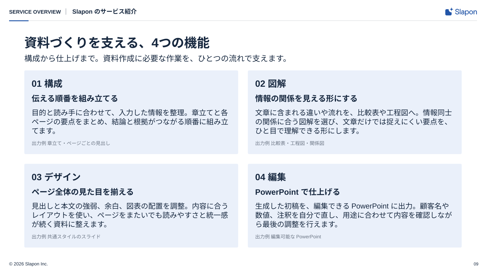

<!-- Generated from index.html#page-features. Edit index.html, not this file. -->

## 組合せ例 09｜説明カードの組

固定のページ型ではなく、図解部品の組み合わせ例。[共通ルール](../components/diagram-rules.md)に沿って部品数・配置・原稿量を調整する。

### 使用するコンポーネント

| 背景 | ヘッダー | 文字 | グリッド | 本文・主役 | フッター |
| --- | --- | --- | --- | --- | --- |
| BG01 | H01-Light | T01＋説明文 | G02を基点に段数可変 | P01＋T02＋T03 | F01-Light |

独立した機能・特徴を詳しく説明する



図解共通ルールを適用した再構成見本。文章・数値は原本のサンプルを保持。新しい資料の原稿ではありません。

2×2の淡い説明面。番号→項目→短い主張→本文→出力例の階層。

### 可変領域・収まらないとき

カード数・行数を原稿に合わせる

情報量を保持する。カードを埋めるために同じ意味の文を増やさない。

過去原本の読取座標（新見本の配置は仕様drawingに記載）

過去原本のレイヤー読取値は比較用に保持する。05〜12の再構成後の配置はdrawingの座標を使い、古い枠へ機械的に文字を押し込まない。

| 要素 | x | y | w | h | 扱い |
| --- | --- | --- | --- | --- | --- |
| カテゴリ | 30 | 25 | 190 | 26 | 原本サンプル。文字は差替え |
| 区切り | 232 | 25 | 8 | 26 | 原本サンプル。文字は差替え |
| パンくず | 252 | 25 | 1020 | 26 | 原本サンプル。文字は差替え |
| 見出し | 80 | 98 | 1440 | 50 | 原本サンプル。文字は差替え |
| 課題提起のサブタイトル | 80 | 168 | 1440 | 35 | 原本サンプル。文字は差替え |
| 機能番号 | 116 | 302 | 35 | 32 | 原本サンプル。文字は差替え |
| 機能名 | 167 | 298 | 577 | 40 | 原本サンプル。文字は差替え |
| 機能の要約 | 116 | 346 | 628 | 36 | 原本サンプル。文字は差替え |
| 機能の説明 | 116 | 385 | 628 | 93 | 原本サンプル。文字は差替え |
| 出力ラベル | 116 | 486 | 56 | 25 | 原本サンプル。文字は差替え |
| 出力内容 | 188 | 484 | 556 | 28 | 原本サンプル。文字は差替え |
| 機能番号 | 856 | 302 | 35 | 32 | 原本サンプル。文字は差替え |
| 機能名 | 907 | 298 | 577 | 40 | 原本サンプル。文字は差替え |
| 機能の要約 | 856 | 346 | 628 | 36 | 原本サンプル。文字は差替え |
| 機能の説明 | 856 | 385 | 628 | 93 | 原本サンプル。文字は差替え |
| 出力ラベル | 856 | 486 | 56 | 25 | 原本サンプル。文字は差替え |
| 出力内容 | 928 | 484 | 556 | 28 | 原本サンプル。文字は差替え |
| 機能番号 | 116 | 572 | 35 | 32 | 原本サンプル。文字は差替え |
| 機能名 | 167 | 568 | 577 | 40 | 原本サンプル。文字は差替え |
| 機能の要約 | 116 | 616 | 628 | 36 | 原本サンプル。文字は差替え |
| 機能の説明 | 116 | 655 | 628 | 93 | 原本サンプル。文字は差替え |
| 出力ラベル | 116 | 756 | 56 | 25 | 原本サンプル。文字は差替え |
| 出力内容 | 188 | 754 | 556 | 28 | 原本サンプル。文字は差替え |
| 機能番号 | 856 | 572 | 35 | 32 | 原本サンプル。文字は差替え |
| 機能名 | 907 | 568 | 577 | 40 | 原本サンプル。文字は差替え |
| 機能の要約 | 856 | 616 | 628 | 36 | 原本サンプル。文字は差替え |
| 機能の説明 | 856 | 655 | 628 | 93 | 原本サンプル。文字は差替え |
| 出力ラベル | 856 | 756 | 56 | 25 | 原本サンプル。文字は差替え |
| 出力内容 | 928 | 754 | 556 | 28 | 原本サンプル。文字は差替え |
| 著作権 | 30 | 860 | 800 | 17 | 原本サンプル。文字は差替え |
| ページ | 1520 | 860 | 55 | 17 | 原本サンプル。文字は差替え |

仕様データ

```
{
  "id": "features",
  "template_node": "45:27827",
  "purpose": "独立した機能・特徴を詳しく説明する",
  "recipe": "2×2の淡い説明面。番号→項目→短い主張→本文→出力例の階層。",
  "overflow": "情報量を保持する。カードを埋めるために同じ意味の文を増やさない。",
  "reference_nodes": [
    {
      "name": "カテゴリ",
      "type": "TEXT",
      "text": "SERVICE OVERVIEW",
      "x": 30,
      "y": 25,
      "w": 190,
      "h": 26
    },
    {
      "name": "区切り",
      "type": "TEXT",
      "text": "•",
      "x": 232,
      "y": 25,
      "w": 8,
      "h": 26
    },
    {
      "name": "パンくず",
      "type": "TEXT",
      "text": "Slapon のサービス紹介",
      "x": 252,
      "y": 25,
      "w": 1020,
      "h": 26
    },
    {
      "name": "見出し",
      "type": "TEXT",
      "text": "資料づくりを支える、4つの機能",
      "x": 80,
      "y": 98,
      "w": 1440,
      "h": 50
    },
    {
      "name": "課題提起のサブタイトル",
      "type": "TEXT",
      "text": "構成から仕上げまで。資料作成に必要な作業を、ひとつの流れで支えます。",
      "x": 80,
      "y": 168,
      "w": 1440,
      "h": 35
    },
    {
      "name": "機能番号",
      "type": "TEXT",
      "text": "01",
      "x": 116,
      "y": 302,
      "w": 35,
      "h": 32
    },
    {
      "name": "機能名",
      "type": "TEXT",
      "text": "構成",
      "x": 167,
      "y": 298,
      "w": 577,
      "h": 40
    },
    {
      "name": "機能の要約",
      "type": "TEXT",
      "text": "伝える順番を組み立てる",
      "x": 116,
      "y": 346,
      "w": 628,
      "h": 36
    },
    {
      "name": "機能の説明",
      "type": "TEXT",
      "text": "目的と読み手に合わせて、入力した情報を整理。\n章立てと各ページの要点をまとめ、結論と根拠が\nつながる順番に組み立てます。",
      "x": 116,
      "y": 385,
      "w": 628,
      "h": 93
    },
    {
      "name": "出力ラベル",
      "type": "TEXT",
      "text": "出力例",
      "x": 116,
      "y": 486,
      "w": 56,
      "h": 25
    },
    {
      "name": "出力内容",
      "type": "TEXT",
      "text": "章立て・ページごとの見出し",
      "x": 188,
      "y": 484,
      "w": 556,
      "h": 28
    },
    {
      "name": "機能番号",
      "type": "TEXT",
      "text": "02",
      "x": 856,
      "y": 302,
      "w": 35,
      "h": 32
    },
    {
      "name": "機能名",
      "type": "TEXT",
      "text": "図解",
      "x": 907,
      "y": 298,
      "w": 577,
      "h": 40
    },
    {
      "name": "機能の要約",
      "type": "TEXT",
      "text": "情報の関係を見える形にする",
      "x": 856,
      "y": 346,
      "w": 628,
      "h": 36
    },
    {
      "name": "機能の説明",
      "type": "TEXT",
      "text": "文章に含まれる違いや流れを、比較表や工程図へ。\n情報同士の関係に合う図解を選び、文章だけでは\n捉えにくい要点を、ひと目で理解できる形にします。",
      "x": 856,
      "y": 385,
      "w": 628,
      "h": 93
    },
    {
      "name": "出力ラベル",
      "type": "TEXT",
      "text": "出力例",
      "x": 856,
      "y": 486,
      "w": 56,
      "h": 25
    },
    {
      "name": "出力内容",
      "type": "TEXT",
      "text": "比較表・工程図・関係図",
      "x": 928,
      "y": 484,
      "w": 556,
      "h": 28
    },
    {
      "name": "機能番号",
      "type": "TEXT",
      "text": "03",
      "x": 116,
      "y": 572,
      "w": 35,
      "h": 32
    },
    {
      "name": "機能名",
      "type": "TEXT",
      "text": "デザイン",
      "x": 167,
      "y": 568,
      "w": 577,
      "h": 40
    },
    {
      "name": "機能の要約",
      "type": "TEXT",
      "text": "ページ全体の見た目を揃える",
      "x": 116,
      "y": 616,
      "w": 628,
      "h": 36
    },
    {
      "name": "機能の説明",
      "type": "TEXT",
      "text": "見出しと本文の強弱、余白、図表の配置を調整。\n内容に合うレイアウトを使い、ページをまたいでも\n読みやすさと統一感が続く資料に整えます。",
      "x": 116,
      "y": 655,
      "w": 628,
      "h": 93
    },
    {
      "name": "出力ラベル",
      "type": "TEXT",
      "text": "出力例",
      "x": 116,
      "y": 756,
      "w": 56,
      "h": 25
    },
    {
      "name": "出力内容",
      "type": "TEXT",
      "text": "共通スタイルのスライド",
      "x": 188,
      "y": 754,
      "w": 556,
      "h": 28
    },
    {
      "name": "機能番号",
      "type": "TEXT",
      "text": "04",
      "x": 856,
      "y": 572,
      "w": 35,
      "h": 32
    },
    {
      "name": "機能名",
      "type": "TEXT",
      "text": "編集",
      "x": 907,
      "y": 568,
      "w": 577,
      "h": 40
    },
    {
      "name": "機能の要約",
      "type": "TEXT",
      "text": "PowerPoint で仕上げる",
      "x": 856,
      "y": 616,
      "w": 628,
      "h": 36
    },
    {
      "name": "機能の説明",
      "type": "TEXT",
      "text": "生成した初稿を、編集できる PowerPoint に出力。\n顧客名や数値、注釈を自分で直し、用途に合わせて\n内容を確認しながら最後の調整を行えます。",
      "x": 856,
      "y": 655,
      "w": 628,
      "h": 93
    },
    {
      "name": "出力ラベル",
      "type": "TEXT",
      "text": "出力例",
      "x": 856,
      "y": 756,
      "w": 56,
      "h": 25
    },
    {
      "name": "出力内容",
      "type": "TEXT",
      "text": "編集可能な PowerPoint",
      "x": 928,
      "y": 754,
      "w": 556,
      "h": 28
    },
    {
      "name": "著作権",
      "type": "TEXT",
      "text": "© 2026 Slapon Inc.",
      "x": 30,
      "y": 860,
      "w": 800,
      "h": 17
    },
    {
      "name": "ページ",
      "type": "TEXT",
      "text": "03",
      "x": 1520,
      "y": 860,
      "w": 55,
      "h": 17
    }
  ],
  "geometry_status": "既存レイヤー読取情報。アウトラインのインク外接矩形と異なる場合がある。改行後はプレビュー照合。",
  "canvas": [
    1600,
    900
  ],
  "composition": {
    "background": "BG01",
    "header": "H01-Light",
    "typography": "T01＋説明文",
    "grid": "G02を上下2段 / 原本の2×2",
    "content": "P01＋T02＋T03",
    "footer": "F01-Light"
  },
  "composition_geometry_policy": "新しい作例はdrawingの座標で再構成。reference_nodesは過去原本の読取値で、新見本の配置値ではない。",
  "classification": "composition_example",
  "fixed_page_template": false,
  "reusable_components": "P01＋T02＋T03",
  "adaptation": "カード数・行数を原稿に合わせる",
  "common_rules": "components/diagram-rules.md",
  "drawing": {
    "canvas": [
      1600,
      900
    ],
    "nodes": [
      {
        "type": "text",
        "x": 30,
        "y": 28,
        "w": 167.0,
        "h": 30,
        "text": "SERVICE OVERVIEW",
        "size": 17,
        "role": "text",
        "line_height": 26,
        "align": "left",
        "font-weight": 700
      },
      {
        "type": "line",
        "x1": 217.0,
        "x2": 217.0,
        "y1": 28.0,
        "y2": 48.0,
        "role": "muted",
        "stroke-width": 1
      },
      {
        "type": "text",
        "x": 238.0,
        "y": 25,
        "w": 1198.0,
        "h": 30,
        "text": "Slapon のサービス紹介",
        "size": 20,
        "role": "text",
        "line_height": 26,
        "align": "left",
        "font-weight": 700
      },
      {
        "type": "line",
        "x1": 30,
        "y1": 68,
        "x2": 1570,
        "y2": 68,
        "role": "line",
        "stroke-width": 1
      },
      {
        "type": "rect",
        "x": 30,
        "y": 67,
        "width": 64,
        "height": 3,
        "rx": 0,
        "role": "main"
      },
      {
        "type": "text",
        "x": 80,
        "y": 114,
        "w": 1440,
        "h": 50,
        "text": "資料づくりを支える、4つの機能",
        "size": 42,
        "role": "text",
        "line_height": 50,
        "align": "left",
        "font-weight": 700
      },
      {
        "type": "text",
        "x": 80,
        "y": 176,
        "w": 1440,
        "h": 80,
        "text": "構成から仕上げまで。資料作成に必要な作業を、ひとつの流れで支えます。",
        "size": 26,
        "role": "text",
        "line_height": 39,
        "align": "left"
      },
      {
        "type": "text",
        "x": 1520,
        "y": 861,
        "w": 55,
        "h": 22,
        "text": "09",
        "size": 14,
        "role": "text",
        "line_height": 20,
        "align": "right"
      },
      {
        "type": "rect",
        "x": 80,
        "y": 232,
        "width": 704,
        "height": 276,
        "rx": 4,
        "role": "sub"
      },
      {
        "type": "text",
        "x": 104,
        "y": 256,
        "w": 656,
        "h": 36,
        "text": "01  構成",
        "size": 30,
        "role": "text",
        "line_height": 36,
        "align": "left",
        "font-weight": 700
      },
      {
        "type": "text",
        "x": 104,
        "y": 308,
        "w": 656,
        "h": 32,
        "text": "伝える順番を組み立てる",
        "size": 26,
        "role": "text",
        "line_height": 32,
        "align": "left",
        "font-weight": 700
      },
      {
        "type": "text",
        "x": 104,
        "y": 356,
        "w": 656,
        "h": 90,
        "text": "目的と読み手に合わせて、入力した情報を整理。章立てと各ページの要点をまとめ、結論と根拠がつながる順番に組み立てます。",
        "size": 24,
        "role": "text",
        "line_height": 30,
        "align": "left"
      },
      {
        "type": "text",
        "x": 104,
        "y": 462,
        "w": 656,
        "h": 22,
        "text": "出力例  章立て・ページごとの見出し",
        "size": 16,
        "role": "muted",
        "line_height": 22,
        "align": "left"
      },
      {
        "type": "rect",
        "x": 816,
        "y": 232,
        "width": 704,
        "height": 276,
        "rx": 4,
        "role": "sub"
      },
      {
        "type": "text",
        "x": 840,
        "y": 256,
        "w": 656,
        "h": 36,
        "text": "02  図解",
        "size": 30,
        "role": "text",
        "line_height": 36,
        "align": "left",
        "font-weight": 700
      },
      {
        "type": "text",
        "x": 840,
        "y": 308,
        "w": 656,
        "h": 32,
        "text": "情報の関係を見える形にする",
        "size": 26,
        "role": "text",
        "line_height": 32,
        "align": "left",
        "font-weight": 700
      },
      {
        "type": "text",
        "x": 840,
        "y": 356,
        "w": 656,
        "h": 90,
        "text": "文章に含まれる違いや流れを、比較表や工程図へ。情報同士の関係に合う図解を選び、文章だけでは捉えにくい要点を、ひと目で理解できる形にします。",
        "size": 24,
        "role": "text",
        "line_height": 30,
        "align": "left"
      },
      {
        "type": "text",
        "x": 840,
        "y": 462,
        "w": 656,
        "h": 22,
        "text": "出力例  比較表・工程図・関係図",
        "size": 16,
        "role": "muted",
        "line_height": 22,
        "align": "left"
      },
      {
        "type": "rect",
        "x": 80,
        "y": 540,
        "width": 704,
        "height": 276,
        "rx": 4,
        "role": "sub"
      },
      {
        "type": "text",
        "x": 104,
        "y": 564,
        "w": 656,
        "h": 36,
        "text": "03  デザイン",
        "size": 30,
        "role": "text",
        "line_height": 36,
        "align": "left",
        "font-weight": 700
      },
      {
        "type": "text",
        "x": 104,
        "y": 616,
        "w": 656,
        "h": 32,
        "text": "ページ全体の見た目を揃える",
        "size": 26,
        "role": "text",
        "line_height": 32,
        "align": "left",
        "font-weight": 700
      },
      {
        "type": "text",
        "x": 104,
        "y": 664,
        "w": 656,
        "h": 90,
        "text": "見出しと本文の強弱、余白、図表の配置を調整。内容に合うレイアウトを使い、ページをまたいでも読みやすさと統一感が続く資料に整えます。",
        "size": 24,
        "role": "text",
        "line_height": 30,
        "align": "left"
      },
      {
        "type": "text",
        "x": 104,
        "y": 770,
        "w": 656,
        "h": 22,
        "text": "出力例  共通スタイルのスライド",
        "size": 16,
        "role": "muted",
        "line_height": 22,
        "align": "left"
      },
      {
        "type": "rect",
        "x": 816,
        "y": 540,
        "width": 704,
        "height": 276,
        "rx": 4,
        "role": "sub"
      },
      {
        "type": "text",
        "x": 840,
        "y": 564,
        "w": 656,
        "h": 36,
        "text": "04  編集",
        "size": 30,
        "role": "text",
        "line_height": 36,
        "align": "left",
        "font-weight": 700
      },
      {
        "type": "text",
        "x": 840,
        "y": 616,
        "w": 656,
        "h": 32,
        "text": "PowerPoint で仕上げる",
        "size": 26,
        "role": "text",
        "line_height": 32,
        "align": "left",
        "font-weight": 700
      },
      {
        "type": "text",
        "x": 840,
        "y": 664,
        "w": 656,
        "h": 90,
        "text": "生成した初稿を、編集できる PowerPoint に出力。顧客名や数値、注釈を自分で直し、用途に合わせて内容を確認しながら最後の調整を行えます。",
        "size": 24,
        "role": "text",
        "line_height": 30,
        "align": "left"
      },
      {
        "type": "text",
        "x": 840,
        "y": 770,
        "w": 656,
        "h": 22,
        "text": "出力例  編集可能な PowerPoint",
        "size": 16,
        "role": "muted",
        "line_height": 22,
        "align": "left"
      }
    ],
    "header_layout": "H01 content_width; separator gaps 20px, glyph-center alignment",
    "title_spacing": "T01 y114 h50; subtitle y176 (12px gap)"
  },
  "rendering_basis": "2026-10-21利用者指示による図解共通ルール適用後の再構成見本。原本はassets/sourceに保存。",
  "applied_rules": {
    "card_padding": 24,
    "sibling_gap": 32,
    "card_radius": 4,
    "body_size": 24,
    "body_line_height": 30,
    "shadow": false,
    "card_height": 276,
    "header_long_category_size": 17,
    "footer_baseline": 875
  }
}
```
