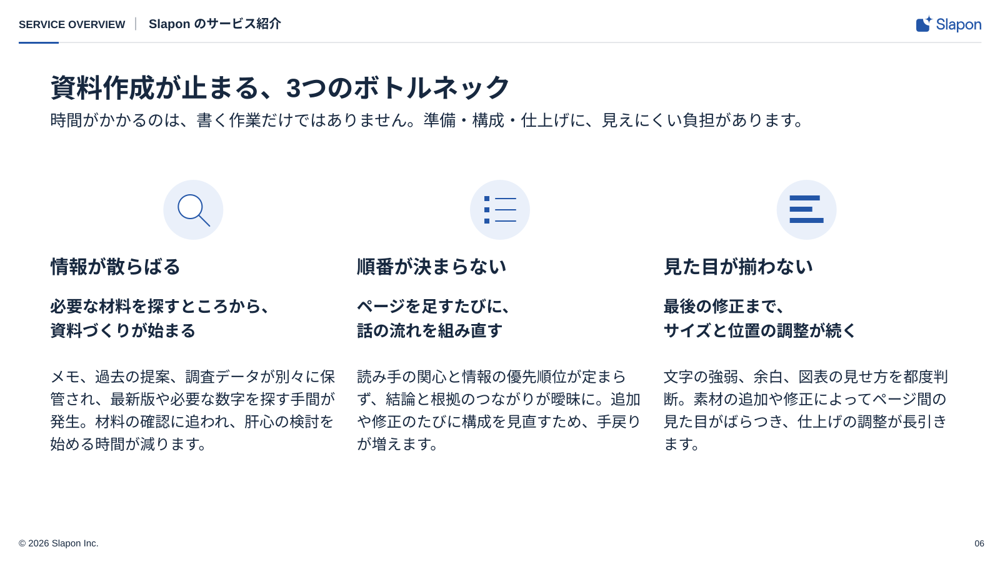

<!-- Generated from index.html#page-issues. Edit index.html, not this file. -->

## 組合せ例 06｜並列の項目

固定のページ型ではなく、図解部品の組み合わせ例。[共通ルール](../components/diagram-rules.md)に沿って部品数・配置・原稿量を調整する。

### 使用するコンポーネント

| 背景 | ヘッダー | 文字 | グリッド | 本文・主役 | フッター |
| --- | --- | --- | --- | --- | --- |
| BG01 | H01-Light | T01＋説明文 | G03を基点に可変 | P02＋T02＋T03 | F01-Light |

独立した課題を並列で比較する



図解共通ルールを適用した再構成見本。文章・数値は原本のサンプルを保持。新しい資料の原稿ではありません。

上段に見出しと説明、下段はアイコン面・項目名・小見出し・説明の3列。

### 可変領域・収まらないとき

項目数は原稿に合わせる。3つに固定しない

3列は見本。2〜4要素へ再配置可。長文は列幅と高さを再配分し、不要なカード化を増やさない。

過去原本の読取座標（新見本の配置は仕様drawingに記載）

過去原本のレイヤー読取値は比較用に保持する。05〜12の再構成後の配置はdrawingの座標を使い、古い枠へ機械的に文字を押し込まない。

| 要素 | x | y | w | h | 扱い |
| --- | --- | --- | --- | --- | --- |
| 課題の見出し | 80 | 451 | 450 | 49 | 原本サンプル。文字は差替え |
| 課題の要約 | 80 | 514 | 450 | 76 | 原本サンプル。文字は差替え |
| 課題の説明 | 80 | 615 | 450 | 144 | 原本サンプル。文字は差替え |
| 課題の見出し | 575 | 451 | 450 | 49 | 原本サンプル。文字は差替え |
| 課題の要約 | 575 | 514 | 450 | 76 | 原本サンプル。文字は差替え |
| 課題の説明 | 575 | 615 | 450 | 144 | 原本サンプル。文字は差替え |
| 課題の見出し | 1070 | 451 | 450 | 49 | 原本サンプル。文字は差替え |
| 課題の要約 | 1070 | 514 | 450 | 76 | 原本サンプル。文字は差替え |
| 課題の説明 | 1070 | 615 | 450 | 144 | 原本サンプル。文字は差替え |
| カテゴリ | 30 | 25 | 190 | 26 | 原本サンプル。文字は差替え |
| 区切り | 232 | 25 | 8 | 26 | 原本サンプル。文字は差替え |
| パンくず | 252 | 25 | 1020 | 26 | 原本サンプル。文字は差替え |
| 見出し | 80 | 98 | 1440 | 50 | 原本サンプル。文字は差替え |
| 課題提起のサブタイトル | 80 | 168 | 1440 | 35 | 原本サンプル。文字は差替え |
| 著作権 | 30 | 860 | 800 | 17 | 原本サンプル。文字は差替え |
| ページ | 1520 | 860 | 55 | 17 | 原本サンプル。文字は差替え |

仕様データ

```
{
  "id": "issues",
  "template_node": "45:27699",
  "purpose": "独立した課題を並列で比較する",
  "recipe": "上段に見出しと説明、下段はアイコン面・項目名・小見出し・説明の3列。",
  "overflow": "3列は見本。2〜4要素へ再配置可。長文は列幅と高さを再配分し、不要なカード化を増やさない。",
  "reference_nodes": [
    {
      "name": "課題の見出し",
      "type": "TEXT",
      "text": "情報が散らばる",
      "x": 80,
      "y": 451,
      "w": 450,
      "h": 49
    },
    {
      "name": "課題の要約",
      "type": "TEXT",
      "text": "必要な材料を探すところから、\n資料づくりが始まる",
      "x": 80,
      "y": 514,
      "w": 450,
      "h": 76
    },
    {
      "name": "課題の説明",
      "type": "TEXT",
      "text": "メモ、過去の提案、調査データが別々に\n保管され、最新版や必要な数字を探す\n手間が発生。材料の確認に追われ、\n肝心の検討を始める時間が減ります。",
      "x": 80,
      "y": 615,
      "w": 450,
      "h": 144
    },
    {
      "name": "課題の見出し",
      "type": "TEXT",
      "text": "順番が決まらない",
      "x": 575,
      "y": 451,
      "w": 450,
      "h": 49
    },
    {
      "name": "課題の要約",
      "type": "TEXT",
      "text": "ページを足すたびに、\n話の流れを組み直す",
      "x": 575,
      "y": 514,
      "w": 450,
      "h": 76
    },
    {
      "name": "課題の説明",
      "type": "TEXT",
      "text": "読み手の関心と情報の優先順位が\n定まらず、結論と根拠のつながりが\n曖昧に。追加や修正のたびに構成を\n見直すため、手戻りが増えます。",
      "x": 575,
      "y": 615,
      "w": 450,
      "h": 144
    },
    {
      "name": "課題の見出し",
      "type": "TEXT",
      "text": "見た目が揃わない",
      "x": 1070,
      "y": 451,
      "w": 450,
      "h": 49
    },
    {
      "name": "課題の要約",
      "type": "TEXT",
      "text": "最後の修正まで、\nサイズと位置の調整が続く",
      "x": 1070,
      "y": 514,
      "w": 450,
      "h": 76
    },
    {
      "name": "課題の説明",
      "type": "TEXT",
      "text": "文字の強弱、余白、図表の見せ方を\n都度判断。素材の追加や修正によって\nページ間の見た目がばらつき、\n仕上げの調整が長引きます。",
      "x": 1070,
      "y": 615,
      "w": 450,
      "h": 144
    },
    {
      "name": "カテゴリ",
      "type": "TEXT",
      "text": "SERVICE OVERVIEW",
      "x": 30,
      "y": 25,
      "w": 190,
      "h": 26
    },
    {
      "name": "区切り",
      "type": "TEXT",
      "text": "•",
      "x": 232,
      "y": 25,
      "w": 8,
      "h": 26
    },
    {
      "name": "パンくず",
      "type": "TEXT",
      "text": "Slapon のサービス紹介",
      "x": 252,
      "y": 25,
      "w": 1020,
      "h": 26
    },
    {
      "name": "見出し",
      "type": "TEXT",
      "text": "資料作成が止まる、3つのボトルネック",
      "x": 80,
      "y": 98,
      "w": 1440,
      "h": 50
    },
    {
      "name": "課題提起のサブタイトル",
      "type": "TEXT",
      "text": "時間がかかるのは、書く作業だけではありません。準備・構成・仕上げに、見えにくい負担があります。",
      "x": 80,
      "y": 168,
      "w": 1440,
      "h": 35
    },
    {
      "name": "著作権",
      "type": "TEXT",
      "text": "© 2026 Slapon Inc.",
      "x": 30,
      "y": 860,
      "w": 800,
      "h": 17
    },
    {
      "name": "ページ",
      "type": "TEXT",
      "text": "03",
      "x": 1520,
      "y": 860,
      "w": 55,
      "h": 17
    }
  ],
  "geometry_status": "既存レイヤー読取情報。アウトラインのインク外接矩形と異なる場合がある。改行後はプレビュー照合。",
  "canvas": [
    1600,
    900
  ],
  "composition": {
    "background": "BG01",
    "header": "H01-Light",
    "typography": "T01＋説明文",
    "grid": "G03 / 原本の3列へ微調整",
    "content": "P02＋T02＋T03",
    "footer": "F01-Light"
  },
  "composition_geometry_policy": "新しい作例はdrawingの座標で再構成。reference_nodesは過去原本の読取値で、新見本の配置値ではない。",
  "classification": "composition_example",
  "fixed_page_template": false,
  "reusable_components": "P02＋T02＋T03",
  "adaptation": "項目数は原稿に合わせる。3つに固定しない",
  "common_rules": "components/diagram-rules.md",
  "drawing": {
    "canvas": [
      1600,
      900
    ],
    "nodes": [
      {
        "type": "text",
        "x": 30,
        "y": 28,
        "w": 167.0,
        "h": 30,
        "text": "SERVICE OVERVIEW",
        "size": 17,
        "role": "text",
        "line_height": 26,
        "align": "left",
        "font-weight": 700
      },
      {
        "type": "line",
        "x1": 217.0,
        "x2": 217.0,
        "y1": 28.0,
        "y2": 48.0,
        "role": "muted",
        "stroke-width": 1
      },
      {
        "type": "text",
        "x": 238.0,
        "y": 25,
        "w": 1198.0,
        "h": 30,
        "text": "Slapon のサービス紹介",
        "size": 20,
        "role": "text",
        "line_height": 26,
        "align": "left",
        "font-weight": 700
      },
      {
        "type": "line",
        "x1": 30,
        "y1": 68,
        "x2": 1570,
        "y2": 68,
        "role": "line",
        "stroke-width": 1
      },
      {
        "type": "rect",
        "x": 30,
        "y": 67,
        "width": 64,
        "height": 3,
        "rx": 0,
        "role": "main"
      },
      {
        "type": "text",
        "x": 80,
        "y": 114,
        "w": 1440,
        "h": 50,
        "text": "資料作成が止まる、3つのボトルネック",
        "size": 42,
        "role": "text",
        "line_height": 50,
        "align": "left",
        "font-weight": 700
      },
      {
        "type": "text",
        "x": 80,
        "y": 176,
        "w": 1440,
        "h": 80,
        "text": "時間がかかるのは、書く作業だけではありません。準備・構成・仕上げに、見えにくい負担があります。",
        "size": 26,
        "role": "text",
        "line_height": 39,
        "align": "left"
      },
      {
        "type": "text",
        "x": 1520,
        "y": 861,
        "w": 55,
        "h": 22,
        "text": "06",
        "size": 14,
        "role": "text",
        "line_height": 20,
        "align": "right"
      },
      {
        "type": "circle",
        "cx": 309.33333333333337,
        "cy": 336,
        "r": 48,
        "role": "sub"
      },
      {
        "type": "circle",
        "cx": 304.33333333333337,
        "cy": 331,
        "r": 19,
        "role": "white",
        "stroke_role": "main",
        "stroke-width": 2
      },
      {
        "type": "line",
        "x1": 318.33333333333337,
        "y1": 345,
        "x2": 335.33333333333337,
        "y2": 362,
        "role": "main",
        "stroke-width": 2
      },
      {
        "type": "text",
        "x": 80.0,
        "y": 408,
        "w": 458.6666666666667,
        "h": 50,
        "text": "情報が散らばる",
        "size": 30,
        "role": "text",
        "line_height": 42,
        "align": "left",
        "font-weight": 700
      },
      {
        "type": "text",
        "x": 80.0,
        "y": 474,
        "w": 458.6666666666667,
        "h": 90,
        "text": "必要な材料を探すところから、\n資料づくりが始まる",
        "size": 26,
        "role": "text",
        "line_height": 39,
        "align": "left",
        "font-weight": 700
      },
      {
        "type": "text",
        "x": 80.0,
        "y": 588,
        "w": 458.6666666666667,
        "h": 216,
        "text": "メモ、過去の提案、調査データが別々に保管され、最新版や必要な数字を探す手間が発生。材料の確認に追われ、肝心の検討を始める時間が減ります。",
        "size": 24,
        "role": "text",
        "line_height": 36,
        "align": "left"
      },
      {
        "type": "circle",
        "cx": 800.0000000000001,
        "cy": 336,
        "r": 48,
        "role": "sub"
      },
      {
        "type": "rect",
        "x": 775.0000000000001,
        "y": 314,
        "width": 8,
        "height": 8,
        "rx": 0,
        "role": "main"
      },
      {
        "type": "line",
        "x1": 793.0000000000001,
        "y1": 318,
        "x2": 825.0000000000001,
        "y2": 318,
        "role": "main",
        "stroke-width": 2
      },
      {
        "type": "rect",
        "x": 775.0000000000001,
        "y": 332,
        "width": 8,
        "height": 8,
        "rx": 0,
        "role": "main"
      },
      {
        "type": "line",
        "x1": 793.0000000000001,
        "y1": 336,
        "x2": 825.0000000000001,
        "y2": 336,
        "role": "main",
        "stroke-width": 2
      },
      {
        "type": "rect",
        "x": 775.0000000000001,
        "y": 350,
        "width": 8,
        "height": 8,
        "rx": 0,
        "role": "main"
      },
      {
        "type": "line",
        "x1": 793.0000000000001,
        "y1": 354,
        "x2": 825.0000000000001,
        "y2": 354,
        "role": "main",
        "stroke-width": 2
      },
      {
        "type": "text",
        "x": 570.6666666666667,
        "y": 408,
        "w": 458.6666666666667,
        "h": 50,
        "text": "順番が決まらない",
        "size": 30,
        "role": "text",
        "line_height": 42,
        "align": "left",
        "font-weight": 700
      },
      {
        "type": "text",
        "x": 570.6666666666667,
        "y": 474,
        "w": 458.6666666666667,
        "h": 90,
        "text": "ページを足すたびに、\n話の流れを組み直す",
        "size": 26,
        "role": "text",
        "line_height": 39,
        "align": "left",
        "font-weight": 700
      },
      {
        "type": "text",
        "x": 570.6666666666667,
        "y": 588,
        "w": 458.6666666666667,
        "h": 216,
        "text": "読み手の関心と情報の優先順位が定まらず、結論と根拠のつながりが曖昧に。追加や修正のたびに構成を見直すため、手戻りが増えます。",
        "size": 24,
        "role": "text",
        "line_height": 36,
        "align": "left"
      },
      {
        "type": "circle",
        "cx": 1290.6666666666667,
        "cy": 336,
        "r": 48,
        "role": "sub"
      },
      {
        "type": "rect",
        "x": 1263.6666666666667,
        "y": 313,
        "width": 48,
        "height": 8,
        "rx": 0,
        "role": "main"
      },
      {
        "type": "rect",
        "x": 1263.6666666666667,
        "y": 331,
        "width": 36,
        "height": 8,
        "rx": 0,
        "role": "main"
      },
      {
        "type": "rect",
        "x": 1263.6666666666667,
        "y": 349,
        "width": 54,
        "height": 8,
        "rx": 0,
        "role": "main"
      },
      {
        "type": "text",
        "x": 1061.3333333333335,
        "y": 408,
        "w": 458.6666666666667,
        "h": 50,
        "text": "見た目が揃わない",
        "size": 30,
        "role": "text",
        "line_height": 42,
        "align": "left",
        "font-weight": 700
      },
      {
        "type": "text",
        "x": 1061.3333333333335,
        "y": 474,
        "w": 458.6666666666667,
        "h": 90,
        "text": "最後の修正まで、\nサイズと位置の調整が続く",
        "size": 26,
        "role": "text",
        "line_height": 39,
        "align": "left",
        "font-weight": 700
      },
      {
        "type": "text",
        "x": 1061.3333333333335,
        "y": 588,
        "w": 458.6666666666667,
        "h": 216,
        "text": "文字の強弱、余白、図表の見せ方を都度判断。素材の追加や修正によってページ間の見た目がばらつき、仕上げの調整が長引きます。",
        "size": 24,
        "role": "text",
        "line_height": 36,
        "align": "left"
      }
    ],
    "header_layout": "H01 content_width; separator gaps 20px, glyph-center alignment",
    "title_spacing": "T01 y114 h50; subtitle y176 (12px gap)"
  },
  "rendering_basis": "2026-10-21利用者指示による図解共通ルール適用後の再構成見本。原本はassets/sourceに保存。",
  "applied_rules": {
    "sibling_gap": 32,
    "icon_box": 64,
    "icon_circle": 96,
    "text_opacity": 1,
    "header_long_category_size": 17,
    "footer_baseline": 875
  }
}
```
