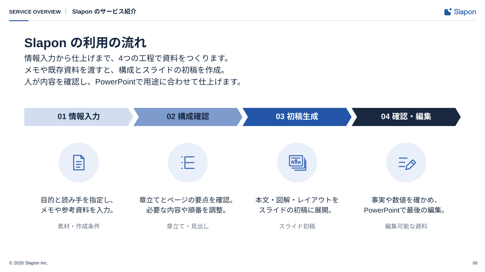

<!-- Generated from index.html#page-process. Edit index.html, not this file. -->

## 組合せ例 08｜工程・流れ

固定のページ型ではなく、図解部品の組み合わせ例。[共通ルール](../components/diagram-rules.md)に沿って部品数・配置・原稿量を調整する。

[連続シェブロン工程図](../components/process-flow.md)をSVGで使用。帯内部の接続は参照図に合わせ、アイコンと文章は工程ごとに中央へそろえる。

### 使用するコンポーネント

| 背景 | ヘッダー | 文字 | グリッド | 本文・主役 | フッター |
| --- | --- | --- | --- | --- | --- |
| BG01 | H01-Light | T01＋複数行の説明 | 工程数から帯幅を再計算 | P03＋P02＋P07＋T03 | F01-Light |

順序のある工程



図解共通ルールを適用した再構成見本。文章・数値は原本のサンプルを保持。新しい資料の原稿ではありません。

上段の連続シェブロンと、下のアイコン・説明・成果物を列ごとに対応させる。

### 可変領域・収まらないとき

順序のある情報だけに使う。4工程に固定しない

4工程固定にしない。順序のない比較へ流用しない。最も濃い面の文字はonmain。

過去原本の読取座標（新見本の配置は仕様drawingに記載）

過去原本のレイヤー読取値は比較用に保持する。05〜12の再構成後の配置はdrawingの座標を使い、古い枠へ機械的に文字を押し込まない。

| 要素 | x | y | w | h | 扱い |
| --- | --- | --- | --- | --- | --- |
| カテゴリ | 30 | 25 | 190 | 26 | 原本サンプル。文字は差替え |
| 区切り | 232 | 25 | 8 | 26 | 原本サンプル。文字は差替え |
| パンくず | 252 | 25 | 1020 | 26 | 原本サンプル。文字は差替え |
| 見出し | 80 | 98 | 1440 | 50 | 原本サンプル。文字は差替え |
| 課題提起のサブタイトル | 80 | 168 | 1440 | 105 | 原本サンプル。文字は差替え |
| 工程名 | 95 | 368 | 330 | 38 | 原本サンプル。文字は差替え |
| 工程の説明 | 80 | 647 | 360 | 66 | 原本サンプル。文字は差替え |
| 出力の種類 | 80 | 735 | 360 | 28 | 原本サンプル。文字は差替え |
| 工程名 | 455 | 368 | 330 | 38 | 原本サンプル。文字は差替え |
| 工程の説明 | 440 | 647 | 360 | 66 | 原本サンプル。文字は差替え |
| 出力の種類 | 440 | 735 | 360 | 28 | 原本サンプル。文字は差替え |
| 工程名 | 815 | 368 | 330 | 38 | 原本サンプル。文字は差替え |
| 工程の説明 | 800 | 647 | 360 | 66 | 原本サンプル。文字は差替え |
| 出力の種類 | 800 | 735 | 360 | 28 | 原本サンプル。文字は差替え |
| 工程名 | 1175 | 368 | 330 | 38 | 原本サンプル。文字は差替え |
| 工程の説明 | 1160 | 647 | 360 | 66 | 原本サンプル。文字は差替え |
| 出力の種類 | 1160 | 735 | 360 | 28 | 原本サンプル。文字は差替え |
| 著作権 | 30 | 860 | 800 | 17 | 原本サンプル。文字は差替え |
| ページ | 1520 | 860 | 55 | 17 | 原本サンプル。文字は差替え |

仕様データ

```
{
  "id": "process",
  "template_node": "45:27755",
  "purpose": "順序のある工程",
  "recipe": "上段の連続シェブロンと、下のアイコン・説明・成果物を列ごとに対応させる。",
  "overflow": "4工程固定にしない。順序のない比較へ流用しない。最も濃い面の文字はonmain。",
  "reference_nodes": [
    {
      "name": "カテゴリ",
      "type": "TEXT",
      "text": "SERVICE OVERVIEW",
      "x": 30,
      "y": 25,
      "w": 190,
      "h": 26
    },
    {
      "name": "区切り",
      "type": "TEXT",
      "text": "•",
      "x": 232,
      "y": 25,
      "w": 8,
      "h": 26
    },
    {
      "name": "パンくず",
      "type": "TEXT",
      "text": "Slapon のサービス紹介",
      "x": 252,
      "y": 25,
      "w": 1020,
      "h": 26
    },
    {
      "name": "見出し",
      "type": "TEXT",
      "text": "Slapon の利用の流れ",
      "x": 80,
      "y": 98,
      "w": 1440,
      "h": 50
    },
    {
      "name": "課題提起のサブタイトル",
      "type": "TEXT",
      "text": "情報入力から仕上げまで、4つの工程で資料をつくります。\nメモや既存資料を渡すと、構成とスライドの初稿を作成。\n人が内容を確認し、PowerPointで用途に合わせて仕上げます。",
      "x": 80,
      "y": 168,
      "w": 1440,
      "h": 105
    },
    {
      "name": "工程名",
      "type": "TEXT",
      "text": "01  情報入力",
      "x": 95,
      "y": 368,
      "w": 330,
      "h": 38
    },
    {
      "name": "工程の説明",
      "type": "TEXT",
      "text": "目的と読み手を指定し、\nメモや参考資料を入力。",
      "x": 80,
      "y": 647,
      "w": 360,
      "h": 66
    },
    {
      "name": "出力の種類",
      "type": "TEXT",
      "text": "素材・作成条件",
      "x": 80,
      "y": 735,
      "w": 360,
      "h": 28
    },
    {
      "name": "工程名",
      "type": "TEXT",
      "text": "02  構成確認",
      "x": 455,
      "y": 368,
      "w": 330,
      "h": 38
    },
    {
      "name": "工程の説明",
      "type": "TEXT",
      "text": "章立てとページの要点を確認。\n必要な内容や順番を調整。",
      "x": 440,
      "y": 647,
      "w": 360,
      "h": 66
    },
    {
      "name": "出力の種類",
      "type": "TEXT",
      "text": "章立て・見出し",
      "x": 440,
      "y": 735,
      "w": 360,
      "h": 28
    },
    {
      "name": "工程名",
      "type": "TEXT",
      "text": "03  初稿生成",
      "x": 815,
      "y": 368,
      "w": 330,
      "h": 38
    },
    {
      "name": "工程の説明",
      "type": "TEXT",
      "text": "本文・図解・レイアウトを\nスライドの初稿に展開。",
      "x": 800,
      "y": 647,
      "w": 360,
      "h": 66
    },
    {
      "name": "出力の種類",
      "type": "TEXT",
      "text": "スライド初稿",
      "x": 800,
      "y": 735,
      "w": 360,
      "h": 28
    },
    {
      "name": "工程名",
      "type": "TEXT",
      "text": "04  確認・編集",
      "x": 1175,
      "y": 368,
      "w": 330,
      "h": 38
    },
    {
      "name": "工程の説明",
      "type": "TEXT",
      "text": "事実や数値を確かめ、\nPowerPointで最後の編集。",
      "x": 1160,
      "y": 647,
      "w": 360,
      "h": 66
    },
    {
      "name": "出力の種類",
      "type": "TEXT",
      "text": "編集可能な資料",
      "x": 1160,
      "y": 735,
      "w": 360,
      "h": 28
    },
    {
      "name": "著作権",
      "type": "TEXT",
      "text": "© 2026 Slapon Inc.",
      "x": 30,
      "y": 860,
      "w": 800,
      "h": 17
    },
    {
      "name": "ページ",
      "type": "TEXT",
      "text": "03",
      "x": 1520,
      "y": 860,
      "w": 55,
      "h": 17
    }
  ],
  "geometry_status": "既存レイヤー読取情報。アウトラインのインク外接矩形と異なる場合がある。改行後はプレビュー照合。",
  "canvas": [
    1600,
    900
  ],
  "composition": {
    "background": "BG01",
    "header": "H01-Light",
    "typography": "T01＋複数行の説明",
    "grid": "G04の考え方 / 原本の連続帯は間隔0",
    "content": "P03＋P02＋P07＋T03",
    "footer": "F01-Light"
  },
  "composition_geometry_policy": "新しい作例はdrawingの座標で再構成。reference_nodesは過去原本の読取値で、新見本の配置値ではない。",
  "classification": "composition_example",
  "fixed_page_template": false,
  "reusable_components": "P03＋P02＋P07＋T03",
  "adaptation": "順序のある情報だけに使う。4工程に固定しない",
  "common_rules": "components/diagram-rules.md",
  "drawing": {
    "canvas": [
      1600,
      900
    ],
    "component_bounds": [
      80,
      357,
      1440,
      422
    ],
    "nodes": [
      {
        "type": "text",
        "x": 30,
        "y": 28,
        "w": 167.0,
        "h": 30,
        "text": "SERVICE OVERVIEW",
        "size": 17,
        "role": "text",
        "line_height": 26,
        "align": "left",
        "font-weight": 700
      },
      {
        "type": "line",
        "x1": 217.0,
        "x2": 217.0,
        "y1": 28.0,
        "y2": 48.0,
        "role": "muted",
        "stroke-width": 1
      },
      {
        "type": "text",
        "x": 238.0,
        "y": 25,
        "w": 1198.0,
        "h": 30,
        "text": "Slapon のサービス紹介",
        "size": 20,
        "role": "text",
        "line_height": 26,
        "align": "left",
        "font-weight": 700
      },
      {
        "type": "line",
        "x1": 30,
        "y1": 68,
        "x2": 1570,
        "y2": 68,
        "role": "line",
        "stroke-width": 1
      },
      {
        "type": "rect",
        "x": 30,
        "y": 67,
        "width": 64,
        "height": 3,
        "rx": 0,
        "role": "main"
      },
      {
        "type": "text",
        "x": 80,
        "y": 114,
        "w": 1440,
        "h": 50,
        "text": "Slapon の利用の流れ",
        "size": 42,
        "role": "text",
        "line_height": 50,
        "align": "left",
        "font-weight": 700
      },
      {
        "type": "text",
        "x": 80,
        "y": 176,
        "w": 1440,
        "h": 120,
        "text": "情報入力から仕上げまで、4つの工程で資料をつくります。\nメモや既存資料を渡すと、構成とスライドの初稿を作成。\n人が内容を確認し、PowerPointで用途に合わせて仕上げます。",
        "size": 26,
        "role": "text",
        "line_height": 39,
        "align": "left"
      },
      {
        "type": "text",
        "x": 1520,
        "y": 861,
        "w": 55,
        "h": 22,
        "text": "08",
        "size": 14,
        "role": "text",
        "line_height": 20,
        "align": "right"
      },
      {
        "type": "asset",
        "asset": "figma/process-flow/chevron-01.svg",
        "x": 80,
        "y": 357,
        "paint_map": {
          "#D6D6D6": "series4"
        },
        "component": true
      },
      {
        "type": "text",
        "x": 95,
        "y": 368,
        "w": 330,
        "h": 40,
        "text": "01  情報入力",
        "size": 26,
        "role": "text",
        "line_height": 37.7,
        "align": "center",
        "font-weight": 700,
        "component": true
      },
      {
        "type": "asset",
        "asset": "figma/process-flow/icon-circle.svg",
        "x": 194,
        "y": 472,
        "paint_map": {
          "#F6F6F6": "sub"
        },
        "component": true
      },
      {
        "type": "asset",
        "asset": "figma/process-flow/icon-01.svg",
        "x": 241.5,
        "y": 512.5,
        "paint_map": {
          "#212121": "main"
        },
        "component": true
      },
      {
        "type": "text",
        "x": 80,
        "y": 647,
        "w": 360,
        "h": 68,
        "text": "目的と読み手を指定し、\nメモや参考資料を入力。",
        "size": 23,
        "role": "text",
        "line_height": 33.35,
        "align": "center",
        "font-weight": 400,
        "component": true
      },
      {
        "type": "text",
        "x": 80,
        "y": 736,
        "w": 360,
        "h": 30,
        "text": "素材・作成条件",
        "size": 20,
        "role": "muted",
        "line_height": 28,
        "align": "center",
        "font-weight": 400,
        "component": true
      },
      {
        "type": "asset",
        "asset": "figma/process-flow/chevron-02.svg",
        "x": 440,
        "y": 357,
        "paint_map": {
          "#A6A6A6": "series2"
        },
        "component": true
      },
      {
        "type": "text",
        "x": 455,
        "y": 368,
        "w": 330,
        "h": 40,
        "text": "02  構成確認",
        "size": 26,
        "role": "text",
        "line_height": 37.7,
        "align": "center",
        "font-weight": 700,
        "component": true
      },
      {
        "type": "asset",
        "asset": "figma/process-flow/icon-circle.svg",
        "x": 554,
        "y": 472,
        "paint_map": {
          "#F6F6F6": "sub"
        },
        "component": true
      },
      {
        "type": "asset",
        "asset": "figma/process-flow/icon-02.svg",
        "x": 598.5,
        "y": 517.5,
        "paint_map": {
          "#212121": "main"
        },
        "component": true
      },
      {
        "type": "text",
        "x": 440,
        "y": 647,
        "w": 360,
        "h": 68,
        "text": "章立てとページの要点を確認。\n必要な内容や順番を調整。",
        "size": 23,
        "role": "text",
        "line_height": 33.35,
        "align": "center",
        "font-weight": 400,
        "component": true
      },
      {
        "type": "text",
        "x": 440,
        "y": 736,
        "w": 360,
        "h": 30,
        "text": "章立て・見出し",
        "size": 20,
        "role": "muted",
        "line_height": 28,
        "align": "center",
        "font-weight": 400,
        "component": true
      },
      {
        "type": "asset",
        "asset": "figma/process-flow/chevron-03.svg",
        "x": 800,
        "y": 357,
        "paint_map": {
          "#7A7A7A": "main"
        },
        "component": true
      },
      {
        "type": "text",
        "x": 815,
        "y": 368,
        "w": 330,
        "h": 40,
        "text": "03  初稿生成",
        "size": 26,
        "role": "white",
        "line_height": 37.7,
        "align": "center",
        "font-weight": 700,
        "component": true
      },
      {
        "type": "asset",
        "asset": "figma/process-flow/icon-circle.svg",
        "x": 914,
        "y": 472,
        "paint_map": {
          "#F6F6F6": "sub"
        },
        "component": true
      },
      {
        "type": "asset",
        "asset": "figma/process-flow/icon-03.svg",
        "x": 953.5,
        "y": 513.5,
        "paint_map": {
          "#212121": "main"
        },
        "component": true
      },
      {
        "type": "text",
        "x": 800,
        "y": 647,
        "w": 360,
        "h": 68,
        "text": "本文・図解・レイアウトを\nスライドの初稿に展開。",
        "size": 23,
        "role": "text",
        "line_height": 33.35,
        "align": "center",
        "font-weight": 400,
        "component": true
      },
      {
        "type": "text",
        "x": 800,
        "y": 736,
        "w": 360,
        "h": 30,
        "text": "スライド初稿",
        "size": 20,
        "role": "muted",
        "line_height": 28,
        "align": "center",
        "font-weight": 400,
        "component": true
      },
      {
        "type": "asset",
        "asset": "figma/process-flow/chevron-04.svg",
        "x": 1160,
        "y": 357,
        "paint_map": {
          "#212121": "text"
        },
        "component": true
      },
      {
        "type": "text",
        "x": 1175,
        "y": 368,
        "w": 330,
        "h": 40,
        "text": "04  確認・編集",
        "size": 26,
        "role": "white",
        "line_height": 37.7,
        "align": "center",
        "font-weight": 700,
        "component": true
      },
      {
        "type": "asset",
        "asset": "figma/process-flow/icon-circle.svg",
        "x": 1274,
        "y": 472,
        "paint_map": {
          "#F6F6F6": "sub"
        },
        "component": true
      },
      {
        "type": "asset",
        "asset": "figma/process-flow/icon-04.svg",
        "x": 1315.5,
        "y": 521.5,
        "paint_map": {
          "#212121": "main"
        },
        "component": true
      },
      {
        "type": "text",
        "x": 1160,
        "y": 647,
        "w": 360,
        "h": 68,
        "text": "事実や数値を確かめ、\nPowerPointで最後の編集。",
        "size": 23,
        "role": "text",
        "line_height": 33.35,
        "align": "center",
        "font-weight": 400,
        "component": true
      },
      {
        "type": "text",
        "x": 1160,
        "y": 736,
        "w": 360,
        "h": 30,
        "text": "編集可能な資料",
        "size": 20,
        "role": "muted",
        "line_height": 28,
        "align": "center",
        "font-weight": 400,
        "component": true
      }
    ],
    "header_layout": "H01 content_width; separator gaps 20px, glyph-center alignment",
    "title_spacing": "T01 y114 h50; subtitle y176 (12px gap)"
  },
  "rendering_basis": "2026-10-21利用者指定FigmaのSVGをローカルに保存し、形状・重なり・native寸法を保持。色は明示した役割マップで顧客へ適用。",
  "applied_rules": {
    "reference": "107:8778",
    "geometry": "参照Figmaの360×60シェブロン4列・列間0・アイコン背景132・線画64枠を継承",
    "shape": "downloaded SVG paths; native width/height unchanged",
    "color_roles": [
      "series4",
      "series2",
      "main",
      "text"
    ],
    "body_type": [
      23,
      33.35
    ],
    "output_type": [
      20,
      28
    ],
    "icon_stroke": 3,
    "opacity": 1,
    "internal_spacing_exception": "連続帯はP03一部品。汎用の部品間32pxを4工程の間に挿入しない。",
    "footer_baseline": 875
  },
  "reference": {
    "fileKey": "yZRuVrGDlV496zazD5AqGf",
    "nodeId": "107:8778",
    "url": "https://www.figma.com/design/yZRuVrGDlV496zazD5AqGf/?node-id=107-8778"
  }
}
```
