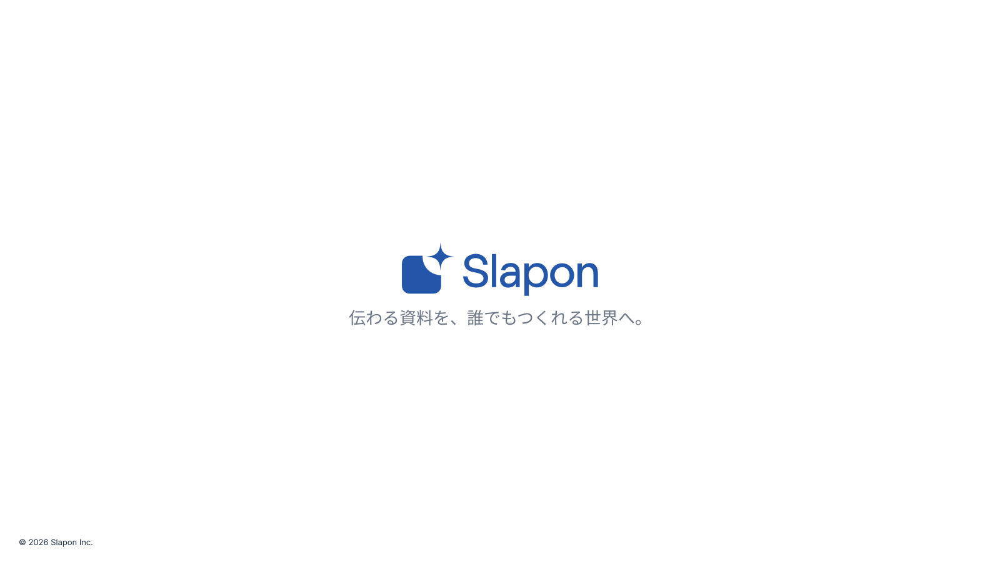

<!-- Generated from index.html#page-closing. Edit index.html, not this file. -->

## 13 クロージング

### 使用するコンポーネント

| 背景 | ヘッダー | 文字 | グリッド | 本文・主役 | フッター |
| --- | --- | --- | --- | --- | --- |
| BG01 | なし | 短い締めの言葉 | G自由 / 中央ロゴ | 正式ロゴ＋タグライン | 発行元のみ |

資料を静かに締める



原本の文章・数値はデザイン確認用。新しい資料の原稿ではありません。

中央に正式ロゴと短い締めの言葉。白背景と広い余白。下端に社名。

### 可変領域・収まらないとき

連絡先は提供時だけ。中央ロゴがない場合は社名テキストを使用。

領域と読取座標（参照px）

過去原本のレイヤー読取値は比較用に保持する。05〜12の再構成後の配置はdrawingの座標を使い、古い枠へ機械的に文字を押し込まない。

| 要素 | x | y | w | h | 扱い |
| --- | --- | --- | --- | --- | --- |
| Tagline | 527 | 489 | 547 | 41 | 原本サンプル。文字は差替え |
| 著作権 | 30 | 860 | 800 | 17 | 原本サンプル。文字は差替え |

仕様データ

```
{
  "id": "closing",
  "template_node": "45:28098",
  "purpose": "資料を静かに締める",
  "recipe": "中央に正式ロゴと短い締めの言葉。白背景と広い余白。下端に社名。",
  "overflow": "連絡先は提供時だけ。中央ロゴがない場合は社名テキストを使用。",
  "reference_nodes": [
    {
      "name": "Tagline",
      "type": "TEXT",
      "text": "伝わる資料を、誰でもつくれる世界へ。",
      "x": 527,
      "y": 489,
      "w": 547,
      "h": 41
    },
    {
      "name": "著作権",
      "type": "TEXT",
      "text": "© 2026 Slapon Inc.",
      "x": 30,
      "y": 860,
      "w": 800,
      "h": 17
    }
  ],
  "geometry_status": "既存レイヤー読取情報。アウトラインのインク外接矩形と異なる場合がある。改行後はプレビュー照合。",
  "canvas": [
    1600,
    900
  ],
  "composition": {
    "background": "BG01",
    "header": "なし",
    "typography": "短い締めの言葉",
    "grid": "G自由 / 中央ロゴ",
    "content": "正式ロゴ＋タグライン",
    "footer": "発行元のみ"
  },
  "composition_geometry_policy": "部品の考え方と原本の構成を対応させた索引。既存作例のSVG・原本座標は変更しない。"
}
```
