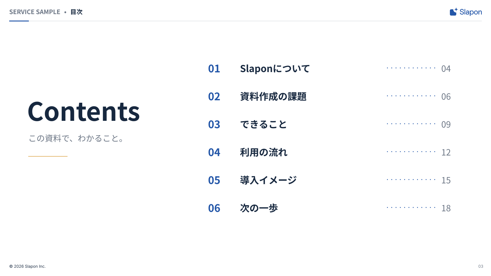

<!-- Generated from index.html#page-contents. Edit index.html, not this file. -->

## 02 目次

### 使用するコンポーネント

| 背景 | ヘッダー | 文字 | グリッド | 本文・主役 | フッター |
| --- | --- | --- | --- | --- | --- |
| BG01 | H01-Light | Contentsの原本配置 | G05の考え方 / 原本の左右配置 | 章番号＋章名＋ページ | F01-Light |

章立てと読み順を示す



原本の文章・数値はデザイン確認用。新しい資料の原稿ではありません。

左にContentsと短い説明、右に章番号・名称・ページ。横線や章番号でまとまりを示す。

### 可変領域・収まらないとき

章の数、ページ番号は実際の構成に合わせる。6章固定にしない。

領域と読取座標（参照px）

過去原本のレイヤー読取値は比較用に保持する。05〜12の再構成後の配置はdrawingの座標を使い、古い枠へ機械的に文字を押し込まない。

| 要素 | x | y | w | h | 扱い |
| --- | --- | --- | --- | --- | --- |
| カテゴリ | 30 | 25 | 167 | 26 | 原本サンプル。文字は差替え |
| 区切り | 209 | 25 | 8 | 26 | 原本サンプル。文字は差替え |
| パンくず | 229 | 25 | 1020 | 26 | 原本サンプル。文字は差替え |
| Contents | 88 | 315 | 535 | 125 | 原本サンプル。文字は差替え |
| この資料で、わかること。 | 92 | 431 | 500 | 41 | 原本サンプル。文字は差替え |
| Number | 678 | 198 | 75 | 51 | 原本サンプル。文字は差替え |
| Title | 782 | 200 | 450 | 47 | 原本サンプル。文字は差替え |
| Page | 1438 | 202 | 65 | 42 | 原本サンプル。文字は差替え |
| Number | 678 | 289 | 75 | 51 | 原本サンプル。文字は差替え |
| Title | 782 | 291 | 450 | 47 | 原本サンプル。文字は差替え |
| Page | 1438 | 293 | 65 | 42 | 原本サンプル。文字は差替え |
| Number | 678 | 380 | 75 | 51 | 原本サンプル。文字は差替え |
| Title | 782 | 382 | 450 | 47 | 原本サンプル。文字は差替え |
| Page | 1438 | 384 | 65 | 42 | 原本サンプル。文字は差替え |
| Number | 678 | 471 | 75 | 51 | 原本サンプル。文字は差替え |
| Title | 782 | 473 | 450 | 47 | 原本サンプル。文字は差替え |
| Page | 1438 | 475 | 65 | 42 | 原本サンプル。文字は差替え |
| Number | 678 | 562 | 75 | 51 | 原本サンプル。文字は差替え |
| Title | 782 | 564 | 450 | 47 | 原本サンプル。文字は差替え |
| Page | 1438 | 566 | 65 | 42 | 原本サンプル。文字は差替え |
| Number | 678 | 653 | 75 | 51 | 原本サンプル。文字は差替え |
| Title | 782 | 655 | 450 | 47 | 原本サンプル。文字は差替え |
| Page | 1438 | 657 | 65 | 42 | 原本サンプル。文字は差替え |
| 著作権 | 30 | 860 | 800 | 17 | 原本サンプル。文字は差替え |
| ページ | 1520 | 860 | 55 | 17 | 原本サンプル。文字は差替え |

仕様データ

```
{
  "id": "contents",
  "template_node": "30:27315",
  "purpose": "章立てと読み順を示す",
  "recipe": "左にContentsと短い説明、右に章番号・名称・ページ。横線や章番号でまとまりを示す。",
  "overflow": "章の数、ページ番号は実際の構成に合わせる。6章固定にしない。",
  "reference_nodes": [
    {
      "name": "カテゴリ",
      "type": "TEXT",
      "text": "SERVICE SAMPLE",
      "x": 30,
      "y": 25,
      "w": 167,
      "h": 26
    },
    {
      "name": "区切り",
      "type": "TEXT",
      "text": "•",
      "x": 209,
      "y": 25,
      "w": 8,
      "h": 26
    },
    {
      "name": "パンくず",
      "type": "TEXT",
      "text": "目次",
      "x": 229,
      "y": 25,
      "w": 1020,
      "h": 26
    },
    {
      "name": "Contents",
      "type": "TEXT",
      "text": "Contents",
      "x": 88,
      "y": 315,
      "w": 535,
      "h": 125
    },
    {
      "name": "この資料で、わかること。",
      "type": "TEXT",
      "text": "この資料で、わかること。",
      "x": 92,
      "y": 431,
      "w": 500,
      "h": 41
    },
    {
      "name": "Number",
      "type": "TEXT",
      "text": "01",
      "x": 678,
      "y": 198,
      "w": 75,
      "h": 51
    },
    {
      "name": "Title",
      "type": "TEXT",
      "text": "Slaponについて",
      "x": 782,
      "y": 200,
      "w": 450,
      "h": 47
    },
    {
      "name": "Page",
      "type": "TEXT",
      "text": "04",
      "x": 1438,
      "y": 202,
      "w": 65,
      "h": 42
    },
    {
      "name": "Number",
      "type": "TEXT",
      "text": "02",
      "x": 678,
      "y": 289,
      "w": 75,
      "h": 51
    },
    {
      "name": "Title",
      "type": "TEXT",
      "text": "資料作成の課題",
      "x": 782,
      "y": 291,
      "w": 450,
      "h": 47
    },
    {
      "name": "Page",
      "type": "TEXT",
      "text": "06",
      "x": 1438,
      "y": 293,
      "w": 65,
      "h": 42
    },
    {
      "name": "Number",
      "type": "TEXT",
      "text": "03",
      "x": 678,
      "y": 380,
      "w": 75,
      "h": 51
    },
    {
      "name": "Title",
      "type": "TEXT",
      "text": "できること",
      "x": 782,
      "y": 382,
      "w": 450,
      "h": 47
    },
    {
      "name": "Page",
      "type": "TEXT",
      "text": "09",
      "x": 1438,
      "y": 384,
      "w": 65,
      "h": 42
    },
    {
      "name": "Number",
      "type": "TEXT",
      "text": "04",
      "x": 678,
      "y": 471,
      "w": 75,
      "h": 51
    },
    {
      "name": "Title",
      "type": "TEXT",
      "text": "利用の流れ",
      "x": 782,
      "y": 473,
      "w": 450,
      "h": 47
    },
    {
      "name": "Page",
      "type": "TEXT",
      "text": "12",
      "x": 1438,
      "y": 475,
      "w": 65,
      "h": 42
    },
    {
      "name": "Number",
      "type": "TEXT",
      "text": "05",
      "x": 678,
      "y": 562,
      "w": 75,
      "h": 51
    },
    {
      "name": "Title",
      "type": "TEXT",
      "text": "導入イメージ",
      "x": 782,
      "y": 564,
      "w": 450,
      "h": 47
    },
    {
      "name": "Page",
      "type": "TEXT",
      "text": "15",
      "x": 1438,
      "y": 566,
      "w": 65,
      "h": 42
    },
    {
      "name": "Number",
      "type": "TEXT",
      "text": "06",
      "x": 678,
      "y": 653,
      "w": 75,
      "h": 51
    },
    {
      "name": "Title",
      "type": "TEXT",
      "text": "次の一歩",
      "x": 782,
      "y": 655,
      "w": 450,
      "h": 47
    },
    {
      "name": "Page",
      "type": "TEXT",
      "text": "18",
      "x": 1438,
      "y": 657,
      "w": 65,
      "h": 42
    },
    {
      "name": "著作権",
      "type": "TEXT",
      "text": "© 2026 Slapon Inc.",
      "x": 30,
      "y": 860,
      "w": 800,
      "h": 17
    },
    {
      "name": "ページ",
      "type": "TEXT",
      "text": "03",
      "x": 1520,
      "y": 860,
      "w": 55,
      "h": 17
    }
  ],
  "geometry_status": "既存レイヤー読取情報。アウトラインのインク外接矩形と異なる場合がある。改行後はプレビュー照合。",
  "canvas": [
    1600,
    900
  ],
  "composition": {
    "background": "BG01",
    "header": "H01-Light",
    "typography": "Contentsの原本配置",
    "grid": "G05の考え方 / 原本の左右配置",
    "content": "章番号＋章名＋ページ",
    "footer": "F01-Light"
  },
  "composition_geometry_policy": "部品の考え方と原本の構成を対応させた索引。既存作例のSVG・原本座標は変更しない。"
}
```
