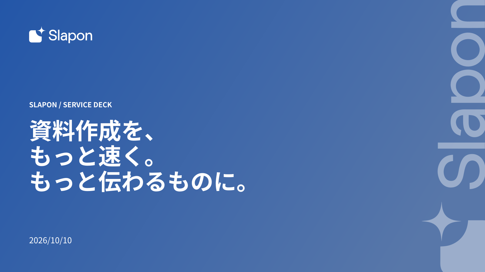

<!-- Generated from index.html#page-cover. Edit index.html, not this file. -->

## 01 表紙

### 使用するコンポーネント

| 背景 | ヘッダー | 文字 | グリッド | 本文・主役 | フッター |
| --- | --- | --- | --- | --- | --- |
| BG03 / 原本のグラデーション | なし（ロゴ枠は独立） | T-COVER | G自由 / 左基準x96 | 左上ロゴ＋主題＋日付＋D01縦ロゴ透かし | なし |

資料の主題を示す



原本の文章・数値はデザイン確認用。新しい資料の原稿ではありません。

主色グラデーションの左に大きい主題。上部ロゴ・下部日付。右端にD01縦ロゴ透かしを置く。顧客版は正式ロゴの白版を同比率枠へ収め、−90°回転・不透明度40%で配置する。

### 可変領域・収まらないとき

表紙3行は見本。短い主題は1〜2行でよい。副題との距離を保つ。

領域と読取座標（参照px）

過去原本のレイヤー読取値は比較用に保持する。05〜12の再構成後の配置はdrawingの座標を使い、古い枠へ機械的に文字を押し込まない。

| 要素 | x | y | w | h | 扱い |
| --- | --- | --- | --- | --- | --- |
| Eyebrow | 96 | 329 | 950 | 35 | 原本サンプル。文字は差替え |
| Title | 96 | 389 | 1100 | 114 | 原本サンプル。文字は差替え |
| Subtitle | 96 | 683 | 900 | 42 | 原本サンプル。文字は差替え |
| 構成からPowerPoint出力まで、AIと一緒に。 | 96 | 775 | 725 | 46 | 原本サンプル。文字は差替え |

仕様データ

```
{
  "id": "cover",
  "template_node": "30:27458",
  "purpose": "資料の主題を示す",
  "recipe": "主色グラデーションの左に主題。上部ロゴ・下部日付。右端にD01縦ロゴ透かし。顧客版は白版正式ロゴを−90°回転、不透明度40%で配置し、スライド境界でクリップする。",
  "overflow": "表紙3行は見本。短い主題は1〜2行でよい。副題との距離を保つ。",
  "reference_nodes": [
    {
      "name": "Eyebrow",
      "type": "TEXT",
      "text": "SLAPON / SERVICE DECK",
      "x": 96,
      "y": 329,
      "w": 950,
      "h": 35
    },
    {
      "name": "Title",
      "type": "TEXT",
      "text": "資料作成を、\nもっと速く。\nもっと伝わるものに。",
      "x": 96,
      "y": 389,
      "w": 1100,
      "h": 114
    },
    {
      "name": "Subtitle",
      "type": "TEXT",
      "text": "構成から図解、デザイン、編集まで。",
      "x": 96,
      "y": 683,
      "w": 900,
      "h": 42
    },
    {
      "name": "構成からPowerPoint出力まで、AIと一緒に。",
      "type": "TEXT",
      "text": "2026/10/10",
      "x": 96,
      "y": 775,
      "w": 725,
      "h": 46
    }
  ],
  "geometry_status": "既存レイヤー読取情報。アウトラインのインク外接矩形と異なる場合がある。改行後はプレビュー照合。",
  "canvas": [
    1600,
    900
  ],
  "composition": {
    "background": "BG03 / 原本のグラデーション",
    "header": "なし（ロゴ枠は独立）",
    "typography": "T-COVER",
    "grid": "G自由 / 左基準x96",
    "content": "左上ロゴ＋主題＋日付＋D01縦ロゴ透かし",
    "footer": "なし"
  },
  "composition_geometry_policy": "部品の考え方と原本の構成を対応させた索引。既存作例のSVG・原本座標は変更しない。",
  "decoration_component": "D01"
}
```
