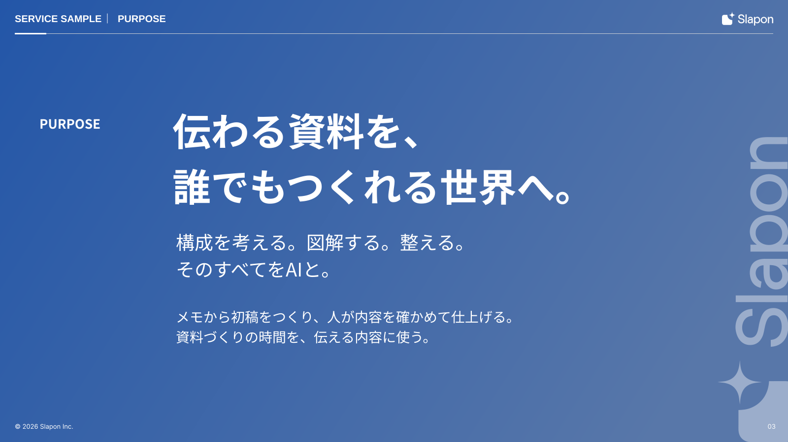

<!-- Generated from index.html#page-message. Edit index.html, not this file. -->

## 03 メッセージ

### 使用するコンポーネント

| 背景 | ヘッダー | 文字 | グリッド | 本文・主役 | フッター |
| --- | --- | --- | --- | --- | --- |
| BG03 | H01-Dark | T-LEAD / 原本の主題配置 | G01の一部 / 左寄り | 主張＋短い補助説明＋D02縦ロゴ透かし | F01-Dark |

一つの主張を強く伝える



原本の文章・数値はデザイン確認用。新しい資料の原稿ではありません。

主色の面に白い主題と短い補助説明。右下にD02縦ロゴ透かしを置き、本文ページとは文字の階層を変える。

ヘッダー左の短線はH01-Darkに合わせて白（onmain）。左右の余白は各30px、短線はx30 / y67 / w64 / h3とする。

### 可変領域・収まらないとき

長文の本文を押し込まない。右端はD02の透かし領域として確保し、文字の輪郭をx1421より左へ収める。

領域と読取座標（参照px）

過去原本のレイヤー読取値は比較用に保持する。05〜12の再構成後の配置はdrawingの座標を使い、古い枠へ機械的に文字を押し込まない。

| 要素 | x | y | w | h | 扱い |
| --- | --- | --- | --- | --- | --- |
| PURPOSE | 80 | 233 | 240 | 39 | 原本サンプル。文字は差替え |
| 伝わる資料を、 | 350 | 209 | 1170 | 117 | 原本サンプル。文字は差替え |
| 構成を考える。図解する。整える。 | 357 | 465 | 1050 | 57 | 原本サンプル。文字は差替え |
| メモから初稿をつくり、人が内容を確かめて仕上げる。 | 357 | 624 | 1040 | 42 | 原本サンプル。文字は差替え |
| カテゴリ | 30 | 25 | 167 | 26 | 原本サンプル。文字は差替え |
| 区切り | 209 | 25 | 8 | 26 | 原本サンプル。文字は差替え |
| パンくず | 229 | 25 | 1020 | 26 | 原本サンプル。文字は差替え |
| 著作権 | 30 | 860 | 800 | 17 | 原本サンプル。文字は差替え |
| ページ | 1520 | 860 | 55 | 17 | 原本サンプル。文字は差替え |

仕様データ

```
{
  "id": "message",
  "template_node": "30:27418",
  "purpose": "一つの主張を強く伝える",
  "recipe": "主色の面に白い主題と短い補助説明。右下にD02縦ロゴ透かし。本文ページとは文字の階層を変える。",
  "overflow": "長文の本文を押し込まない。右端はD02の透かし領域として確保し、文字の輪郭をx1421より左へ収める。",
  "reference_nodes": [
    {
      "name": "PURPOSE",
      "type": "TEXT",
      "text": "PURPOSE",
      "x": 80,
      "y": 233,
      "w": 240,
      "h": 39
    },
    {
      "name": "伝わる資料を、",
      "type": "TEXT",
      "text": "伝わる資料を、\n誰でもつくれる世界へ。",
      "x": 350,
      "y": 209,
      "w": 1170,
      "h": 117
    },
    {
      "name": "構成を考える。図解する。整える。",
      "type": "TEXT",
      "text": "構成を考える。図解する。整える。\nそのすべてをAIと。",
      "x": 357,
      "y": 465,
      "w": 1050,
      "h": 57
    },
    {
      "name": "メモから初稿をつくり、人が内容を確かめて仕上げる。",
      "type": "TEXT",
      "text": "メモから初稿をつくり、人が内容を確かめて仕上げる。\n資料づくりの時間を、伝える内容に使う。",
      "x": 357,
      "y": 624,
      "w": 1040,
      "h": 42
    },
    {
      "name": "カテゴリ",
      "type": "TEXT",
      "text": "SERVICE SAMPLE",
      "x": 30,
      "y": 25,
      "w": 167,
      "h": 26
    },
    {
      "name": "区切り",
      "type": "TEXT",
      "text": "•",
      "x": 209,
      "y": 25,
      "w": 8,
      "h": 26
    },
    {
      "name": "パンくず",
      "type": "TEXT",
      "text": "PURPOSE",
      "x": 229,
      "y": 25,
      "w": 1020,
      "h": 26
    },
    {
      "name": "著作権",
      "type": "TEXT",
      "text": "© 2026 Slapon Inc.",
      "x": 30,
      "y": 860,
      "w": 800,
      "h": 17
    },
    {
      "name": "ページ",
      "type": "TEXT",
      "text": "03",
      "x": 1520,
      "y": 860,
      "w": 55,
      "h": 17
    }
  ],
  "geometry_status": "既存レイヤー読取情報。アウトラインのインク外接矩形と異なる場合がある。改行後はプレビュー照合。",
  "canvas": [
    1600,
    900
  ],
  "composition": {
    "background": "BG03",
    "header": "H01-Dark",
    "typography": "T-LEAD / 原本の主題配置",
    "grid": "G01の一部 / 左寄り",
    "content": "主張＋短い補助説明＋D02縦ロゴ透かし",
    "footer": "F01-Dark"
  },
  "composition_geometry_policy": "部品の考え方と原本の構成を対応させた索引。既存作例のSVG・原本座標は変更しない。",
  "decoration_component": "D02",
  "watermark_reference": {
    "fileKey": "yZRuVrGDlV496zazD5AqGf",
    "frameNodeId": "107:8650",
    "watermarkNodeId": "107:8659",
    "url": "https://www.figma.com/design/yZRuVrGDlV496zazD5AqGf/?node-id=107-8650"
  },
  "header_short_rule": {
    "rect": [
      30,
      67,
      64,
      3
    ],
    "fill_role": "onmain",
    "color": "#FFFFFF",
    "basis": "2026-10-21利用者指示：メッセージの左側ボーダーは白。"
  }
}
```
