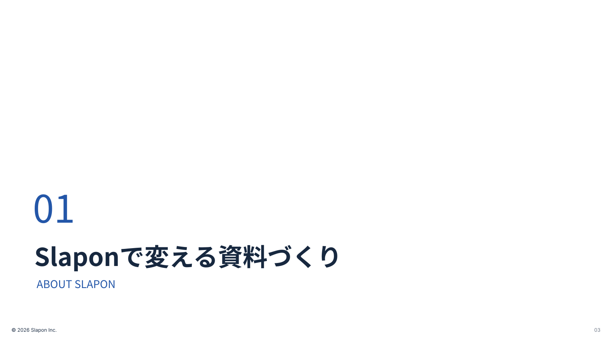

<!-- Generated from index.html#page-section. Edit index.html, not this file. -->

## 04 中扉

### 使用するコンポーネント

| 背景 | ヘッダー | 文字 | グリッド | 本文・主役 | フッター |
| --- | --- | --- | --- | --- | --- |
| BG01 | なし | 章番号＋T01 / 原本の左下配置 | G自由 / 左基準 | 章番号＋章名＋短い英字 | F01-Light |

章の切り替わり



原本の文章・数値はデザイン確認用。新しい資料の原稿ではありません。

白い余白を広く保ち、左下に章番号・章名・英字の小ラベル。

### 可変領域・収まらないとき

章数・英語ラベルは実原稿に合わせる。上段ヘッダーを自動追加しない。

領域と読取座標（参照px）

過去原本のレイヤー読取値は比較用に保持する。05〜12の再構成後の配置はdrawingの座標を使い、古い枠へ機械的に文字を押し込まない。

| 要素 | x | y | w | h | 扱い |
| --- | --- | --- | --- | --- | --- |
| 02 | 86 | 491 | 180 | 150 | 原本サンプル。文字は差替え |
| 資料作成の課題 | 90 | 627 | 1200 | 98 | 原本サンプル。文字は差替え |
| THE CHALLENGE | 96 | 726 | 1150 | 42 | 原本サンプル。文字は差替え |
| 著作権 | 30 | 860 | 800 | 17 | 原本サンプル。文字は差替え |
| ページ | 1520 | 860 | 55 | 17 | 原本サンプル。文字は差替え |

仕様データ

```
{
  "id": "section",
  "template_node": "30:27577",
  "purpose": "章の切り替わり",
  "recipe": "白い余白を広く保ち、左下に章番号・章名・英字の小ラベル。",
  "overflow": "章数・英語ラベルは実原稿に合わせる。上段ヘッダーを自動追加しない。",
  "reference_nodes": [
    {
      "name": "02",
      "type": "TEXT",
      "text": "01",
      "x": 86,
      "y": 491,
      "w": 180,
      "h": 150
    },
    {
      "name": "資料作成の課題",
      "type": "TEXT",
      "text": "Slaponで変える資料づくり",
      "x": 90,
      "y": 627,
      "w": 1200,
      "h": 98
    },
    {
      "name": "THE CHALLENGE",
      "type": "TEXT",
      "text": "ABOUT SLAPON",
      "x": 96,
      "y": 726,
      "w": 1150,
      "h": 42
    },
    {
      "name": "著作権",
      "type": "TEXT",
      "text": "© 2026 Slapon Inc.",
      "x": 30,
      "y": 860,
      "w": 800,
      "h": 17
    },
    {
      "name": "ページ",
      "type": "TEXT",
      "text": "03",
      "x": 1520,
      "y": 860,
      "w": 55,
      "h": 17
    }
  ],
  "geometry_status": "既存レイヤー読取情報。アウトラインのインク外接矩形と異なる場合がある。改行後はプレビュー照合。",
  "canvas": [
    1600,
    900
  ],
  "composition": {
    "background": "BG01",
    "header": "なし",
    "typography": "章番号＋T01 / 原本の左下配置",
    "grid": "G自由 / 左基準",
    "content": "章番号＋章名＋短い英字",
    "footer": "F01-Light"
  },
  "composition_geometry_policy": "部品の考え方と原本の構成を対応させた索引。既存作例のSVG・原本座標は変更しない。"
}
```
